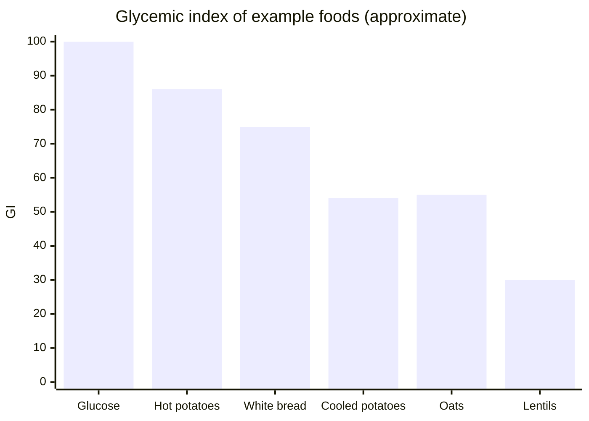

# Glycemic index

## Summary

The glycemic index (GI) ranks carbohydrate foods by how much they raise blood glucose compared with pure glucose, which has a GI of 100. Foods are low (55 or less), medium (56 to 69) or high (70 or more). Meals with low and medium GI are preferred, especially in insulin resistance and diabetes. The GI of a meal can be lowered by adding fat, protein or fiber, choosing whole grains and legumes, and cooling starchy foods. Glycemic load (GL) adds portion size to the picture.

*This note is educational. It is not medical advice and does not replace a doctor, dietitian or pharmacist, especially during pregnancy, illness or when taking medicines.*

## Prerequisites

- [Carbohydrates](../../../../natural-sciences/chemistry/biochemistry/carbohydrates/carbohydrates.md)

## Core concepts

### Definition

The *glycemic index* is the area under the blood glucose curve over 2 hours after eating 50 g of available carbohydrate from a food, expressed as a percentage of the area after 50 g of glucose. The *glycemic load* is GI × grams of available carbohydrate in a portion / 100.

### Analogy

The glycemic index is like the speed at which a car fills a parking lot. A high-GI food is a bus emptying all its passengers at once; a low-GI food is cars arriving one at a time. The lot (bloodstream) handles the trickle easily. The analogy breaks because glycemic load matters too: one bus with few passengers may be fine.

### Mechanism

**Factors that lower a meal's GI.**

- **Fat** slows stomach emptying and glucose absorption. Good additions are seeds, nuts, cold-pressed oils, fatty fish and avocado.
- **Fiber**: every meal should include vegetables, legumes, bran, oats or whole grains ([Dietary fiber](dietary-fiber.md)).
- **Protein** slows emptying and stimulates insulin, flattening the glucose curve.
- **Resistant starch** from cooling cooked starch ([Resistant starch](resistant-starch.md)).
- **Processing and ripeness**: whole grains, al dente pasta and less ripe fruit have lower GI.

The notes describe GI below 70 as the target (low and medium); international tables use 55 or less for low and 56 to 69 for medium.

| Category | GI | Examples |
| --- | --- | --- |
| Low | 55 or less | Lentils (about 30), most fruit, oats (about 55) |
| Medium | 56 to 69 | Cooled potatoes (about 54 to 56), basmati rice |
| High | 70 or more | White bread (about 75), hot boiled potatoes (about 86) |

Values from Atkinson and colleagues (2021) and the notes; GI varies with variety and preparation.

The chart compares example GI values.

### Claimed effects and evidence

Each entry states the proposed effect and how strong the human evidence is, using the grades defined in the [Evidence grades](../evidence-grades.md) note.

- **Low-GI diets improve glycemic control in diabetes.** Meta-analyses show modest reductions in HbA1c. Evidence: moderate.
- **Low-GI diets cause weight loss.** Effects are small or inconsistent. Evidence: limited.

## Worked example

A lunch of 150 g white rice (GI about 73) alone produces a high glucose peak. Replacing half of the rice with lentils, adding a tablespoon of olive oil and a large salad, and using rice cooked the day before and reheated lowers the meal's glycemic response substantially, while keeping the same amount of food.

## Trade offs and when to use it

GI is a useful tool but has limits: it varies between people, it ignores portion size (use GL) and some low-GI foods (chocolate, ice cream) are low because of fat and sugar type, not because they are healthy.

## Common mistakes

- **Judging foods by GI alone.** Consider glycemic load and overall nutrient quality.
- **Avoiding all high-GI foods.** Combine them with fat, protein and fiber.

## Practice

1. What is the reference food for GI?
2. Name three ways to lower a meal's GI.
3. What does glycemic load add?

### Answers

1. Pure glucose with a GI of 100.
2. Add fat, fiber or protein; choose whole grains; cool starchy foods.
3. The amount of carbohydrate in a portion.

## Further reading

- Atkinson, F. S., Brand-Miller, J. C., Foster-Powell, K. et al. (2021). International tables of glycemic index and glycemic load values 2021: a systematic review. American Journal of Clinical Nutrition, 114(5), 1625-1632. [DOI](https://doi.org/10.1093/ajcn/nqab233). International tables of GI and GL values.
- Fernandes, G., Velangi, A., Wolever, T. M. S. (2005). Glycemic index of potatoes commonly consumed in North America. Journal of the American Dietetic Association, 105(4), 557-562. [DOI](https://doi.org/10.1016/j.jada.2005.01.003). GI of hot and cold potatoes.
