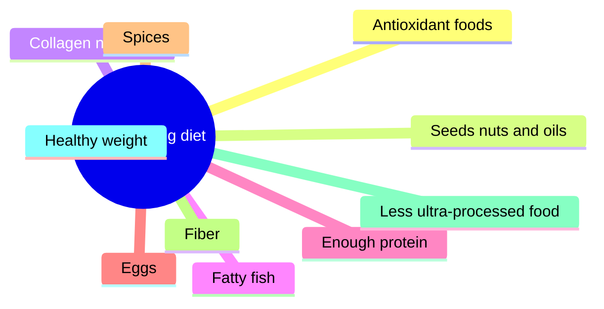

# Healthy aging diet

## Summary

A diet that supports healthy aging is rich in antioxidant-containing vegetables and fruit, nuts, seeds and olive oil, fatty fish, enough high-quality protein, eggs, herbs and spices and fiber, low in ultra-processed food, and matched in energy to maintain a healthy weight. These ten elements come from common recommendations. Most are supported by observational studies of dietary patterns such as the Mediterranean diet and some by trials; claims about single foods "slowing aging" go further than the evidence.

*This note is educational. It is not medical advice and does not replace a doctor, dietitian or pharmacist, especially during pregnancy, illness or when taking medicines.*

## Prerequisites

- [Dietary fiber](dietary-fiber.md)

## Core concepts

### Definition

*A healthy aging diet* is a dietary pattern associated with lower risk of chronic disease, disability and cognitive decline in older age. It resembles the Mediterranean dietary pattern.

### Analogy

A healthy aging diet is like regular maintenance of a car: oil changes, good fuel and avoiding rough roads do not make the car new again, but it lasts longer and breaks down less. The analogy breaks because diet is only one part of aging; exercise, sleep and genetics matter as much.

### Mechanism

**The ten elements.**

1. **Antioxidants.** A high intake of antioxidants is one of the main features of an anti-aging diet; antioxidants neutralize free radicals, whose excess is thought to accelerate aging ([Oxidative stress](../../../../natural-sciences/chemistry/biochemistry/oxidative-stress.md)). Useful sources: anthocyanins (blueberries, chokeberry, red cabbage), quercetin (onions, cherries, broccoli, cocoa), chlorogenic acid (green coffee), catechins (green tea), hesperidin (oranges, grapefruit), beta-carotene (carrot juice, pumpkin dishes), lutein and zeaxanthin (lettuce, spinach, egg yolks), lycopene (tomato soup) and vitamin C (blackcurrants, kiwi, gold kiwi).
2. **Seeds, nuts and oils.** Sunflower seeds, pumpkin seeds, almonds and olive oil are rich sources of vitamin E, called the "vitamin of youth and fertility". It is a strong antioxidant, slows skin aging, improves sperm quality and protects against eye diseases such as cataract ([Vitamin E](../vitamins/vitamin-e.md)).
3. **Nutrients for collagen production.** Collagen keeps blood vessels, bones, joints, skin, nails and hair in good condition. The body makes it from amino acids with the help of vitamin C, copper, iron, zinc and silicon ([Collagen](../../../../natural-sciences/chemistry/biochemistry/proteins/collagen.md)).
4. **Fatty sea fish** 2 to 3 times a week (Atlantic herring, sardines, Atlantic mackerel, salmon, rainbow trout). They provide omega-3 fatty acids and leucine (important for muscle health and protection against sarcopenia). Omega-3 fats reduce joint pain, tenderness and swelling, slow cognitive decline, help prevent atherosclerosis and reduce cardiovascular risk ([Omega-3 fatty acids](../../../../natural-sciences/chemistry/biochemistry/lipids/omega-3-fatty-acids.md)).
5. **More protein.** Complete protein slows sarcopenia, the loss of muscle mass and strength that is a major cause of reduced fitness and disability in older people. Best sources: lean red meat, poultry, fish, eggs and fermented dairy ([Muscle protein balance](../../physiology/muscle/muscle-protein-balance.md)).
6. **Eggs.** Besides complete protein, eggs provide choline (memory, concentration, lower dementia risk, muscle function, liver protection), vitamin B2 (reduces tiredness), pantothenic acid (immunity, appearance, mental performance) and vitamin A (vision and immunity).
7. **A variety of spices.** Turmeric is anti-inflammatory and may ease joint disease; Ceylon cinnamon may lower blood glucose, ease rheumatoid arthritis and lower blood pressure; rosemary may improve memory; ginger may lower triglycerides, reduce inflammation and improve memory. See [Turmeric (Curcuma longa)](../herbal-extracts/turmeric.md) and [Ginger (Zingiber officinale)](../herbal-extracts/ginger.md).
8. **Dietary fiber** regulates metabolic processes that worsen with age; it protects against colorectal cancer, supports beneficial gut bacteria, helps remove waste and lowers blood glucose ([Dietary fiber](dietary-fiber.md)).
9. **Less ultra-processed food**, which is rich in sugar, rapidly absorbed carbohydrates and unhealthy fats. A meta-analysis found that the highest consumption of ultra-processed food was associated with about 25 percent higher risk of death from any cause.
10. **Appropriate energy intake.** Maintaining a healthy weight, and reaching it in overweight and obesity, matters because excess weight worsens typical age-related changes: it damages joints, causes back pain, worsens heart, liver, pancreas and kidney health, lowers fertility, raises dementia risk and promotes eye diseases.

**Further practical points.**

- **Fatty fish lower triglycerides.** Omega-3 fatty acids in herring, wild salmon, mackerel, sardines and rainbow trout lower triglycerides; 2 to 3 portions a week are recommended.
- **Avocado.** A 2016 meta-analysis of avocado-enriched diets reported lower LDL cholesterol and, in some analyses, lower triglycerides; the notes cite a reduction of about 19 mg/dL in triglycerides, a figure I have not confirmed in the paper.
- **Add fat to vegetables and fruit.** Vitamin K and carotenoids (which the body converts to vitamin A) are fat-soluble. Fat acts as a carrier that helps their absorption. Add olive oil, avocado oil or melted butter to salads, and combine fruit (smoothies, fruit salad) with nuts and seeds.
- **Cook eggs wisely.** A soft-boiled egg, with the white fully set and the yolk still runny, keeps more of some nutrients (for example lutein) than a long-boiled egg, is easy to digest and microbiologically safe once the white is set. Cooking itself greatly improves protein digestibility compared with raw eggs (about 91 versus 51 percent), so the protein does not "lose its value"; very long cooking mainly oxidizes some fats and pigments.
- **Anti-inflammatory foods.** Commonly recommended foods: fatty sea fish, berries, leafy greens, cruciferous vegetables, avocado, green tea, walnuts, cold-pressed olive oil, ginger and coffee.
- **ORAC scale.** The oxygen radical absorbance capacity (ORAC) scale estimated the ability of foods to absorb reactive oxygen species in a test tube. Top of the scale: ground cloves, dried oregano, dried thyme, cinnamon, dried rosemary and turmeric; also high: coriander leaves, cocoa, peppermint, artichokes, curry, white mulberry, radishes, strawberries, asparagus and cabbage. The US Department of Agriculture withdrew its ORAC database in 2012 because test tube values do not show effects in the body.

The mindmap shows the ten elements.

### Claimed effects and evidence

Each entry states the proposed effect and how strong the human evidence is, using the grades defined in the [Evidence grades](../evidence-grades.md) note.

- **Mediterranean-style diet lowers cardiovascular events.** Shown in the PREDIMED trial. Evidence: strong.
- **Higher protein slows sarcopenia.** Protein with resistance training preserves muscle in older adults. Evidence: moderate.
- **Ultra-processed food associated with higher mortality.** About 25 percent higher in a meta-analysis of observational studies. Evidence: moderate.
- **Antioxidant supplements slow aging.** Trials of antioxidant supplements show no benefit, and some show harm. Evidence: not supported.
- **Single spices improve memory or lower blood pressure.** Small trials with mixed results. Evidence: limited.

## Worked example

A 60-year-old changes a typical day: breakfast of oats with blueberries, walnuts and kefir; lunch of salmon with salad dressed in olive oil and cooled potatoes; dinner of lentil soup with turmeric and wholemeal bread; snacks of an apple and pumpkin seeds. The day includes about 35 g fiber, about 1.2 g protein per kg of body weight and two portions of fatty fish in the week, and almost no ultra-processed food.

## Trade offs and when to use it

A dietary pattern works through many foods together; focusing on one "superfood" misses the point. People with kidney disease need individual advice on protein.

## Common mistakes

- **Relying on antioxidant supplements.** Use whole foods; supplements did not help in trials.
- **Neglecting protein in older age.** Aim for adequate protein spread across meals.

## Practice

1. Name five elements of a healthy aging diet.
2. Why add fat to salads?
3. Why was the ORAC database withdrawn?

### Answers

1. Antioxidant foods, nuts and seeds, fatty fish, enough protein, fiber (also eggs, spices, less ultra-processed food, healthy weight, collagen nutrients).
2. Carotenoids and vitamin K are fat-soluble and absorbed better with fat.
3. Test tube antioxidant capacity does not show effects in the body.

## Further reading

- Estruch, R., Ros, E., Salas-Salvadó, J. et al. (2018). Primary prevention of cardiovascular disease with a Mediterranean diet supplemented with extra-virgin olive oil or nuts. New England Journal of Medicine, 378(25), e34. [DOI](https://doi.org/10.1056/NEJMoa1800389). PREDIMED trial of the Mediterranean diet.
- Pagliai, G., Dinu, M., Madarena, M. P. et al. (2021). Consumption of ultra-processed foods and health status: a systematic review and meta-analysis. British Journal of Nutrition, 125(3), 308-318. [DOI](https://doi.org/10.1017/S0007114520002688). Meta-analysis of ultra-processed food and health.
- Peou, S., Milliard-Hasting, B., Shah, S. A. (2016). Impact of avocado-enriched diets on plasma lipoproteins: a meta-analysis. Journal of Clinical Lipidology, 10(1), 161-171. [DOI](https://doi.org/10.1016/j.jacl.2015.10.011). Meta-analysis of avocado and lipids.
- Evenepoel, P., Geypens, B., Luypaerts, A. et al. (1998). Digestibility of cooked and raw egg protein in humans as assessed by stable isotope techniques. Journal of Nutrition, 128(10), 1716-1722. [DOI](https://doi.org/10.1093/jn/128.10.1716). Digestibility of cooked and raw egg protein.
- Blackburn, E. H., Epel, E. S., Lin, J. (2015). Human telomere biology: a contributory and interactive factor in aging, disease risks, and protection. Science, 350(6265), 1193-1198. [DOI](https://doi.org/10.1126/science.aab3389). Telomere biology and lifestyle factors.
