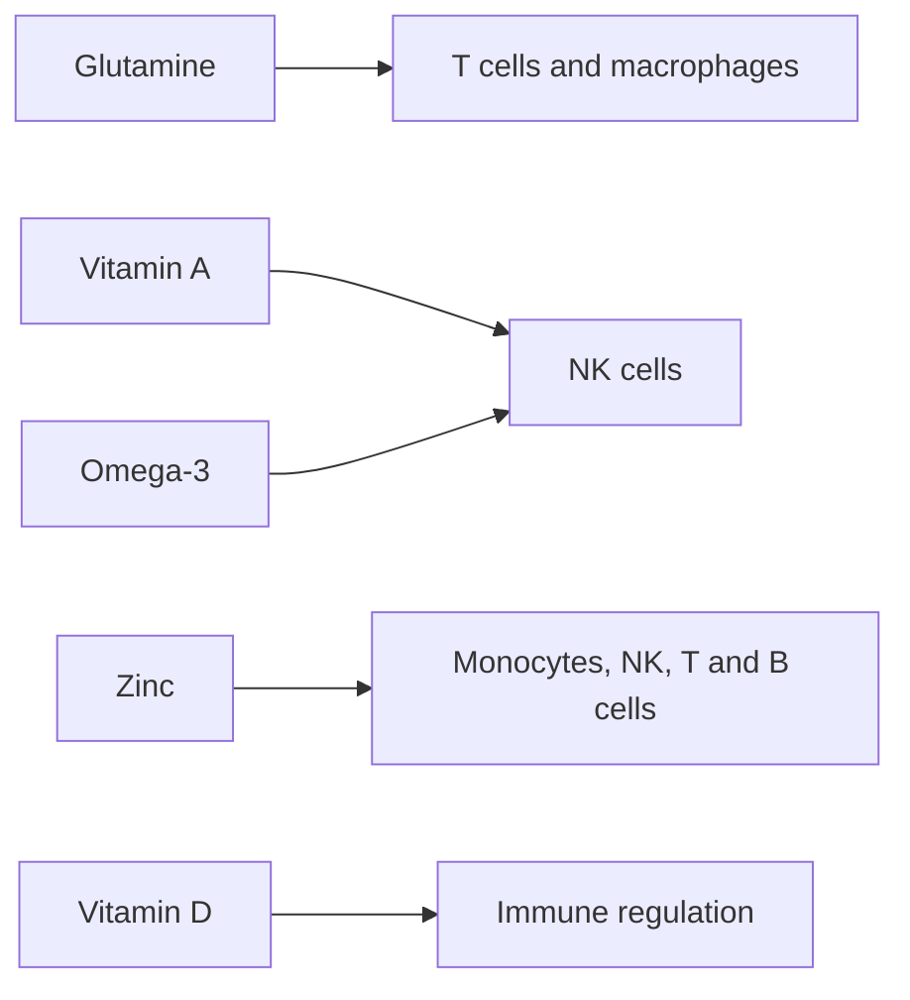

# Nutrition and immunity

## Summary

The immune system needs adequate nutrients to work. Deficiencies of glutamine, vitamin D, vitamin A, zinc and omega-3 fatty acids impair specific immune cells. Several plant compounds, such as curcumin, thymoquinone, chrysin, galangin, catechins, quercetin, luteolin and genistein, regulate detoxifying enzymes in laboratory studies and are proposed to help prevent cancer. Correcting deficiencies helps; extra amounts beyond adequacy, and the cancer-preventing claims for plant compounds, have limited human evidence.

*This note is educational. It is not medical advice and does not replace a doctor, dietitian or pharmacist, especially during pregnancy, illness or when taking medicines.*

## Prerequisites

- [Vitamin D](../vitamins/vitamin-d.md)

## Core concepts

### Definition

*Nutritional immunology* studies how nutrients affect the immune system. *Natural killer (NK) cells* are immune cells that destroy infected and tumor cells. *Phase II detoxifying enzymes* conjugate foreign compounds for excretion.

### Analogy

Nutrients are like the supplies of an army. Without ammunition (zinc), maps (vitamin A) or fuel (glutamine), even a well-trained army fights poorly. Extra supplies beyond what the army can use do not make it fight better. The analogy breaks because some nutrients, like vitamin A, are harmful in excess.

### Mechanism

**Nutrients and immune cells.**

- **Glutamine.** Low levels may inhibit T lymphocyte activity and reduce the phagocytic capacity of macrophages, that is, the ability of immune cells to engulf dangerous or altered cells. Food sources: lean beef, eggs, tofu ([Glutamine](../../../../natural-sciences/chemistry/biochemistry/amino-acids/glutamine.md)).
- **Vitamin D** regulates immune activity and, in laboratory studies, acts directly on tumor cells ([Vitamin D](../vitamins/vitamin-d.md)).
- **Vitamin A.** Deficiency impairs the function of NK cells. Sources: animal foods (eggs, butter, liver, fatty fish) and plant beta-carotene (kale, broccoli, sweet potatoes, carrots, pumpkin, peppers, mango, apricots) ([Vitamin A](../vitamins/vitamin-a.md)).
- **Zinc.** Low intake disturbs the development of monocytes, NK cells, T and B lymphocytes. Sources: oysters, shrimp, beef, lamb, goose and turkey, legumes, pumpkin and sunflower seeds ([Zinc](../minerals/zinc.md)).
- **Omega-3 fatty acids** increase the cytotoxicity of NK cells against tumor cells and regulate inflammation. Sources: herring, sardines, salmon, mackerel, flaxseed and oils rich in omega-3 ([Omega-3 fatty acids](../../../../natural-sciences/chemistry/biochemistry/lipids/omega-3-fatty-acids.md)).

**Plant compounds that regulate detoxifying enzymes.** Compounds that, at various stages, may prevent cancer development by regulating detoxifying enzymes in laboratory studies:

| Compound | Sources |
| --- | --- |
| Curcumin | Turmeric |
| Thymoquinone | Black cumin (nigella) seeds and oil |
| Chrysin | Propolis |
| Galangin | Propolis, galangal |
| Catechins | Green tea |
| Quercetin | Onions, asparagus, broccoli, spinach, kale, cranberries, apples with skin |
| Luteolin | Celery, chamomile, thyme, green pepper, red pepper |
| Genistein | Fermented soy (natto, miso) |

The flowchart links nutrients to immune cells.

### Claimed effects and evidence

Each entry states the proposed effect and how strong the human evidence is, using the grades defined in the [Evidence grades](../evidence-grades.md) note.

- **Deficiencies impair immune function.** Well established for zinc, vitamins A, C, D and protein. Evidence: established physiology.
- **Vitamin D supplements reduce respiratory infections.** Small benefit in meta-analyses, mainly in deficient people with daily doses. Evidence: moderate.
- **Zinc lozenges shorten colds.** Some meta-analyses show shorter duration. Evidence: limited.
- **Plant compounds prevent cancer by regulating detoxifying enzymes.** Laboratory and animal studies; no proof in humans. Evidence: very limited.
- **Glutamine supplements improve immunity in healthy people.** No clear benefit outside critical illness. Evidence: not supported.

## Worked example

An older adult who rarely goes outside has a low vitamin D level (25-hydroxyvitamin D of 20 nmol/L) and eats little meat. A doctor recommends vitamin D supplements and more zinc-rich foods (legumes, seeds, some meat). Correcting the deficiency supports immune function; adding high-dose supplements beyond adequacy would not add benefit.

## Trade offs and when to use it

Focus on adequacy through food; supplement only proven deficiencies. Vitamin A and zinc are harmful in excess.

## Common mistakes

- **Megadosing vitamins to "boost" immunity.** Adequacy matters; excess can harm.
- **Treating laboratory findings as cancer prevention.** Test tube effects do not prove benefit in people.

## Practice

1. Which immune cells does vitamin A deficiency impair?
2. Name three compounds that regulate detoxifying enzymes in laboratory studies.
3. Do extra nutrients beyond adequacy boost immunity?

### Answers

1. NK cells.
2. Curcumin, quercetin, catechins (also thymoquinone, chrysin, galangin, luteolin, genistein).
3. Generally not; correcting deficiency is what helps.

## Further reading

- Calder, P. C., Carr, A. C., Gombart, A. F. et al. (2020). Optimal nutritional status for a well-functioning immune system is an important factor to protect against viral infections. Nutrients, 12(4), 1181. [DOI](https://doi.org/10.3390/nu12041181). Review of nutrients and immune function.
