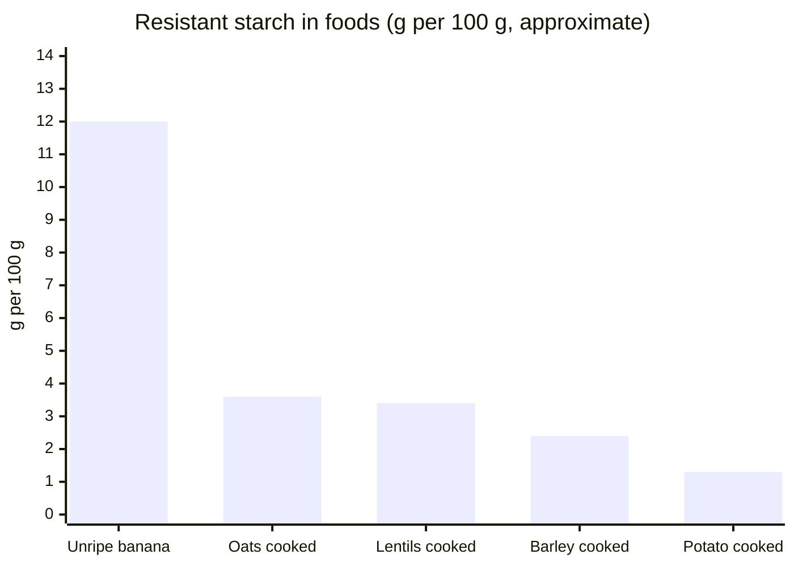

# Resistant starch

## Summary

Resistant starch is starch that escapes digestion in the small intestine and is fermented in the colon, acting like fiber. Cooking and then cooling starchy foods such as pasta, rice or potatoes increases resistant starch (retrogradation), and reheating does not reverse most of this. Cooling cooked potatoes lowers their glycemic index from about 86 to about 54 in some measurements. Benefits are reported with about 6 g per meal, 20 g per day or 14 percent of total starch intake.

*This note is educational. It is not medical advice and does not replace a doctor, dietitian or pharmacist, especially during pregnancy, illness or when taking medicines.*

## Prerequisites

- [Dietary fiber](dietary-fiber.md)

## Core concepts

### Definition

*Resistant starch* (RS) is the fraction of starch not absorbed in the small intestine of healthy people. Types:

- RS1: physically inaccessible (whole grains, seeds);
- RS2: native granules (raw potato, unripe banana);
- RS3: retrograded starch formed when cooked starch cools;
- RS4: chemically modified starch;
- RS5: starch-lipid complexes.

### Analogy

Retrograded starch is like a jumper that shrinks and tightens after washing: cooling makes starch chains pack tightly, and digestive enzymes find it hard to get in. Reheating loosens it only a little. The analogy breaks because a tightly packed starch still provides some energy, through bacterial fermentation.

### Mechanism

Cooking gelatinizes starch: granules swell and become easy to digest. On cooling, amylose chains realign into crystalline regions (retrogradation) that amylase cannot break down. Bacteria in the colon ferment them into short-chain fatty acids.

**How long to cool.** Cooling to room temperature and then keeping the food in the refrigerator for about an hour is enough. One study reported that cooling at 5 °C for 60 minutes reduced digestible starch from 78 to 45 percent, with little further change with longer cooling. Reheating does not substantially raise digestible starch again.

**Glycemic index.** The glycemic index of boiled potatoes is about 86 when hot and about 54 after cooling, moving them from the high to the medium category (values from the notes; Fernandes and colleagues, 2005, reported 89 hot and 56 cold for red potatoes).

**Target intakes.** Depending on the source, benefits have been reported with:

- 6 g of resistant starch per meal;
- 20 g per day;
- 14 percent of total starch intake.

**Content in foods.**

| Food | Resistant starch (g per 100 g) |
| --- | --- |
| Unripe bananas | 12 |
| Cooked oats | 3.6 |
| Cooked lentils | 3.4 |
| Cooked pearl barley | 2.4 |
| Cooked potatoes | 1.3 |

Values vary with variety, cooking and cooling; treat them as approximate.

The chart shows the resistant starch content from the table.

### Claimed effects and evidence

Each entry states the proposed effect and how strong the human evidence is, using the grades defined in the [Evidence grades](../evidence-grades.md) note.

- **Lower post-meal glucose.** Resistant starch and cooling lower post-meal glycemia in several trials. Evidence: moderate.
- **Improved insulin sensitivity.** Some trials show improvement with about 15 to 40 g per day. Evidence: limited.
- **Production of butyrate.** Fermentation of RS produces butyrate. Evidence: established physiology.

## Worked example

A person with prediabetes cooks potatoes and pasta in the evening, cools them overnight and reheats them for lunch the next day. A typical portion of 200 g cooled potatoes provides about 3 to 5 g of resistant starch (more than freshly cooked). Combined with lentils (3.4 g per 100 g), the meal reaches about 6 g, the amount reported per meal.

## Trade offs and when to use it

Cooling is a simple way to increase resistant starch but does not turn a starchy food into a low-carbohydrate food. Very high intakes cause gas and bloating.

## Common mistakes

- **Believing reheating cancels the effect.** Most retrograded starch survives reheating.
- **Overestimating the effect.** Cooling lowers, but does not remove, digestible starch.

## Practice

1. What is retrogradation?
2. How does cooling affect the glycemic index of potatoes?
3. Name three intake levels reported as beneficial.

### Answers

1. Recrystallization of starch chains on cooling that makes starch resistant to digestion.
2. It falls from about 86 to about 54.
3. 6 g per meal, 20 g per day, 14 percent of starch intake.

## Further reading

- Englyst, H. N., Kingman, S. M., Cummings, J. H. (1992). Classification and measurement of nutritionally important starch fractions. European Journal of Clinical Nutrition, 46(Suppl 2), S33-S50. Classification of starch fractions including resistant starch.
- Fernandes, G., Velangi, A., Wolever, T. M. S. (2005). Glycemic index of potatoes commonly consumed in North America. Journal of the American Dietetic Association, 105(4), 557-562. [DOI](https://doi.org/10.1016/j.jada.2005.01.003). Glycemic index of hot and cold potatoes.
