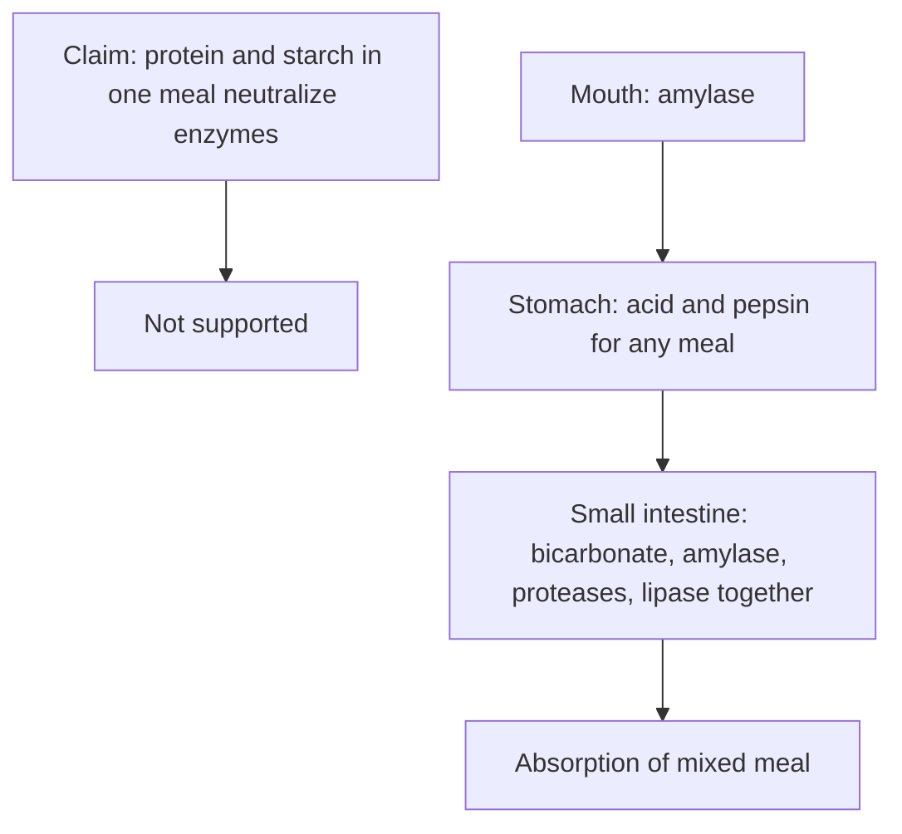

# Trophology (food combining)

## Summary

Trophology, or food combining, is the idea that foods must be combined correctly for easier digestion with less energy. It claims that concentrated proteins (meat, eggs) need an acidic environment and carbohydrates (bread, pasta) an alkaline one, so eating them together makes the digestive enzymes "conflict and neutralize each other". This is not how digestion works, and a randomized trial found no extra weight loss with food combining. The idea draws on traditional Chinese medicine, including a 14th century text, and on the Hay diet of the 1920s.

*This note is educational. It is not medical advice and does not replace a doctor, dietitian or pharmacist, especially during pregnancy, illness or when taking medicines.*

## Prerequisites

No prior notes are needed.

## Core concepts

### Definition

*Trophology* (food combining) is a set of rules about which foods may be eaten together, based on the belief that different foods need opposite digestive conditions.

### Analogy

Food combining imagines the stomach as a kitchen with one stove that can only cook either soup or roast at a time. In reality, digestion is an assembly line with different stations (mouth, stomach, small intestine), each designed to handle mixed meals. The analogy breaks because even the real assembly line overlaps: starch digestion starts in the mouth and continues in the small intestine.

### Mechanism

**Claims.** Trophology is described as a science of correct food combination, forgotten in modern medicine but now seen as a subtle art in a niche of nutrition. Chinese medicine has for centuries emphasized combining foods for longevity and health. In 1378, on his hundredth birthday, the Taoist Chia Ming is said to have presented the Ming emperor with a book, *Essential Things to Know About Eating and Drinking*, warning that substances can have opposing natures and that eating them carelessly brings the organs out of harmony. The basic rule of proper combinations is to avoid Yin and Yang conflict in the stomach; Western proponents translate this into acid-base balance, or pH.

**What actually happens in digestion.**

1. Starch digestion starts in the mouth with salivary amylase.
2. In the stomach, acid (pH about 1.5 to 3.5) and pepsin start protein digestion in every meal, whatever its composition. Salivary amylase continues for a while inside the food bolus until acid reaches it.
3. In the small intestine, bicarbonate from the pancreas neutralizes the acid, and pancreatic amylase, proteases and lipase digest carbohydrate, protein and fat at the same time.

The digestive system is built for mixed meals; most natural foods (legumes, grains, milk) contain both protein and carbohydrate. Enzymes do not "neutralize each other".

**Evidence.** In a 6-week randomized trial, food combining and a balanced diet with the same energy intake produced the same weight loss (Golay and colleagues, 2000).

The flowchart compares the claim with physiology.

### Claimed effects and evidence

Each entry states the proposed effect and how strong the human evidence is, using the grades defined in the [Evidence grades](../evidence-grades.md) note.

- **Separating protein and carbohydrate improves digestion.** Contradicts digestive physiology. Evidence: not supported.
- **Food combining causes extra weight loss.** A randomized trial found the same weight loss as a balanced diet. Evidence: not supported.
- **Any weight loss on food combining diets.** Comes from eating less energy, not from the combinations. Evidence: moderate.

## Worked example

Two groups follow diets of 1,100 kcal per day for 6 weeks: one follows food combining rules, the other a balanced diet. In Golay and colleagues' trial, both groups lost about 6 kg, with no difference in weight or body fat.

## Trade offs and when to use it

Food combining rules are harmless for most people but add complexity without benefit. Following them may reduce intake simply because meals become more restricted.

## Common mistakes

- **Believing enzymes cancel each other.** Digestion handles mixed meals in stages.
- **Crediting food combining for weight loss.** Energy intake explains the results.

## Practice

1. What does trophology claim?
2. Where are protein, fat and carbohydrate digested together?
3. What did the randomized trial find?

### Answers

1. Proteins and carbohydrates need opposite digestive conditions and should not be eaten together.
2. In the small intestine.
3. The same weight loss with food combining and a balanced diet.

## Further reading

- Golay, A., Allaz, A. F., Ybarra, J. et al. (2000). Similar weight loss with low-energy food combining or balanced diets. International Journal of Obesity, 24(4), 492-496. [DOI](https://doi.org/10.1038/sj.ijo.0801185). Randomized trial of food combining versus balanced diet.
