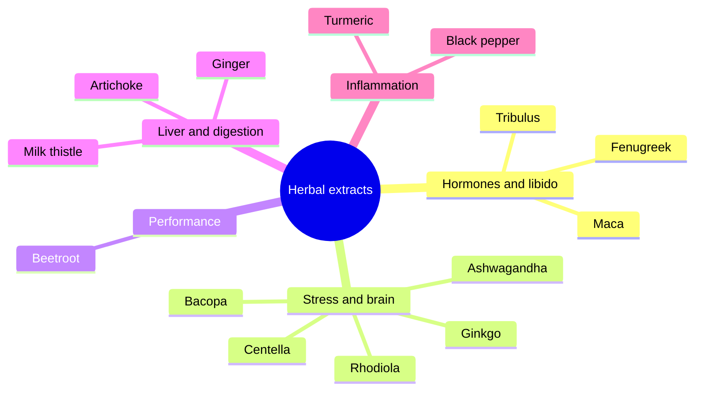

# Herbal extracts

Herbal extracts are concentrated preparations of plant parts sold as supplements, many from Ayurvedic, Chinese or European folk medicine. These notes cover 14 extracts, grouped by their main claimed use. Lion's mane extract is covered with the [medicinal mushrooms](../mushrooms/lions-mane.md). Extracts vary in standardization, and several interact with medicines or carry rare risks of liver injury.

## Map

## Reading order

1. [Tribulus (Tribulus terrestris)](tribulus.md)
2. [Fenugreek (Trigonella foenum-graecum)](fenugreek.md)
3. [Maca (Lepidium meyenii)](maca.md)
4. [Ashwagandha (Withania somnifera)](ashwagandha.md)
5. [Rhodiola (Rhodiola rosea)](rhodiola.md)
6. [Bacopa (Bacopa monnieri)](bacopa.md)
7. [Ginkgo (Ginkgo biloba)](ginkgo.md)
8. [Gotu kola (Centella asiatica)](centella.md)
9. [Beetroot (Beta vulgaris)](beetroot.md)
10. [Milk thistle (Silybum marianum)](milk-thistle.md)
11. [Artichoke leaf (Cynara scolymus)](artichoke.md)
12. [Ginger (Zingiber officinale)](ginger.md)
13. [Turmeric (Curcuma longa)](turmeric.md)
14. [Black pepper (Piper nigrum)](black-pepper.md)
