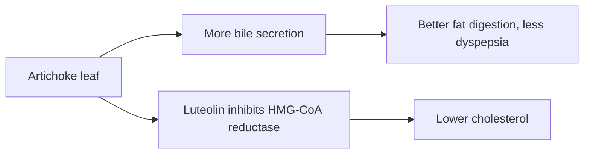

# Artichoke leaf (Cynara scolymus)

## Summary

Artichoke leaf extract is rich in cynarin, chlorogenic acid and luteolin. It stimulates bile production (choleretic effect), which is the basis for its traditional use for digestion and the liver. Small trials show modest reductions in total and LDL cholesterol and relief of dyspepsia symptoms. Claims for weight loss and other effects lack evidence.

*This note is educational. It is not medical advice and does not replace a doctor, dietitian or pharmacist, especially during pregnancy, illness or when taking medicines.*

## Prerequisites

No prior notes are needed.

## Core concepts

### Definition

*Artichoke* (Cynara cardunculus var. scolymus) is a thistle. *Cynarin* (1,3-dicaffeoylquinic acid) is a caffeic acid derivative considered one of its active compounds.

### Analogy

Artichoke leaf acts like a gentle push on the liver's bile tap, increasing bile flow to help digest fat. The analogy breaks because the cholesterol effect probably also involves inhibiting cholesterol synthesis by luteolin.

### Mechanism

Cynarin and chlorogenic acid increase bile secretion. Luteolin inhibits HMG-CoA reductase (the same enzyme that statins block) in laboratory studies. The extract also has antioxidant effects.

The flowchart shows the actions of artichoke leaf extract.

### Proposed effects and evidence

Each entry states the proposed effect and how strong the human evidence is, using the grades defined in the [Evidence grades](../evidence-grades.md) note.

- **Liver health.** Choleretic effect; small studies in fatty liver. Evidence: limited.
- **Lower cholesterol.** Cochrane: small trials show modest reductions; evidence inconclusive. Evidence: limited.
- **Better digestion and less dyspepsia.** Some trials show relief of functional dyspepsia. Evidence: limited.
- **Antioxidant action.** Laboratory studies. Evidence: very limited.
- **Anti-inflammatory action.** Laboratory studies. Evidence: very limited.
- **Support in irritable bowel syndrome.** Small uncontrolled studies. Evidence: very limited.
- **Heart function.** No meaningful evidence. Evidence: very limited.
- **Diuretic action.** Traditional use. Evidence: very limited.
- **Blood glucose control.** Small studies. Evidence: very limited.
- **Weight loss.** No meaningful evidence. Evidence: very limited.

## Worked example

A person with mildly raised cholesterol (LDL 3.6 mmol/L) takes 1,280 mg artichoke leaf extract daily for 12 weeks, as in one trial. LDL falls by about 0.2 to 0.3 mmol/L, much less than a statin would achieve; diet changes are needed in any case.

## Trade offs and when to use it

Artichoke extract is generally safe, but it should be avoided with bile duct obstruction and gallstones (it increases bile flow) and by people allergic to the daisy family.

## Common mistakes

- **Using it with gallstones.** Increased bile flow can trigger pain.
- **Replacing cholesterol treatment.** Effects are small.

## Practice

1. What is cynarin?
2. What does a choleretic do?
3. Who should avoid artichoke extract?

### Answers

1. A caffeic acid derivative in artichoke.
2. It increases bile secretion.
3. People with gallstones or bile duct obstruction.

## Further reading

- Wider, B., Pittler, M. H., Thompson Coon, J. et al. (2013). Artichoke leaf extract for treating hypercholesterolaemia. Cochrane Database of Systematic Reviews, CD003335. [DOI](https://doi.org/10.1002/14651858.CD003335.pub3). Cochrane review of artichoke leaf extract for cholesterol.
