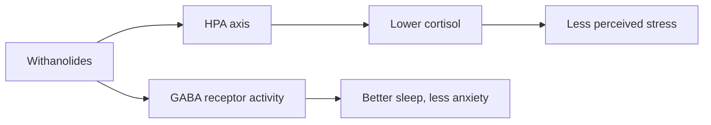

# Ashwagandha (Withania somnifera)

## Summary

Ashwagandha is an adaptogenic plant of Ayurvedic medicine. Its root extract contains withanolides, steroidal lactones considered responsible for its effects. Several randomized trials show reduced perceived stress, anxiety and cortisol, and some show better sleep, strength gains and testosterone in men. Most trials are small and many are funded by extract manufacturers. Rare but serious liver injury has been reported, and some countries have restricted it.

*This note is educational. It is not medical advice and does not replace a doctor, dietitian or pharmacist, especially during pregnancy, illness or when taking medicines.*

## Prerequisites

No prior notes are needed.

## Core concepts

### Definition

*Ashwagandha* (Withania somnifera, Indian ginseng or winter cherry) is a nightshade plant. *Withanolides* are its steroidal lactones. Extracts are standardized to withanolide content (for example KSM-66 or Sensoril).

### Analogy

Ashwagandha is described as a shock absorber for stress: it does not remove the bumps on the road (stressors) but may soften how the body reacts. The analogy breaks because the mechanism is not well established, and expectations play a role in self-rated stress.

### Mechanism

Withanolides appear to modulate the hypothalamic-pituitary-adrenal (HPA) axis, lowering cortisol, and act on GABA receptors, which may explain anxiolytic and sleep effects. Animal studies show anti-inflammatory and antioxidant effects.

The flowchart shows the proposed mechanisms.

### Proposed effects and evidence

Each entry states the proposed effect and how strong the human evidence is, using the grades defined in the [Evidence grades](../evidence-grades.md) note.

- **Adaptogenic action and stress reduction.** Several RCTs show lower perceived stress and cortisol. Evidence: moderate.
- **Mental health: anxiety and depression.** Reduced anxiety scores in small trials. Evidence: limited.
- **Better cognitive function.** Small trials. Evidence: limited.
- **Better physical performance.** Small trials show more strength and VO2 max gains. Evidence: limited.
- **Hormonal support: testosterone and fertility.** Some trials show higher testosterone and sperm quality in men. Evidence: limited.
- **Immune support.** Little human evidence. Evidence: very limited.
- **Anti-inflammatory and antioxidant action.** Animal studies. Evidence: very limited.
- **Cardiovascular health.** Little human evidence. Evidence: very limited.
- **Better sleep quality.** Small trials show improved sleep onset and quality. Evidence: limited.
- **Sexual health.** Small trials in women and men. Evidence: limited.

## Worked example

In a 60-day trial (Chandrasekhar and colleagues, 2012), 64 stressed adults took 300 mg of root extract twice daily or placebo. Stress scale scores fell by about 44 percent versus 5.5 percent with placebo, and serum cortisol fell by about 28 percent. The trial was small and used one branded extract.

## Trade offs and when to use it

Usually well tolerated, but rare cases of cholestatic liver injury, thyroid hormone increases and interactions with sedatives, thyroid and immunosuppressive drugs exist. It should be avoided in pregnancy and by people with hyperthyroidism or autoimmune disease without medical advice.

## Common mistakes

- **Ignoring signs of liver injury.** Stop and seek care if jaundice or dark urine develops.
- **Using in pregnancy.** It is traditionally considered abortifacient.

## Practice

1. What are withanolides?
2. Which effect has the best support?
3. What rare serious adverse effect is reported?

### Answers

1. Steroidal lactones that are the main active compounds of ashwagandha.
2. Reduced perceived stress and cortisol.
3. Liver injury.

## Further reading

- Chandrasekhar, K., Kapoor, J., Anishetty, S. (2012). A prospective, randomized double-blind, placebo-controlled study of safety and efficacy of a high-concentration full-spectrum extract of ashwagandha root in reducing stress and anxiety in adults. Indian Journal of Psychological Medicine, 34(3), 255-262. [DOI](https://doi.org/10.4103/0253-7176.106022). Trial of ashwagandha for stress and anxiety.
- National Institute of Diabetes and Digestive and Kidney Diseases. LiverTox: Clinical and Research Information on Drug-Induced Liver Injury. [Link](https://www.ncbi.nlm.nih.gov/books/NBK547852/). Reports of herbal liver injury including ashwagandha.
