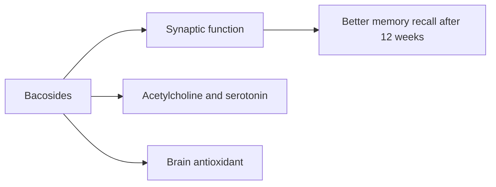

# Bacopa (Bacopa monnieri)

## Summary

Bacopa monnieri (brahmi) is a creeping herb used in Ayurvedic medicine to improve memory and learning. Its active compounds are bacosides. Meta-analyses of randomized trials show modest improvements in memory recall and attention speed after at least 12 weeks of use. Evidence for anxiety, depression and ADHD is limited.

*This note is educational. It is not medical advice and does not replace a doctor, dietitian or pharmacist, especially during pregnancy, illness or when taking medicines.*

## Prerequisites

No prior notes are needed.

## Core concepts

### Definition

*Bacopa monnieri* is an aquatic plant of the family Plantaginaceae. *Bacosides* are triterpenoid saponins considered its active compounds.

### Analogy

Bacopa is like slow, steady practice for memory: effects build over months rather than appearing after a single dose, unlike caffeine. The analogy breaks because the mechanism involves chemistry (bacosides acting on neurons), not practice.

### Mechanism

Bacosides may enhance synaptic communication, increase dendrite branching, modulate acetylcholine and serotonin, and act as antioxidants in the brain (animal studies). Effects in humans appear after 8 to 12 weeks.

The flowchart shows the time course and proposed actions.

### Proposed effects and evidence

Each entry states the proposed effect and how strong the human evidence is, using the grades defined in the [Evidence grades](../evidence-grades.md) note.

- **Better memory and cognitive function.** Meta-analysis: improved recall and attention speed. Evidence: moderate.
- **Neuroprotection.** Animal studies. Evidence: very limited.
- **Less anxiety and stress.** Small trials. Evidence: limited.
- **Cognitive support in older adults.** Several trials in older adults show improved memory. Evidence: limited.
- **Better concentration and attention.** Faster attention in meta-analysis. Evidence: limited.
- **Anti-inflammatory action.** Laboratory studies. Evidence: very limited.
- **Antioxidant action.** Laboratory studies. Evidence: very limited.
- **Support in depression.** Little evidence. Evidence: very limited.
- **Better cognition in children with ADHD.** Small, low-quality studies. Evidence: very limited.
- **Cardiovascular support.** No meaningful evidence. Evidence: very limited.

## Worked example

A student takes 300 mg of bacopa extract (standardized to 55 percent bacosides) daily. Expecting a quick effect before an exam next week would be a mistake: trials show benefits after about 12 weeks, mainly for recall of new information. Common side effects are nausea and loose stools; taking it with food helps.

## Trade offs and when to use it

Bacopa is generally safe; it can cause digestive upset and may interact with thyroid and cholinergic drugs.

## Common mistakes

- **Expecting acute effects.** Benefits require weeks to months.
- **Taking it on an empty stomach.** Take with food to reduce nausea.

## Practice

1. What are bacosides?
2. How long before effects on memory appear?
3. Which cognitive domain improves most in meta-analysis?

### Answers

1. Triterpenoid saponins that are the active compounds of bacopa.
2. About 12 weeks.
3. Memory recall.

## Further reading

- Kongkeaw, C., Dilokthornsakul, P., Thanarangsarit, P. et al. (2014). Meta-analysis of randomized controlled trials on cognitive effects of Bacopa monnieri extract. Journal of Ethnopharmacology, 151(1), 528-535. [DOI](https://doi.org/10.1016/j.jep.2013.11.008). Meta-analysis of bacopa and cognition.
