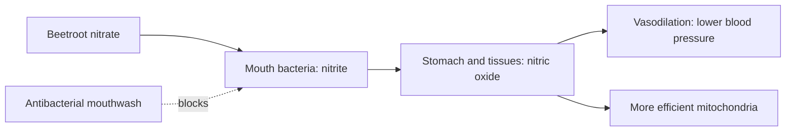

# Beetroot (Beta vulgaris)

## Summary

Beetroot extract, powder or juice comes from red beets, a vegetable rich in nitrate, betalains, vitamins and minerals. Nitrate is converted in the body to nitric oxide (NO), which widens blood vessels and makes muscle use oxygen more efficiently. Beetroot juice reduces the oxygen cost of exercise and improves endurance performance in recreational athletes, and lowers systolic blood pressure by about 4 mmHg. Using antibacterial mouthwash blocks the effect.

*This note is educational. It is not medical advice and does not replace a doctor, dietitian or pharmacist, especially during pregnancy, illness or when taking medicines.*

## Prerequisites

No prior notes are needed.

## Core concepts

### Definition

*Dietary nitrate* (NO3-) is converted by bacteria on the tongue to nitrite (NO2-), which in the stomach and tissues is reduced to *nitric oxide*. *Betalains* (betanin) are the red pigments of beets.

### Analogy

The nitrate pathway is like a relay race. Nitrate is passed from beetroot to the mouth bacteria, who turn it into nitrite; the stomach and tissues turn nitrite into nitric oxide, which opens the blood vessels. If mouthwash kills the mouth runners, the relay stops. The analogy breaks because nitric oxide also directly affects mitochondria.

### Mechanism

Nitric oxide relaxes vascular smooth muscle (vasodilation), improves blood flow and oxygen delivery, and increases mitochondrial efficiency, reducing the oxygen cost of submaximal exercise by a few percent. Effects peak 2 to 3 hours after a dose of about 6 to 8 mmol nitrate (about 500 mL of juice or 70 to 140 mL of concentrated shots). Betalains are antioxidant and anti-inflammatory in the laboratory.

The flowchart shows the nitrate-nitrite-NO pathway.

### Proposed effects and evidence

Each entry states the proposed effect and how strong the human evidence is, using the grades defined in the [Evidence grades](../evidence-grades.md) note.

- **Better physical performance.** Reduced oxygen cost and better endurance in recreational athletes; less effect in elite athletes. Evidence: moderate.
- **Lower blood pressure.** About 4 mmHg systolic reduction in meta-analysis. Evidence: moderate.
- **Anti-inflammatory action.** Laboratory studies of betalains. Evidence: very limited.
- **Faster muscle recovery.** Small trials. Evidence: limited.
- **Antioxidant action.** Laboratory studies. Evidence: very limited.
- **Liver health.** Animal studies. Evidence: very limited.
- **Digestive support.** Fiber in whole beets. Evidence: very limited.
- **Brain health and blood flow.** One small study showed increased blood flow to frontal regions in older adults. Evidence: very limited.
- **Better erectile function.** No meaningful evidence. Evidence: very limited.
- **Weight management.** No meaningful evidence. Evidence: very limited.

## Worked example

A recreational cyclist drinks 140 mL of concentrated beetroot juice (about 8 mmol nitrate) 2.5 hours before a 10 km time trial. Studies of similar protocols show oxygen cost falls by about 3 to 5 percent and time trial performance improves by 1 to 2 percent. Urine and stool may turn pink (beeturia), which is harmless.

## Trade offs and when to use it

Beetroot is safe for most people. It is high in oxalate (a concern for kidney stone formers). Mouthwash blunts its effects.

## Common mistakes

- **Using antibacterial mouthwash.** It blocks conversion of nitrate to nitrite.
- **Taking it right before exercise.** Effects peak 2 to 3 hours after intake.

## Practice

1. What does nitrate become in the body?
2. How much does beetroot juice lower systolic blood pressure?
3. Why does mouthwash block the effect?

### Answers

1. Nitrite and then nitric oxide.
2. About 4 mmHg.
3. It kills the oral bacteria that convert nitrate to nitrite.

## Further reading

- Jones, A. M., Thompson, C., Wylie, L. J. et al. (2018). Dietary nitrate and physical performance. Annual Review of Nutrition, 38, 303-328. [DOI](https://doi.org/10.1146/annurev-nutr-082117-051622). Review of dietary nitrate and performance.
- Siervo, M., Lara, J., Ogbonmwan, I. et al. (2013). Inorganic nitrate and beetroot juice supplementation reduces blood pressure in adults: a systematic review and meta-analysis. Journal of Nutrition, 143(6), 818-826. [DOI](https://doi.org/10.3945/jn.112.170233). Meta-analysis of nitrate and blood pressure.
