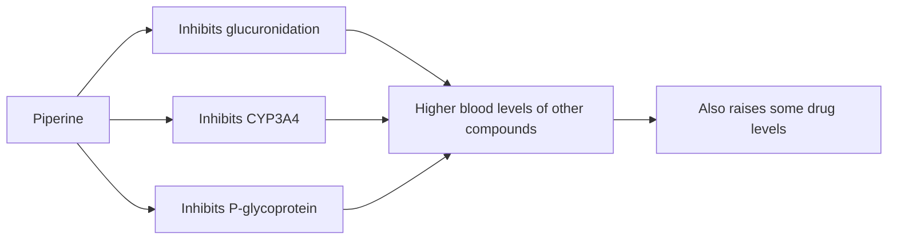

# Black pepper (Piper nigrum)

## Summary

Black pepper fruit extract is standardized to piperine, the alkaloid responsible for pepper's pungent taste. Piperine increases the bioavailability of other compounds by inhibiting drug-metabolizing enzymes (glucuronidation and CYP3A4) and the P-glycoprotein pump. This is why it is added to curcumin and other supplements, but it also means it can raise blood levels of medicines. Other claimed effects come mostly from laboratory studies.

*This note is educational. It is not medical advice and does not replace a doctor, dietitian or pharmacist, especially during pregnancy, illness or when taking medicines.*

## Prerequisites

No prior notes are needed.

## Core concepts

### Definition

*Piperine* is an alkaloid of black pepper (Piper nigrum). Supplements (often sold as BioPerine) contain about 5 to 20 mg piperine.

### Analogy

Piperine is like a doorman who slows down the exit of guests from a club: other compounds (such as curcumin) stay longer in the blood because their "exit" (metabolism and pumping out of cells) is slowed. The analogy breaks because the doorman cannot tell supplements from prescription drugs, which also stay longer.

### Mechanism

Piperine inhibits glucuronidation in the gut and liver, inhibits CYP3A4 and P-glycoprotein, and may increase intestinal absorption. In a human study, 20 mg piperine with 2 g curcumin increased curcumin bioavailability about 20-fold (2,000 percent). It also stimulates digestive enzymes and TRPV1 receptors.

The flowchart shows how piperine increases bioavailability.

### Proposed effects and evidence

Each entry states the proposed effect and how strong the human evidence is, using the grades defined in the [Evidence grades](../evidence-grades.md) note.

- **Increased bioavailability of nutrients and compounds.** Shown for curcumin and some drugs in humans. Evidence: moderate.
- **Digestive support.** Stimulates digestive enzymes in animals. Evidence: very limited.
- **Anti-inflammatory action.** Laboratory studies. Evidence: very limited.
- **Antioxidant action.** Laboratory studies. Evidence: very limited.
- **Weight loss support.** Animal studies. Evidence: very limited.
- **Better cognitive function.** Animal studies. Evidence: very limited.
- **Antibacterial action.** Laboratory studies. Evidence: very limited.
- **Blood glucose regulation.** Animal studies. Evidence: very limited.
- **Heart health.** Animal studies. Evidence: very limited.
- **Immune support.** Animal studies. Evidence: very limited.

## Worked example

A person taking a calcium channel blocker or anticoagulant starts a curcumin plus piperine supplement. Piperine inhibits CYP3A4 and P-glycoprotein, which can raise blood levels of some drugs. A pharmacist should check for interactions; this is a more important practical effect than most claimed health benefits.

## Trade offs and when to use it

Black pepper in food is safe. Piperine supplements can interact with medicines metabolized by CYP3A4 or transported by P-glycoprotein.

## Common mistakes

- **Ignoring drug interactions.** Piperine can raise drug levels.
- **Assuming it has strong effects of its own.** Most evidence is about enhancing other compounds.

## Practice

1. What is piperine?
2. How does piperine increase curcumin levels?
3. By how much did piperine increase curcumin bioavailability in humans?

### Answers

1. The alkaloid that gives black pepper its pungency.
2. By inhibiting glucuronidation, CYP3A4 and P-glycoprotein.
3. About 20-fold.

## Further reading

- Shoba, G., Joy, D., Joseph, T. et al. (1998). Influence of piperine on the pharmacokinetics of curcumin in animals and human volunteers. Planta Medica, 64(4), 353-356. [DOI](https://doi.org/10.1055/s-2006-957450). Piperine and curcumin pharmacokinetics.
