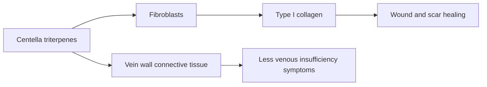

# Gotu kola (Centella asiatica)

## Summary

Centella asiatica (gotu kola) is a plant used in Ayurvedic and Chinese medicine. Its extract contains triterpenes (asiaticoside, madecassoside, asiatic and madecassic acid). It is valued for skin health and wound healing, venous circulation, and in tradition for cognition. Topical preparations support wound and scar healing in some studies, and a standardized extract improves symptoms of chronic venous insufficiency in small trials. Cognitive and anxiety effects have limited evidence.

*This note is educational. It is not medical advice and does not replace a doctor, dietitian or pharmacist, especially during pregnancy, illness or when taking medicines.*

## Prerequisites

No prior notes are needed.

## Core concepts

### Definition

*Centella asiatica* is a herb of the family Apiaceae. Its *triterpenes* (centelloids) stimulate collagen synthesis in fibroblasts. *TTFCA* (total triterpenic fraction of Centella asiatica) is a standardized extract.

### Analogy

Centella acts like a foreman on the skin's construction site: its triterpenes encourage fibroblasts to lay down collagen in an orderly way, helping wounds heal and scars form. The analogy breaks because evidence in humans is mostly for topical and venous uses, not for "rebuilding" the body generally.

### Mechanism

Asiaticoside and madecassoside stimulate type I collagen synthesis and fibroblast proliferation, increase antioxidants in new tissue and reduce inflammation. In veins, TTFCA improves connective tissue around vessels and microcirculation.

The flowchart shows the actions of centella triterpenes.

### Proposed effects and evidence

Each entry states the proposed effect and how strong the human evidence is, using the grades defined in the [Evidence grades](../evidence-grades.md) note.

- **Skin health.** Topical use supports skin repair; widely used in cosmetics. Evidence: limited.
- **Better circulation and vein health.** Small trials of TTFCA in chronic venous insufficiency show improvement. Evidence: limited.
- **Cognitive function.** Small trials in older adults. Evidence: very limited.
- **Anti-inflammatory and antioxidant action.** Laboratory studies. Evidence: very limited.
- **Mental health and anxiety.** One small trial. Evidence: very limited.
- **Faster wound healing.** Topical preparations helped in some small studies of wounds and burns. Evidence: limited.
- **Cardiovascular support.** No meaningful evidence beyond venous effects. Evidence: very limited.
- **Less cellulite.** Small cosmetic studies. Evidence: very limited.
- **Liver health.** Rare cases of liver injury reported, rather than benefit. Evidence: not supported.
- **Respiratory health.** Traditional use only. Evidence: very limited.

## Worked example

A person with heavy legs and ankle swelling from chronic venous insufficiency is advised compression stockings by their doctor. Some small trials of TTFCA (60 to 180 mg daily) show reduced swelling and symptoms; it can be discussed as an addition, not a replacement for compression.

## Trade offs and when to use it

Topical use is safe for most people. Oral use is generally well tolerated, but rare liver injury has been reported.

## Common mistakes

- **Using oral centella for liver support.** Rare liver injury has been reported.
- **Replacing compression therapy.** Use it only as an addition.

## Practice

1. What are the main active compounds of centella?
2. How do they help wound healing?
3. Which circulation condition has some trial support?

### Answers

1. Triterpenes: asiaticoside and madecassoside.
2. They stimulate collagen synthesis by fibroblasts.
3. Chronic venous insufficiency.

## Further reading

- Bylka, W., Znajdek-Awiżeń, P., Studzińska-Sroka, E. et al. (2013). Centella asiatica in cosmetology. Postępy Dermatologii i Alergologii, 30(1), 46-49. [DOI](https://doi.org/10.5114/pdia.2013.33378). Review of Centella asiatica in cosmetology.
- National Institute of Diabetes and Digestive and Kidney Diseases. LiverTox: Clinical and Research Information on Drug-Induced Liver Injury. [Link](https://www.ncbi.nlm.nih.gov/books/NBK547852/). Information on herbal liver injury.
