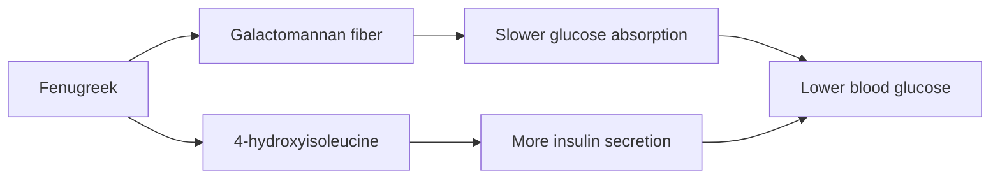

# Fenugreek (Trigonella foenum-graecum)

## Summary

Fenugreek extract is a concentrated form of fenugreek seeds, rich in soluble fiber (galactomannan), steroidal saponins (diosgenin), alkaloids, flavonoids and 4-hydroxyisoleucine. It is taken as capsules, powder or liquid. Meta-analyses show it lowers fasting and post-meal blood glucose in people with diabetes, probably through its fiber. Some trials suggest small increases in testosterone and libido in men, and it is widely used to increase breast milk, though evidence is weak.

*This note is educational. It is not medical advice and does not replace a doctor, dietitian or pharmacist, especially during pregnancy, illness or when taking medicines.*

## Prerequisites

No prior notes are needed.

## Core concepts

### Definition

*Fenugreek* is a legume whose seeds are used as a spice and medicine. *4-Hydroxyisoleucine* is an amino acid in fenugreek that stimulates insulin secretion in the laboratory. *Galactomannan* is its viscous soluble fiber.

### Analogy

Fenugreek seed is like a natural gel pack in the gut: when mixed with water, its fiber swells and slows the passage of sugar into the blood. The analogy breaks because fenugreek also contains compounds that act directly on insulin secretion.

### Mechanism

Galactomannan slows gastric emptying and glucose absorption. 4-Hydroxyisoleucine enhances glucose-dependent insulin secretion. Saponins may inhibit cholesterol absorption. Proposed hormonal effects involve saponins that may inhibit aromatase and 5-alpha-reductase.

The flowchart shows the main mechanisms.

### Proposed effects and evidence

Each entry states the proposed effect and how strong the human evidence is, using the grades defined in the [Evidence grades](../evidence-grades.md) note.

- **Blood glucose regulation.** Meta-analysis: lower fasting glucose and HbA1c in diabetes. Evidence: moderate.
- **Support of lactation.** Small trials with mixed results. Evidence: limited.
- **Hormonal health and sexual function (testosterone, libido).** Some trials in men show small increases in testosterone and libido. Evidence: limited.
- **Better digestion.** Traditional use; fiber effects. Evidence: limited.
- **Anti-inflammatory and antioxidant action.** Laboratory studies. Evidence: very limited.
- **Cardiovascular health and lipids.** Small reductions in cholesterol in some trials. Evidence: limited.
- **Weight loss through satiety.** Small effects. Evidence: limited.
- **Relief of menstrual pain.** One small trial. Evidence: very limited.
- **Skin and hair health.** No meaningful evidence. Evidence: very limited.
- **Antibacterial and antiviral action.** Laboratory studies. Evidence: very limited.

## Worked example

A person with type 2 diabetes adds 10 g fenugreek seed powder to meals daily. In meta-analyses, doses of 5 g or more lowered fasting glucose by about 15 mg/dL. Because this adds to diabetes medication, they monitor blood glucose to avoid hypoglycemia. Their sweat and urine may smell of maple syrup, a harmless effect.

## Trade offs and when to use it

Fenugreek is generally safe as food. It can cause gas, interact with diabetes drugs and anticoagulants, cause allergic reactions (it is a legume) and should be avoided in pregnancy in medicinal doses because it may stimulate the uterus.

## Common mistakes

- **Combining with diabetes drugs without monitoring.** Glucose may fall too low.
- **Using medicinal doses in pregnancy.** It may stimulate uterine contractions.

## Practice

1. Which fiber in fenugreek lowers blood glucose?
2. What does 4-hydroxyisoleucine do?
3. What harmless side effect is common?

### Answers

1. Galactomannan.
2. It stimulates insulin secretion.
3. A maple syrup odor of sweat and urine.

## Further reading

- Neelakantan, N., Narayanan, M., de Souza, R. J. et al. (2014). Effect of fenugreek (Trigonella foenum-graecum L.) intake on glycemia: a meta-analysis of clinical trials. Nutrition Journal, 13, 7. [DOI](https://doi.org/10.1186/1475-2891-13-7). Meta-analysis of fenugreek and glycemia.
