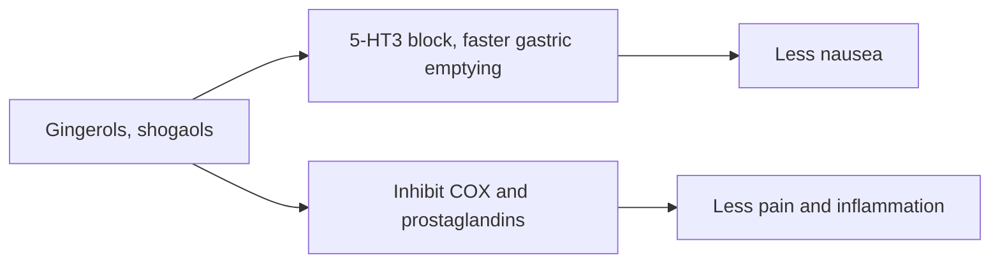

# Ginger (Zingiber officinale)

## Summary

Ginger root extract contains gingerols, shogaols and zingiberene, which give ginger its taste and effects. Ginger is used as a spice and in traditional medicine. Its best-supported use is against nausea, especially in pregnancy; it also modestly reduces menstrual pain and osteoarthritis pain. Effects on blood glucose, lipids and memory are small or uncertain.

*This note is educational. It is not medical advice and does not replace a doctor, dietitian or pharmacist, especially during pregnancy, illness or when taking medicines.*

## Prerequisites

No prior notes are needed.

## Core concepts

### Definition

*Ginger* is the rhizome of Zingiber officinale. *Gingerols* are the pungent compounds of fresh ginger; drying and heating convert them to *shogaols*, which are more pungent.

### Analogy

Ginger acts like a gentle brake on the nausea signals between the gut and the brain, calming the stomach. The analogy breaks because it also has anti-inflammatory effects similar to mild painkillers.

### Mechanism

Gingerols and shogaols block serotonin 5-HT3 receptors in the gut and speed gastric emptying, reducing nausea. They inhibit COX and lipoxygenase enzymes and prostaglandin synthesis (anti-inflammatory and analgesic), and have antimicrobial effects in the laboratory.

The flowchart shows the main actions of ginger.

### Proposed effects and evidence

Each entry states the proposed effect and how strong the human evidence is, using the grades defined in the [Evidence grades](../evidence-grades.md) note.

- **Anti-inflammatory action.** Modest effects in osteoarthritis trials. Evidence: limited.
- **Antiemetic action.** Meta-analysis: reduces pregnancy-related nausea; also used for postoperative and chemotherapy nausea. Evidence: moderate.
- **Digestive support.** Speeds gastric emptying. Evidence: limited.
- **Pain relief, including menstrual pain.** Small trials show effects similar to ibuprofen for menstrual pain. Evidence: limited.
- **Antioxidant action.** Laboratory studies. Evidence: very limited.
- **Cardiovascular health and lower triglycerides.** Small reductions in some meta-analyses. Evidence: limited.
- **Antimicrobial action.** Laboratory studies. Evidence: very limited.
- **Better brain function and memory.** Small trials. Evidence: very limited.
- **Immune support.** Little evidence. Evidence: very limited.
- **Blood glucose regulation.** Small reductions in type 2 diabetes trials. Evidence: limited.

## Worked example

A pregnant woman with morning sickness takes 250 mg ginger four times a day (1 g daily) after discussing it with her midwife. In a meta-analysis (Viljoen and colleagues, 2014), ginger improved nausea compared with placebo, without increasing risks for the pregnancy at these doses.

## Trade offs and when to use it

Ginger is safe in food amounts; higher doses can cause heartburn and may increase bleeding risk with anticoagulants.

## Common mistakes

- **Using very high doses in pregnancy.** Stay around 1 g daily and consult a midwife.
- **Combining high doses with anticoagulants.** It may increase bleeding.

## Practice

1. Which compounds give ginger its effects?
2. What is the best-supported use?
3. How does ginger reduce nausea?

### Answers

1. Gingerols and shogaols.
2. Reducing nausea, especially in pregnancy.
3. By blocking 5-HT3 receptors and speeding gastric emptying.

## Further reading

- Viljoen, E., Visser, J., Koen, N. et al. (2014). A systematic review and meta-analysis of the effect and safety of ginger in the treatment of pregnancy-associated nausea and vomiting. Nutrition Journal, 13, 20. [DOI](https://doi.org/10.1186/1475-2891-13-20). Meta-analysis of ginger for pregnancy nausea.
