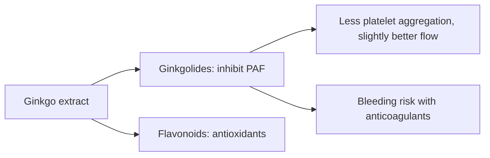

# Ginkgo (Ginkgo biloba)

## Summary

Ginkgo biloba is one of the oldest living tree species, used in traditional Chinese medicine. Standardized leaf extract (EGb 761) contains flavonoid glycosides and terpene lactones (ginkgolides and bilobalide). It is promoted for circulation, memory and dementia. The large GEM trial found that ginkgo did not prevent dementia in older adults. Some trials show small symptomatic benefits in existing dementia and in intermittent claudication. It increases bleeding risk with anticoagulants.

*This note is educational. It is not medical advice and does not replace a doctor, dietitian or pharmacist, especially during pregnancy, illness or when taking medicines.*

## Prerequisites

No prior notes are needed.

## Core concepts

### Definition

*Ginkgo biloba* is a gymnosperm tree. *Ginkgolides* inhibit platelet-activating factor; *bilobalide* is a sesquiterpene. EGb 761 is standardized to 24 percent flavonoid glycosides and 6 percent terpene lactones.

### Analogy

Ginkgo is marketed like a plumber for the brain's pipes: improving blood flow so the brain works better. In healthy people the pipes already flow well, and ginkgo did not prevent the decline of dementia. The analogy breaks because dementia is mostly not a plumbing problem.

### Mechanism

Ginkgolides inhibit platelet-activating factor, reducing platelet aggregation and increasing blood flow slightly; flavonoids are antioxidants. Effects on neurotransmitters are proposed.

The flowchart shows the main mechanisms.

### Proposed effects and evidence

Each entry states the proposed effect and how strong the human evidence is, using the grades defined in the [Evidence grades](../evidence-grades.md) note.

- **Better blood circulation.** Small improvement in walking distance in peripheral artery disease. Evidence: limited.
- **Cognitive support in healthy people.** No benefit in large trials. Evidence: not supported.
- **Protection against oxidative damage.** Laboratory studies. Evidence: very limited.
- **Anti-inflammatory action.** Laboratory studies. Evidence: very limited.
- **Cardiovascular health.** No reduction in events in GEM. Evidence: not supported.
- **Eye health: glaucoma and macular degeneration.** Small studies. Evidence: very limited.
- **Better sexual function, including antidepressant-induced.** Trials show no clear benefit. Evidence: not supported.
- **Fewer symptoms in existing dementia.** Some trials of EGb 761 show small benefits. Evidence: limited.
- **Prevention of dementia.** GEM trial: no effect over 6 years. Evidence: not supported.
- **Treatment of vertigo and tinnitus.** Mixed evidence; tinnitus not supported. Evidence: limited.
- **Skin health.** No meaningful evidence. Evidence: very limited.

## Worked example

In the Ginkgo Evaluation of Memory study (DeKosky and colleagues, 2008), 3,069 adults aged 75 or older took 120 mg EGb 761 twice daily or placebo for a median of 6.1 years. Dementia rates were the same in both groups (about 3.3 per 100 person-years).

## Trade offs and when to use it

Ginkgo leaf extract is generally safe, but it raises bleeding risk with anticoagulants and antiplatelet drugs and before surgery. Raw seeds are toxic (ginkgotoxin).

## Common mistakes

- **Taking ginkgo to prevent dementia.** A large trial showed no effect.
- **Combining with anticoagulants.** It increases bleeding risk.

## Practice

1. What are ginkgolides?
2. What did the GEM trial find?
3. What is the main safety concern?

### Answers

1. Terpene lactones that inhibit platelet-activating factor.
2. No prevention of dementia.
3. Bleeding risk with anticoagulants.

## Further reading

- DeKosky, S. T., Williamson, J. D., Fitzpatrick, A. L. et al. (2008). Ginkgo biloba for prevention of dementia: a randomized controlled trial. JAMA, 300(19), 2253-2262. [DOI](https://doi.org/10.1001/jama.2008.683). GEM trial of ginkgo for dementia prevention.
