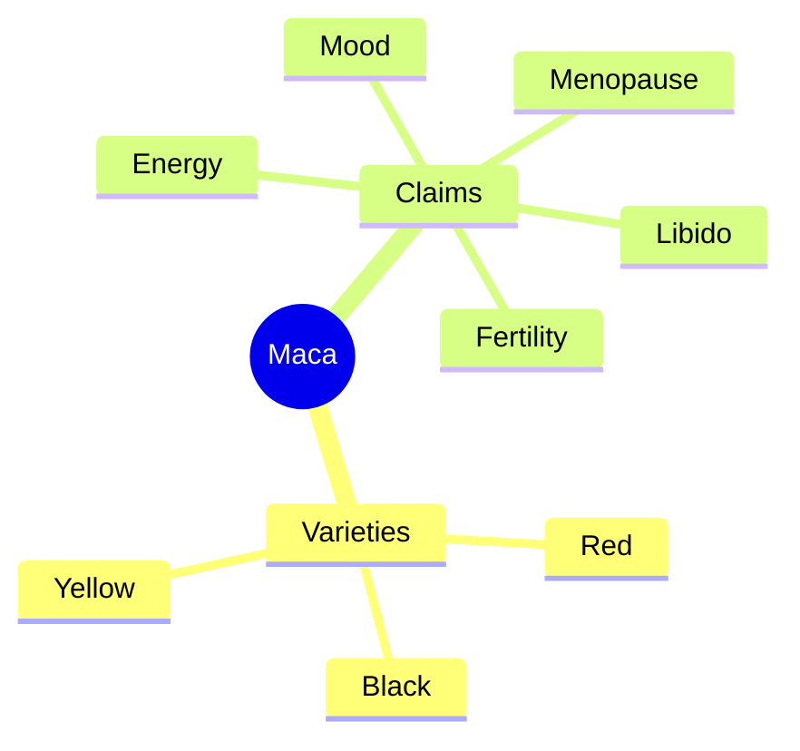

# Maca (Lepidium meyenii)

## Summary

Maca is a root vegetable of the cabbage family grown in the Andes above 4,000 meters, in yellow, red and black varieties. It is rich in carbohydrates, fiber, amino acids, vitamins and minerals, and contains macamides and glucosinolates. In Andean tradition, it was used for fertility, energy and libido. Small trials suggest modest improvements in libido and some sperm parameters, without changes in sex hormones.

*This note is educational. It is not medical advice and does not replace a doctor, dietitian or pharmacist, especially during pregnancy, illness or when taking medicines.*

## Prerequisites

No prior notes are needed.

## Core concepts

### Definition

*Maca* (Lepidium meyenii, also L. peruvianum) is a cruciferous plant. *Macamides* are fatty acid amides specific to maca. It is often called an adaptogen.

### Analogy

Maca is treated in tradition as a high-mountain energy food, like a root that let people thrive at altitude. Modern trials suggest it may slightly improve desire without changing hormones, a bit like a seasoning that changes the taste of a dish without changing its ingredients. The analogy breaks because the mechanism is unknown.

### Mechanism

Maca does not change testosterone, estradiol, LH or FSH in trials. Proposed mechanisms for libido include effects on the brain or the endocannabinoid system (macamides). Black maca showed effects on sperm in some studies; red maca on prostate size in rats.

The mindmap shows maca varieties and claims.

### Proposed effects and evidence

Each entry states the proposed effect and how strong the human evidence is, using the grades defined in the [Evidence grades](../evidence-grades.md) note.

- **More energy and endurance.** One small cycling trial; little evidence. Evidence: very limited.
- **Better fertility and sperm quality.** Small trials show improvements in sperm count or motility. Evidence: limited.
- **Better libido and sexual function.** A systematic review found limited evidence of benefit. Evidence: limited.
- **Hormonal support and fewer menopausal symptoms.** Small trials; hormones unchanged. Evidence: limited.
- **Better mood and less stress.** Small trials. Evidence: very limited.
- **Cognitive function.** Animal studies. Evidence: very limited.
- **Bone health.** Animal studies. Evidence: very limited.
- **Skin health.** No meaningful evidence. Evidence: very limited.
- **Immune support.** No meaningful evidence. Evidence: very limited.

## Worked example

In a 12-week trial, men taking 1.5 or 3 g maca daily reported more sexual desire from week 8, while testosterone and estradiol did not change. Such trials were small, and the systematic review by Shin and colleagues (2010) judged the evidence limited.

## Trade offs and when to use it

Maca is a food and generally safe. Raw maca can upset digestion; traditional preparations cook it.

## Common mistakes

- **Expecting hormone changes.** Trials show no change in sex hormones.
- **Eating large amounts raw.** Traditional use cooks maca.

## Practice

1. Where is maca grown?
2. Does maca change testosterone?
3. Which claimed effect has limited support?

### Answers

1. In the Andes above 4,000 meters.
2. No.
3. Libido and some sperm parameters.

## Further reading

- Shin, B. C., Lee, M. S., Yang, E. J. et al. (2010). Maca (L. meyenii) for improving sexual function: a systematic review. BMC Complementary and Alternative Medicine, 10, 44. [DOI](https://doi.org/10.1186/1472-6882-10-44). Systematic review of maca for sexual function.
