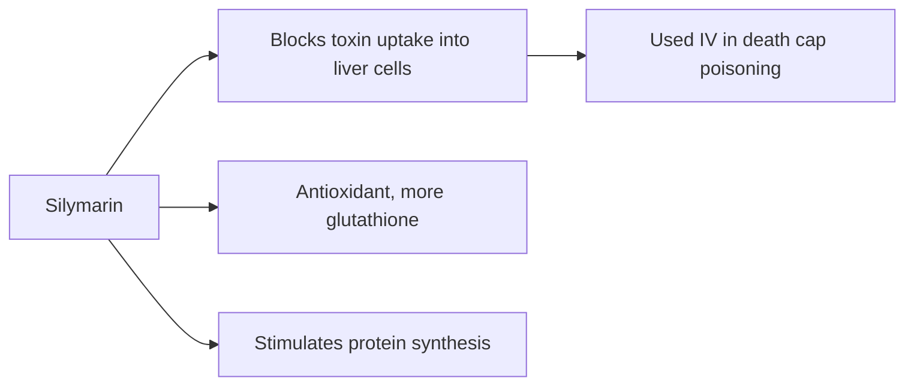

# Milk thistle (Silybum marianum)

## Summary

Milk thistle seed extract contains silymarin, a mixture of flavonolignans (mainly silybin). It is traditionally used to protect and regenerate the liver. Silymarin is antioxidant and anti-inflammatory in laboratory studies, and intravenous silibinin is used for death cap mushroom poisoning. A Cochrane review of milk thistle in alcoholic and viral liver disease found no significant effect on mortality or complications. It is safe but of unproven benefit in most liver diseases.

*This note is educational. It is not medical advice and does not replace a doctor, dietitian or pharmacist, especially during pregnancy, illness or when taking medicines.*

## Prerequisites

No prior notes are needed.

## Core concepts

### Definition

*Milk thistle* is a thistle of the daisy family. *Silymarin* is the seed extract containing silybin (silibinin), isosilybin, silychristin and silydianin. Oral absorption is low.

### Analogy

Silymarin is described as a bodyguard for liver cells: it stands at the door and blocks toxins from entering, and helps repair damage. In the special case of death cap poisoning, the bodyguard (as intravenous silibinin) really blocks the toxin's entry. For common liver diseases, the bodyguard's effect has not been shown.

### Mechanism

Silybin inhibits the uptake of amatoxin into liver cells (through the OATP1B3 transporter), scavenges free radicals, increases glutathione and stimulates protein synthesis in liver cells (laboratory and animal studies). Oral bioavailability is low; phospholipid complexes improve it.

The flowchart shows the proposed actions of silymarin.

### Proposed effects and evidence

Each entry states the proposed effect and how strong the human evidence is, using the grades defined in the [Evidence grades](../evidence-grades.md) note.

- **Liver protection.** Laboratory and animal studies; established use only in amatoxin poisoning (IV). Evidence: limited.
- **Liver regeneration.** Animal studies. Evidence: very limited.
- **Anti-inflammatory action.** Laboratory studies. Evidence: very limited.
- **Antioxidant action.** Laboratory studies. Evidence: limited.
- **Treatment of liver diseases (alcoholic, hepatitis B and C).** Cochrane: no effect on mortality or complications. Evidence: not supported.
- **Better digestion.** Traditional use. Evidence: very limited.
- **Detoxification.** Not supported beyond amatoxin poisoning. Evidence: very limited.
- **Skin health.** Small topical studies. Evidence: very limited.
- **Lower cholesterol.** Small trials, mostly in diabetes. Evidence: limited.
- **Anticancer effects.** Laboratory studies. Evidence: very limited.

## Worked example

A person who drinks heavily takes milk thistle hoping to protect the liver. In the Cochrane review, silymarin did not reduce mortality or complications in alcoholic liver disease. Reducing alcohol has a far larger effect; silymarin cannot offset ongoing alcohol damage.

## Trade offs and when to use it

Milk thistle is well tolerated; it can cause digestive upset and allergic reactions in people allergic to the daisy family.

## Common mistakes

- **Using milk thistle to offset drinking.** It does not protect against continued alcohol damage.
- **Self-treating mushroom poisoning.** This is an emergency; intravenous silibinin is given in hospital.

## Practice

1. What is silymarin?
2. In which poisoning is silibinin used?
3. What did the Cochrane review find?

### Answers

1. The flavonolignan extract of milk thistle seeds.
2. Death cap (amatoxin) poisoning.
3. No effect on mortality in alcoholic and viral liver disease.

## Further reading

- Rambaldi, A., Jacobs, B. P., Gluud, C. (2007). Milk thistle for alcoholic and/or hepatitis B or C virus liver diseases. Cochrane Database of Systematic Reviews, CD003620. [DOI](https://doi.org/10.1002/14651858.CD003620.pub3). Cochrane review of milk thistle in liver disease.
