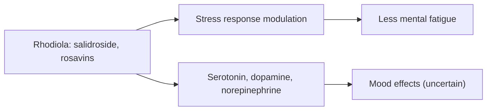

# Rhodiola (Rhodiola rosea)

## Summary

Rhodiola rosea ("golden root" or "roseroot") is an adaptogen used in folk medicine of Scandinavia, Russia and Siberia to improve physical and mental performance under stress. Its root contains salidroside and rosavins. A systematic review found some evidence that it reduces mental fatigue, but trials were of variable quality. Effects on depression, physical performance and other claims are uncertain.

*This note is educational. It is not medical advice and does not replace a doctor, dietitian or pharmacist, especially during pregnancy, illness or when taking medicines.*

## Prerequisites

No prior notes are needed.

## Core concepts

### Definition

*Rhodiola rosea* is a succulent plant of cold regions. Standardized extracts contain about 3 percent rosavins and 1 percent salidroside. Rhodiola is a protected species in some countries, including Poland.

### Analogy

Rhodiola is like a mild pick-me-up for a tired mind, used before exams or long shifts in folk tradition. The analogy breaks because, unlike coffee, its effect is not stimulant and is less consistent.

### Mechanism

Rhodiola is thought to modulate the stress response (HPA axis, stress-activated protein kinases) and levels of serotonin, dopamine and norepinephrine. Salidroside is antioxidant in laboratory studies.

The flowchart shows the proposed mechanisms.

### Proposed effects and evidence

Each entry states the proposed effect and how strong the human evidence is, using the grades defined in the [Evidence grades](../evidence-grades.md) note.

- **Less stress and fatigue.** Some evidence of reduced mental fatigue in a systematic review. Evidence: limited.
- **Better cognitive function.** Small trials under fatigue. Evidence: limited.
- **Antidepressant effect.** One small trial versus sertraline found smaller effects with fewer side effects. Evidence: limited.
- **Better physical performance.** Mixed results. Evidence: limited.
- **More energy and vitality.** Subjective improvements in small trials. Evidence: limited.
- **Antioxidant action.** Laboratory studies. Evidence: very limited.
- **Cardiovascular support.** Animal studies. Evidence: very limited.
- **Better mood.** Small trials. Evidence: limited.
- **Immune support.** Animal studies. Evidence: very limited.
- **Effects on metabolism.** Animal studies. Evidence: very limited.

## Worked example

A doctor working night shifts takes 170 mg rhodiola extract daily for 2 weeks. A small trial in a similar population reported less mental fatigue on cognitive tests. The systematic review by Ishaque and colleagues (2012) found such effects but rated many trials at risk of bias.

## Trade offs and when to use it

Rhodiola is generally well tolerated; it can cause dizziness or dry mouth and may interact with antidepressants.

## Common mistakes

- **Using rhodiola instead of treatment for depression.** Evidence is preliminary.
- **Harvesting wild plants.** It is protected in some countries.

## Practice

1. What are the main compounds of rhodiola?
2. Which effect has the most support?
3. Why should wild rhodiola not be harvested in Poland?

### Answers

1. Salidroside and rosavins.
2. Reduced mental fatigue.
3. It is a protected species.

## Further reading

- Ishaque, S., Shamseer, L., Bukutu, C. et al. (2012). Rhodiola rosea for physical and mental fatigue: a systematic review. BMC Complementary and Alternative Medicine, 12, 70. [DOI](https://doi.org/10.1186/1472-6882-12-70). Systematic review of rhodiola for fatigue.
