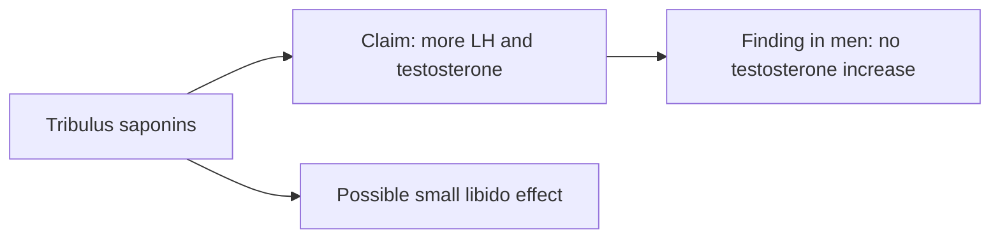

# Tribulus (Tribulus terrestris)

## Summary

Tribulus terrestris (puncture vine) is a plant used in Ayurvedic and Chinese medicine. Extracts of its fruit or root contain steroidal saponins (protodioscin), flavonoids and alkaloids. It is marketed to raise testosterone, libido and athletic performance. Trials in men consistently show no increase in testosterone; some small trials suggest modest improvements in libido and erectile function.

*This note is educational. It is not medical advice and does not replace a doctor, dietitian or pharmacist, especially during pregnancy, illness or when taking medicines.*

## Prerequisites

No prior notes are needed.

## Core concepts

### Definition

*Tribulus terrestris* is a flowering plant of the family Zygophyllaceae. *Protodioscin* is the steroidal saponin claimed to be its main active compound.

### Analogy

Tribulus is marketed like a key to the testosterone factory. Measurements show the factory output (testosterone) does not change, though some users report feeling more desire. The analogy breaks because libido is influenced by many factors besides testosterone, including expectation.

### Mechanism

Protodioscin was proposed to increase luteinizing hormone and testosterone, based on animal studies. In humans, blood testosterone does not rise. Effects on libido, if real, may act through nitric oxide or other pathways.

The flowchart compares the claim and the finding.

### Proposed effects and evidence

Each entry states the proposed effect and how strong the human evidence is, using the grades defined in the [Evidence grades](../evidence-grades.md) note.

- **Higher testosterone.** Trials in young men and athletes show no increase. Evidence: not supported.
- **Better libido and sexual function.** Some small trials show improvement in men and women. Evidence: limited.
- **Fertility and sperm quality.** Small, low-quality studies. Evidence: very limited.
- **Better physical performance and muscle mass.** Trials in athletes show no effect. Evidence: not supported.
- **Urinary tract health and kidney stones.** Traditional use; animal studies. Evidence: very limited.
- **Anti-inflammatory and antioxidant action.** Laboratory studies. Evidence: very limited.
- **Mood and stress as an adaptogen.** No meaningful evidence. Evidence: very limited.
- **Lower blood pressure and cholesterol.** Animal studies. Evidence: very limited.
- **Relief of menopausal symptoms.** Small trials on libido in postmenopausal women. Evidence: limited.

## Worked example

In a trial (Neychev and Mitev, 2005), young men took tribulus at 10 or 20 mg per kg body weight daily for 4 weeks. Testosterone, androstenedione and luteinizing hormone did not differ from placebo.

## Trade offs and when to use it

Tribulus is usually well tolerated, but rare cases of kidney and liver injury and gynecomastia have been reported. Sports supplements containing it are sometimes contaminated with banned substances.

## Common mistakes

- **Buying tribulus to raise testosterone.** Trials show no effect.
- **Ignoring contamination of sports products.** Choose third-party tested products.

## Practice

1. What is protodioscin?
2. Does tribulus raise testosterone in men?
3. Which claimed effect has some limited support?

### Answers

1. The steroidal saponin claimed to be the active compound of tribulus.
2. No.
3. Libido and sexual function.

## Further reading

- Neychev, V. K., Mitev, V. I. (2005). The aphrodisiac herb Tribulus terrestris does not influence the androgen production in young men. Journal of Ethnopharmacology, 101(1-3), 319-323. [DOI](https://doi.org/10.1016/j.jep.2005.05.017). Trial of tribulus and androgens in young men.
