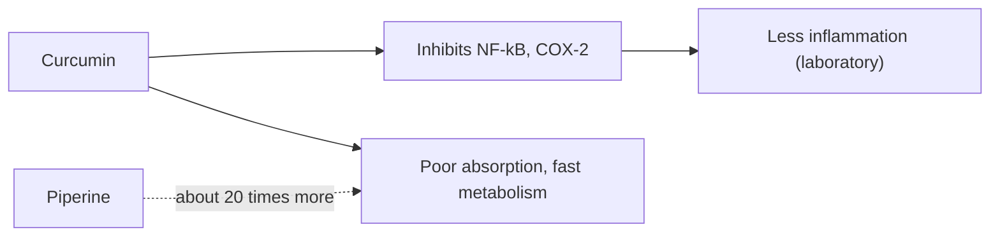

# Turmeric (Curcuma longa)

## Summary

Turmeric rhizome extract contains curcuminoids, mainly curcumin, a polyphenol with anti-inflammatory and antioxidant effects in the laboratory. Curcumin is poorly absorbed, so supplements are combined with piperine, fats or special formulations. A meta-analysis found turmeric extracts reduced arthritis pain about as much as painkillers, though trials were small. Many other claims, including cancer, rest on laboratory studies; curcumin is a notorious source of misleading laboratory results.

*This note is educational. It is not medical advice and does not replace a doctor, dietitian or pharmacist, especially during pregnancy, illness or when taking medicines.*

## Prerequisites

No prior notes are needed.

## Core concepts

### Definition

*Turmeric* is the rhizome of Curcuma longa. *Curcuminoids* are curcumin, demethoxycurcumin and bisdemethoxycurcumin; turmeric powder contains about 3 percent. Supplements are concentrated extracts (often 95 percent curcuminoids).

### Analogy

Curcumin is like a very talented actor who performs brilliantly on a small stage (the test tube) but barely reaches the audience in a large theater (the body) because the microphone (absorption) is weak. Piperine and special formulations are attempts to turn up the microphone. The analogy breaks because some benefits may come from effects in the gut, where absorption does not matter.

### Mechanism

Curcumin inhibits NF-kB, COX-2 and lipoxygenase and scavenges radicals in the laboratory. It interferes with many laboratory assays (it is classed as a PAINS compound), which partly explains its huge but often unreliable research literature. Absorption is low and it is rapidly conjugated; piperine increased curcumin bioavailability about 20-fold in one human study ([Black pepper (Piper nigrum)](black-pepper.md)).

The notes stress that achieving health benefits needs concentrated extracts, because the amount of curcumin in turmeric used in cooking is small.

The flowchart shows curcumin's proposed actions and absorption problem.

### Proposed effects and evidence

Each entry states the proposed effect and how strong the human evidence is, using the grades defined in the [Evidence grades](../evidence-grades.md) note.

- **Anti-inflammatory action.** Laboratory evidence; clinical effects in arthritis. Evidence: limited.
- **Antioxidant action.** Laboratory evidence. Evidence: limited.
- **Cardiovascular support.** Small trials of markers. Evidence: limited.
- **Anticancer effects.** Laboratory studies; no clinical proof. Evidence: very limited.
- **Brain health.** Small trials of memory with mixed results. Evidence: limited.
- **Support in depression.** Small trials suggest benefit as add-on. Evidence: limited.
- **Digestive support.** Small trials in dyspepsia and ulcerative colitis. Evidence: limited.
- **Diabetes support.** Small trials. Evidence: limited.
- **Skin health.** Small studies. Evidence: very limited.
- **Arthritis pain relief.** Meta-analysis of 8 trials: pain reduction similar to NSAIDs in knee osteoarthritis. Evidence: moderate.

## Worked example

A person with knee osteoarthritis takes 1,000 mg of curcumin extract (with piperine) daily for 8 weeks. In the meta-analysis by Daily and colleagues (2016), similar doses reduced pain scores to a degree comparable with NSAIDs, but the trials were small and the authors called for larger studies.

## Trade offs and when to use it

Turmeric in food is safe. Concentrated extracts, especially with piperine, have been linked to liver injury, gallbladder problems and interactions with anticoagulants and other drugs.

## Common mistakes

- **Expecting effects from spice amounts.** Clinical trials use concentrated extracts.
- **Ignoring liver warnings with high-bioavailability products.** Rare liver injury has been reported.

## Practice

1. What is the main active compound of turmeric?
2. Why is curcumin combined with piperine?
3. Which use has the best evidence?

### Answers

1. Curcumin.
2. To increase its absorption.
3. Pain relief in osteoarthritis.

## Further reading

- Daily, J. W., Yang, M., Park, S. (2016). Efficacy of turmeric extracts and curcumin for alleviating the symptoms of joint arthritis: a systematic review and meta-analysis of randomized clinical trials. Journal of Medicinal Food, 19(8), 717-729. [DOI](https://doi.org/10.1089/jmf.2016.3705). Meta-analysis of turmeric for arthritis.
- Shoba, G., Joy, D., Joseph, T. et al. (1998). Influence of piperine on the pharmacokinetics of curcumin in animals and human volunteers. Planta Medica, 64(4), 353-356. [DOI](https://doi.org/10.1055/s-2006-957450). Piperine and curcumin bioavailability.
- National Institute of Diabetes and Digestive and Kidney Diseases. LiverTox: Clinical and Research Information on Drug-Induced Liver Injury. [Link](https://www.ncbi.nlm.nih.gov/books/NBK547852/). Reports of turmeric-associated liver injury.
