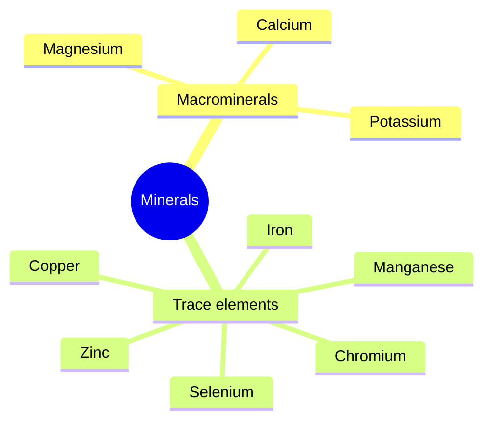

# Minerals

Minerals are inorganic elements the body needs for bones and teeth, fluid balance, nerve conduction, muscle function and as cofactors of enzymes. Start with the overview, then read individual minerals.

## Map

## Reading order

1. [Minerals overview](minerals-overview.md)
2. [Calcium](calcium.md)
3. [Magnesium](magnesium.md)
4. [Potassium](potassium.md)
5. [Iron](iron.md)
6. [Zinc](zinc.md)
7. [Copper](copper.md)
8. [Manganese](manganese.md)
9. [Selenium](selenium.md)
10. [Chromium](chromium.md)
