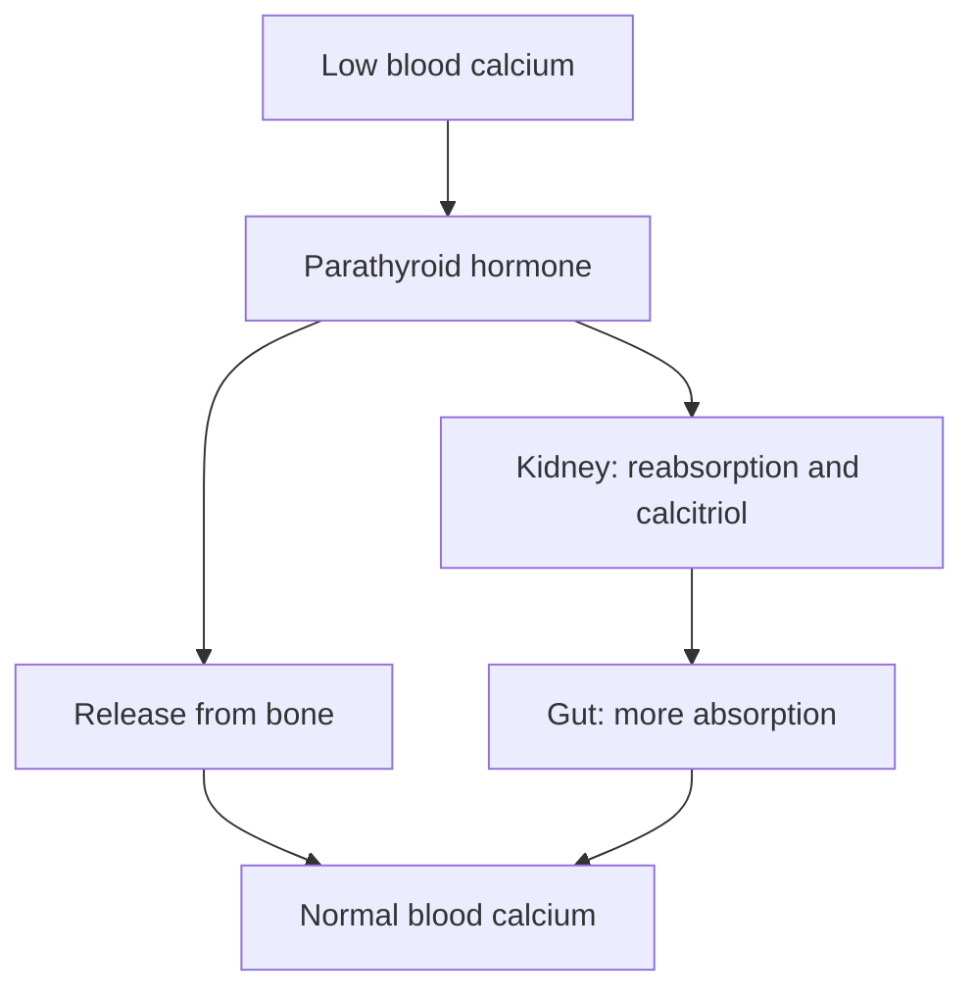

# Calcium

## Summary

Calcium is the most abundant mineral in the body: about 99 percent is in bones and teeth as hydroxyapatite, which gives them hardness. The remaining 1 percent is essential for muscle contraction, nerve conduction, blood clotting, heart rhythm and hormone secretion, and its blood level is tightly regulated. Adequate calcium with vitamin D supports bone health. Calcium from food is preferred; some meta-analyses linked supplements to a small increase in heart attack risk, which remains debated.

*This note is educational. It is not medical advice and does not replace a doctor, dietitian or pharmacist, especially during pregnancy, illness or when taking medicines.*

## Prerequisites

- [Minerals overview](minerals-overview.md)

## Core concepts

### Definition

*Calcium* (Ca) is a macromineral and electrolyte. The body contains about 1 to 1.2 kg, almost all in the skeleton. Blood calcium is kept at about 2.2 to 2.6 mmol/L by parathyroid hormone, calcitriol and calcitonin.

### Analogy

The skeleton is like a calcium bank. When blood calcium falls, hormones withdraw calcium from bone; when intake is good, calcium is deposited. A long period of withdrawals without deposits leaves the bank weak (osteoporosis). The analogy breaks because the bank also needs other "staff" (vitamin D, vitamin K, magnesium, exercise) to accept deposits.

### Mechanism

- **Bone and teeth.** Calcium phosphate crystals (hydroxyapatite) give bones and teeth their hardness. Bone is remodeled continuously; peak bone mass is reached in the late 20s.
- **Muscle contraction.** Calcium released from the sarcoplasmic reticulum binds troponin and allows cross-bridge cycling ([Muscle contraction](../../physiology/muscle/muscle-contraction.md)), including in the heart.
- **Nerve conduction.** Calcium entry triggers neurotransmitter release at synapses.
- **Blood clotting.** Calcium (factor IV) is needed at several steps of the coagulation cascade.
- **Hormone secretion and enzymes.** Calcium is a second messenger and enzyme cofactor, for example in insulin secretion.

**Regulation.** Low blood calcium raises parathyroid hormone, which releases calcium from bone, increases kidney reabsorption and activates vitamin D ([Vitamin D](../vitamins/vitamin-d.md)).

The flowchart shows calcium regulation.

### Intake and food sources

| Item | Value |
| --- | --- |
| RDA | 1,000 mg adults; 1,200 mg women over 50 and men over 70; 1,300 mg teenagers |
| UL | 2,500 mg (2,000 mg over 50) |
| Food sources | Milk (about 120 mg per 100 mL), yogurt, cheese (hard cheese 700 to 1,000 mg per 100 g), kale, broccoli, tofu set with calcium, almonds, sardines with bones, fortified juices and cereals |
| Absorption | About 30 percent; reduced by oxalate (spinach) and phytate |

### Proposed effects and evidence

Each entry states the proposed effect and how strong the human evidence is, using the grades defined in the [Evidence grades](../evidence-grades.md) note.

- **Building and maintaining bones and teeth.** Main structural mineral of the skeleton. Evidence: established physiology.
- **Muscle contraction.** Essential trigger of contraction. Evidence: established physiology.
- **Nerve conduction.** Essential for neurotransmitter release; low blood calcium causes tetany. Evidence: established physiology.
- **Blood clotting.** Cofactor of the coagulation cascade. Evidence: established physiology.
- **Heart rhythm.** Calcium currents shape the cardiac action potential. Evidence: established physiology.
- **Hormone secretion including insulin.** Calcium triggers secretion. Evidence: established physiology.
- **Enzyme cofactor.** Cofactor for many enzymes. Evidence: established physiology.
- **Lower risk of osteoporosis and fractures.** Calcium with vitamin D reduces fractures modestly in older, institutionalized or deficient people; little effect in community-dwelling adults with adequate intake. Evidence: moderate.
- **Dental health and less periodontal disease.** Plausible; limited direct evidence. Evidence: limited.
- **Cardiovascular health.** Food calcium is not linked to heart disease; supplements were linked to about 30 percent more heart attacks in one meta-analysis, which is debated. Excess with an imbalance of magnesium and vitamin D may increase vascular calcification. Evidence: limited.

## Worked example

A 55-year-old woman eats yogurt (200 mg), cheese (300 mg), a glass of milk (240 mg) and vegetables (150 mg), totaling about 900 mg. She needs 1,200 mg. Adding a calcium-fortified plant drink or one more dairy portion closes the gap; if she cannot, a supplement of 500 mg with vitamin D is reasonable, taken with food in divided doses.

## Trade offs and when to use it

Food sources are preferred. Supplements can cause constipation and kidney stones, and are best limited to the gap between diet and needs.

## Common mistakes

- **Counting spinach as a good calcium source.** Oxalate blocks most of its calcium.
- **Taking large single doses.** Absorption is best with 500 mg or less at a time.

## Practice

1. Where is 99 percent of body calcium?
2. Which hormone raises blood calcium?
3. Why is food calcium preferred to supplements?

### Answers

1. In bones and teeth.
2. Parathyroid hormone.
3. Supplements may raise heart attack and kidney stone risk, while food calcium does not.

## Further reading

- NIH Office of Dietary Supplements. Calcium: Fact Sheet for Health Professionals. [Link](https://ods.od.nih.gov/factsheets/Calcium-HealthProfessional/). Reference intakes and evidence.
- Bolland, M. J., Avenell, A., Baron, J. A. et al. (2010). Effect of calcium supplements on risk of myocardial infarction and cardiovascular events: meta-analysis. BMJ, 341, c3691. [DOI](https://doi.org/10.1136/bmj.c3691). Meta-analysis of calcium supplements and cardiovascular events.
