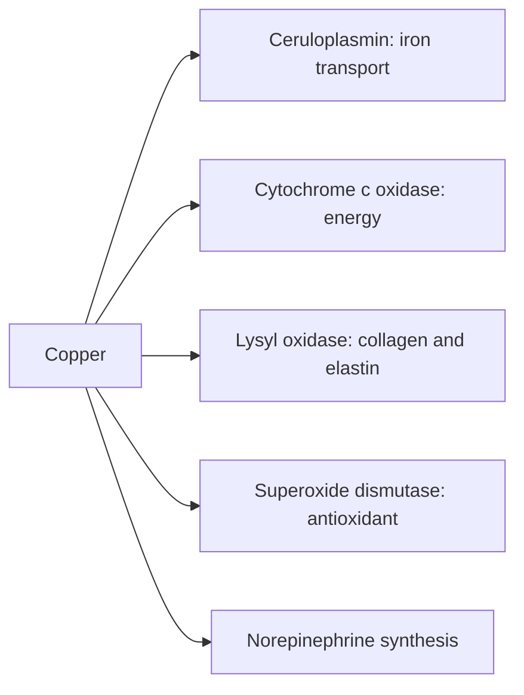

# Copper

## Summary

Copper is a trace element that is a cofactor of enzymes involved in energy production, iron metabolism, connective tissue formation, antioxidant defense and neurotransmitter synthesis. Deficiency is rare but causes anemia that does not respond to iron, low white blood cells, bone problems and nerve damage; it is most often caused by excessive zinc intake or gut surgery. Excess copper is toxic, and in Wilson disease copper accumulates in the liver and brain.

*This note is educational. It is not medical advice and does not replace a doctor, dietitian or pharmacist, especially during pregnancy, illness or when taking medicines.*

## Prerequisites

- [Minerals overview](minerals-overview.md)

## Core concepts

### Definition

*Copper* (Cu) is a trace element; the body contains about 50 to 120 mg. Important copper enzymes include *ceruloplasmin* (iron oxidation), *cytochrome c oxidase* (energy production), *lysyl oxidase* (collagen and elastin cross-linking) and *copper-zinc superoxide dismutase* (antioxidant).

### Analogy

Copper is like the rust-control and connection specialist in a factory: it helps load iron onto its transport (ceruloplasmin), finishes the last step of energy production and welds collagen and elastin fibers together. The analogy breaks because copper itself, if free, promotes oxidation, so the body keeps it bound to proteins.

### Mechanism

- **Iron metabolism.** Ceruloplasmin and hephaestin oxidize iron so it can bind transferrin. Copper deficiency causes anemia resembling iron deficiency.
- **Energy.** Cytochrome c oxidase (complex IV) transfers electrons to oxygen.
- **Connective tissue.** Lysyl oxidase cross-links collagen and elastin, giving strength to bone, skin and vessels ([Collagen](../../../../natural-sciences/chemistry/biochemistry/proteins/collagen.md)).
- **Antioxidant.** Copper-zinc superoxide dismutase converts superoxide to hydrogen peroxide.
- **Nervous system.** Dopamine beta-hydroxylase makes norepinephrine; copper is needed for myelin.
- **Pigment.** Tyrosinase makes melanin.

The flowchart shows copper enzymes.

### Intake and food sources

| Item | Value |
| --- | --- |
| RDA | 900 µg |
| UL | 10,000 µg (10 mg) |
| Food sources | Oysters and mussels, liver, almonds, hazelnuts, cashews, sesame, dark leafy vegetables (spinach, kale), whole grains (brown rice, oats), dark chocolate, legumes, mushrooms |

### Proposed effects and evidence

Each entry states the proposed effect and how strong the human evidence is, using the grades defined in the [Evidence grades](../evidence-grades.md) note.

- **Hemoglobin synthesis and iron metabolism.** Deficiency causes anemia similar to iron deficiency. Evidence: established physiology.
- **Protection from oxidative stress.** Cofactor of superoxide dismutase. Evidence: established physiology.
- **Nervous system health.** Deficiency causes neuropathy and myelopathy. Evidence: established physiology.
- **Bone and connective tissue health.** Needed for collagen and elastin cross-linking. Evidence: established physiology.
- **Lipid metabolism and cholesterol.** Deficiency raises cholesterol in animals; human relevance unclear. Evidence: limited.
- **Immune function.** Deficiency causes neutropenia and infections. Evidence: established physiology.
- **Wound healing.** Copper dressings are studied; oral benefit not shown. Evidence: very limited.
- **Blood glucose regulation.** Unclear role. Evidence: very limited.
- **Heart health and vessel elasticity.** Deficiency weakens vessels in animals; human evidence limited. Evidence: limited.
- **Detoxification of heavy metals.** No evidence; excess copper is itself toxic. Evidence: not supported.

## Worked example

A person takes 100 mg zinc daily for a year to "boost immunity". They develop anemia and numbness in their legs. Tests show low copper and ceruloplasmin: high zinc induced metallothionein in gut cells, which trapped copper. Stopping zinc and giving copper corrects the anemia, but nerve damage may only partly recover.

## Trade offs and when to use it

Deficiency is rare with a normal diet; it usually results from excess zinc, gastric bypass or genetic disorders. Copper supplements are rarely needed.

## Common mistakes

- **Combining long-term high-dose zinc without copper.** It causes copper deficiency.
- **Taking copper supplements "for detox".** Excess copper is toxic.

## Practice

1. Which copper enzyme is needed for iron transport?
2. Why can copper deficiency cause anemia?
3. What is the most common cause of copper deficiency?

### Answers

1. Ceruloplasmin.
2. Iron cannot be oxidized and loaded onto transferrin.
3. Excess zinc intake or gut surgery.

## Further reading

- NIH Office of Dietary Supplements. Copper: Fact Sheet for Health Professionals. [Link](https://ods.od.nih.gov/factsheets/Copper-HealthProfessional/). Reference intakes and evidence.
