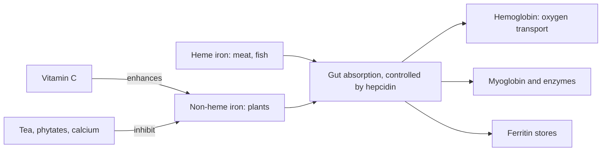

# Iron

## Summary

Iron is a trace element that forms the core of hemoglobin, which carries oxygen in red blood cells, and myoglobin, which stores oxygen in muscle. It is also part of enzymes for energy production and DNA synthesis. Iron deficiency is the most common nutrient deficiency worldwide and causes microcytic (iron deficiency) anemia, fatigue and reduced performance. Heme iron from meat is absorbed better than non-heme iron from plants; vitamin C improves non-heme absorption. Excess iron is toxic.

*This note is educational. It is not medical advice and does not replace a doctor, dietitian or pharmacist, especially during pregnancy, illness or when taking medicines.*

## Prerequisites

- [Minerals overview](minerals-overview.md)

## Core concepts

### Definition

*Iron* (Fe) is a trace element. *Heme iron* (in meat and fish) is absorbed at about 15 to 35 percent; *non-heme iron* (in plants and supplements) at about 2 to 20 percent, depending on iron status and other foods. *Ferritin* is the storage protein; its blood level reflects iron stores.

### Analogy

Iron in hemoglobin is like a seat in a taxi for oxygen: each iron atom can carry one oxygen molecule from the lungs to the tissues. Without enough taxis, the tissues are short of oxygen even if the air is fine. The analogy breaks because the body has no way to excrete excess iron, so too many taxis clog the streets (iron overload damages organs).

### Mechanism

- **Oxygen transport and storage.** Each hemoglobin has four heme groups with iron; myoglobin stores oxygen in muscle.
- **Energy production.** Iron is part of cytochromes and iron-sulfur proteins in the electron transport chain ([Oxidative phosphorylation](../../../../natural-sciences/chemistry/biochemistry/oxidative-phosphorylation.md)).
- **DNA synthesis.** Ribonucleotide reductase needs iron.
- **Immunity and cognition.** Deficiency impairs immune cells and brain development in children.
- **Regulation.** The body controls iron mainly at absorption, through the hormone hepcidin; there is no active excretion. Losses occur through bleeding (menstruation), so women of reproductive age need more.

**Absorption modifiers.** Vitamin C and meat enhance non-heme absorption; phytates (grains, legumes), polyphenols (tea, coffee) and calcium inhibit it.

The flowchart shows iron absorption and use.

### Intake and food sources

| Item | Value |
| --- | --- |
| RDA | 8 mg men and women over 50; 18 mg women 19 to 50; 27 mg in pregnancy |
| UL | 45 mg |
| Heme sources | Beef, chicken, liver, fish, poultry |
| Non-heme sources | Legumes (beans, lentils), pumpkin and sesame seeds, nuts, green leafy vegetables (spinach, kale), fortified cereals |

Vegetarians need about 1.8 times more iron because of lower absorption.

### Proposed effects and evidence

Each entry states the proposed effect and how strong the human evidence is, using the grades defined in the [Evidence grades](../evidence-grades.md) note.

- **Hemoglobin production and oxygen transport.** Essential; deficiency causes microcytic anemia. Evidence: established physiology.
- **DNA synthesis.** Needed for ribonucleotide reductase. Evidence: established physiology.
- **Immune function.** Deficiency impairs immune response. Evidence: established physiology.
- **Enzyme function and energy metabolism.** Part of cytochromes and many enzymes. Evidence: established physiology.
- **Protection from oxidative stress.** Iron is part of catalase and peroxidases, but free iron promotes oxidative damage. Evidence: established physiology.
- **Cognitive health.** Deficiency impairs attention and development in children; iron improves cognition in deficient children. Evidence: moderate.
- **Body temperature regulation.** Iron deficiency anemia is associated with poor cold tolerance. Evidence: limited.
- **Physical performance.** Correcting deficiency improves endurance; no benefit without deficiency. Evidence: moderate.
- **Healthy pregnancy.** Needs rise to 27 mg daily; supplements reduce maternal anemia. Evidence: strong.
- **Digestive health.** Iron supplements often cause gastrointestinal side effects rather than benefits. Evidence: not supported.

## Worked example

A female runner feels tired and her race times worsen. Her hemoglobin is normal, but ferritin is 12 µg/L (low). Iron deficiency without anemia already reduces performance. Her doctor prescribes iron every other day (absorption is better than daily, because hepcidin rises after each dose) taken with orange juice and away from coffee. After 3 months, ferritin is 45 µg/L and her performance returns.

## Trade offs and when to use it

Test before supplementing: iron overload (for example in hereditary hemochromatosis) damages the liver, heart and pancreas. Iron supplements are a leading cause of poisoning in young children.

## Common mistakes

- **Taking iron without testing.** Check hemoglobin and ferritin first.
- **Taking iron with tea, coffee or calcium.** Separate them by at least an hour.

## Practice

1. What is the difference between heme and non-heme iron?
2. Which blood test reflects iron stores?
3. Why do women of reproductive age need more iron?

### Answers

1. Heme iron from meat is absorbed much better than non-heme iron from plants.
2. Ferritin.
3. Menstrual blood losses.

## Further reading

- NIH Office of Dietary Supplements. Iron: Fact Sheet for Health Professionals. [Link](https://ods.od.nih.gov/factsheets/Iron-HealthProfessional/). Reference intakes, absorption and safety.
