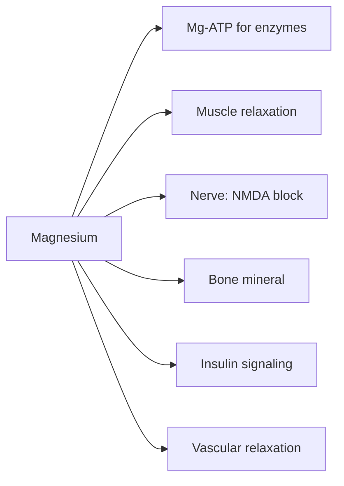

# Magnesium

## Summary

Magnesium is a macromineral needed for more than 300 enzymes, including all reactions that use ATP, and for muscle and nerve function, bone, blood glucose and blood pressure control. Many people eat less than recommended. Magnesium citrate is a common supplement form, chelated with citric acid, valued for good absorption and also used as a mild laxative. Supplements modestly lower blood pressure and help prevent migraine; claims for sleep, mood and muscle cramps have weaker support.

*This note is educational. It is not medical advice and does not replace a doctor, dietitian or pharmacist, especially during pregnancy, illness or when taking medicines.*

## Prerequisites

- [Minerals overview](minerals-overview.md)

## Core concepts

### Definition

*Magnesium* (Mg) is a macromineral; the body contains about 25 g, half in bone. *Magnesium citrate* is a salt of magnesium and citric acid, better absorbed than magnesium oxide. Other forms include glycinate, lactate, chloride and oxide.

### Analogy

Magnesium is like the handle on ATP: enzymes that use ATP actually grab the magnesium-ATP complex. Without the handle, the energy currency is hard to spend. The analogy breaks because magnesium also has separate roles, such as blocking calcium channels and NMDA receptors in nerves.

### Mechanism

- **ATP and enzymes.** ATP exists in cells mainly as Mg-ATP; kinases, DNA and RNA polymerases and hundreds of other enzymes require magnesium ([ATP](../../../../natural-sciences/chemistry/biochemistry/atp.md)).
- **Muscle and nerve.** Magnesium regulates calcium entry and the release of calcium in muscle, supporting relaxation after contraction. In nerves it blocks NMDA receptors.
- **Bone.** It is part of bone mineral and affects parathyroid hormone and vitamin D activation.
- **Glucose.** It is needed for insulin signaling; low magnesium is linked to insulin resistance.
- **Blood pressure and heart rhythm.** It relaxes vascular smooth muscle and stabilizes cardiac rhythm; intravenous magnesium treats some arrhythmias.
- **Gut.** Unabsorbed magnesium salts draw water into the bowel, which is why citrate and oxide act as laxatives.

The flowchart shows the main roles of magnesium.

### Intake and food sources

| Item | Value |
| --- | --- |
| RDA | 400 to 420 mg men, 310 to 320 mg women |
| UL | 350 mg from supplements (no limit for food magnesium) |
| Food sources | Pumpkin seeds (about 550 mg per 100 g), almonds, cashews, spinach, legumes, whole grains, dark chocolate |
| Forms | Citrate (good absorption, laxative at higher doses), glycinate (gentle on the gut), oxide (low absorption, strong laxative) |

People with kidney disease should not take magnesium supplements without medical advice.

### Proposed effects and evidence

Each entry states the proposed effect and how strong the human evidence is, using the grades defined in the [Evidence grades](../evidence-grades.md) note.

- **Muscle health, cramps and recovery.** Magnesium is essential for muscle function; supplements did not reduce ordinary leg cramps in a Cochrane review (except possibly in pregnancy). Evidence: limited.
- **Nervous system, stress and sleep.** Small trials in older adults and people with low magnesium suggest better sleep; evidence is weak. Evidence: limited.
- **Bone health and osteoporosis prevention.** Higher intake is associated with higher bone density; supplement trials are few. Evidence: limited.
- **Blood glucose regulation and type 2 diabetes risk.** Supplements improve insulin sensitivity in people with low magnesium. Evidence: moderate.
- **Heart function and blood pressure.** A meta-analysis found about 2 mmHg lower systolic pressure with about 370 mg daily for 3 months. Evidence: moderate.
- **Digestion and constipation.** Magnesium citrate and oxide are effective osmotic laxatives. Evidence: strong.
- **Mood and depression.** Some small trials show benefit; quality is low. Evidence: limited.
- **Skin health and inflammation.** No meaningful evidence for oral supplements. Evidence: very limited.
- **Migraine prevention.** Recommended as a probably effective option in some guidelines (400 to 600 mg daily). Evidence: moderate.
- **Detoxification.** No meaningful evidence. Evidence: very limited.

## Worked example

A person with frequent migraines takes 400 mg magnesium citrate daily. At this dose, about a quarter experience loose stools; switching to glycinate reduces this. After 3 months, migraine days fall moderately, consistent with guideline recommendations, although the evidence is not as strong as for prescription drugs.

## Trade offs and when to use it

Magnesium supplements are generally safe at up to 350 mg; the main side effect is diarrhea. Diets rich in whole grains, nuts and vegetables usually provide enough.

## Common mistakes

- **Taking magnesium oxide for deficiency.** Absorption is low; citrate or glycinate are better absorbed.
- **Taking supplements with kidney disease.** Excretion is impaired, and magnesium can accumulate.

## Practice

1. Why is magnesium needed for ATP use?
2. What is the UL for supplemental magnesium?
3. Which effect of magnesium citrate is strong evidence?

### Answers

1. Enzymes use the Mg-ATP complex.
2. 350 mg per day.
3. Its laxative effect.

## Further reading

- NIH Office of Dietary Supplements. Magnesium: Fact Sheet for Health Professionals. [Link](https://ods.od.nih.gov/factsheets/Magnesium-HealthProfessional/). Reference intakes and evidence.
- Zhang, X., Li, Y., Del Gobbo, L. C. et al. (2016). Effects of magnesium supplementation on blood pressure: a meta-analysis of randomized double-blind placebo-controlled trials. Hypertension, 68(2), 324-333. [DOI](https://doi.org/10.1161/HYPERTENSIONAHA.116.07664). Meta-analysis of magnesium and blood pressure.
