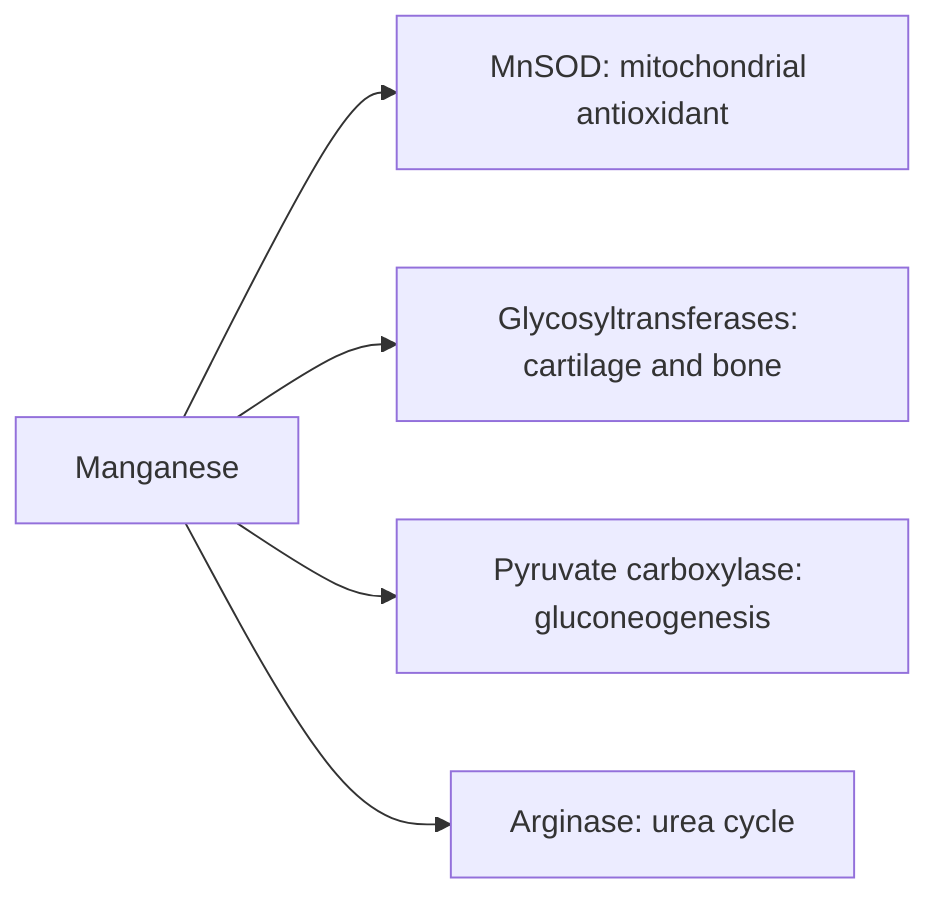

# Manganese

## Summary

Manganese is a trace element that is a cofactor of enzymes in carbohydrate, amino acid and cholesterol metabolism, bone and cartilage formation (synthesis of glycosaminoglycans and proteoglycans) and antioxidant defense (manganese superoxide dismutase in mitochondria). Deficiency is very rare in humans. Excess, mostly from inhaled manganese dust or contaminated water, damages the nervous system.

*This note is educational. It is not medical advice and does not replace a doctor, dietitian or pharmacist, especially during pregnancy, illness or when taking medicines.*

## Prerequisites

- [Minerals overview](minerals-overview.md)

## Core concepts

### Definition

*Manganese* (Mn) is a trace element; the body contains about 10 to 20 mg, mostly in bone, liver and kidneys. Key enzymes: *manganese superoxide dismutase* (MnSOD), *arginase* (urea cycle), *pyruvate carboxylase* (gluconeogenesis) and *glycosyltransferases* (proteoglycan synthesis).

### Analogy

Manganese is like a specialist tool kept in a few workshops: the mitochondria (antioxidant defense), the cartilage workshop (building proteoglycans) and the liver (urea cycle and glucose production). The analogy breaks because, unlike most tools, manganese can damage the brain when inhaled in excess.

### Mechanism

- **Antioxidant.** MnSOD in mitochondria converts superoxide from the electron transport chain to hydrogen peroxide ([Oxidative stress](../../../../natural-sciences/chemistry/biochemistry/oxidative-stress.md)).
- **Bone and cartilage.** Glycosyltransferases that build glycosaminoglycans and proteoglycans need manganese ([Glycosaminoglycans](../../../../natural-sciences/chemistry/biochemistry/carbohydrates/glycosaminoglycans.md)).
- **Metabolism.** Pyruvate carboxylase (glucose production), arginase (urea cycle, [Urea cycle](../../../../natural-sciences/chemistry/biochemistry/urea-cycle.md)) and enzymes of cholesterol synthesis.

The flowchart shows manganese enzymes.

### Intake and food sources

| Item | Value |
| --- | --- |
| Adequate intake | 2.3 mg men, 1.8 mg women |
| UL | 11 mg |
| Food sources | Whole grains (brown rice, oats), nuts (almonds, Brazil nuts), seeds (sunflower, sesame), legumes (beans, lentils), leafy greens (spinach, kale), tea, mussels and oysters |

### Proposed effects and evidence

Each entry states the proposed effect and how strong the human evidence is, using the grades defined in the [Evidence grades](../evidence-grades.md) note.

- **Metabolism of carbohydrates, proteins and fats.** Cofactor of key metabolic enzymes. Evidence: established physiology.
- **Bone formation.** Needed for bone matrix in animals; human deficiency is rare. Evidence: established physiology.
- **Protection from oxidative stress.** Part of mitochondrial superoxide dismutase. Evidence: established physiology.
- **Neurological function.** Needed for brain enzymes; excess is neurotoxic (manganism, similar to Parkinson disease). Evidence: established physiology.
- **Enzymatic functions: lipid and nucleic acid metabolism.** Cofactor in these reactions. Evidence: established physiology.
- **Blood glucose regulation.** Animal studies; human evidence limited. Evidence: very limited.
- **Skin health and collagen.** Prolidase, involved in collagen, needs manganese; supplement benefit not shown. Evidence: very limited.
- **Immune function.** Little human evidence. Evidence: very limited.
- **Hormonal balance.** Little human evidence. Evidence: very limited.
- **Detoxification of heavy metals.** No evidence. Evidence: not supported.

## Worked example

A cup of black tea provides about 0.5 mg manganese, and a bowl of oatmeal about 1.4 mg, so a typical diet easily reaches the adequate intake. Welders who inhale manganese fumes for years can develop manganism, with tremor and gait problems, showing that the route and amount matter.

## Trade offs and when to use it

Supplements are rarely needed. People with liver disease excrete manganese poorly and should avoid supplements.

## Common mistakes

- **Adding manganese supplements to joint products in high doses.** Stay below the UL.
- **Ignoring occupational exposure.** Inhaled manganese is the main cause of toxicity.

## Practice

1. Which antioxidant enzyme contains manganese?
2. What does manganese do in cartilage?
3. What disease does excess inhaled manganese cause?

### Answers

1. Mitochondrial superoxide dismutase.
2. It is a cofactor of enzymes that build glycosaminoglycans and proteoglycans.
3. Manganism, a Parkinson-like syndrome.

## Further reading

- NIH Office of Dietary Supplements. Manganese: Fact Sheet for Health Professionals. [Link](https://ods.od.nih.gov/factsheets/Manganese-HealthProfessional/). Reference intakes and safety.
