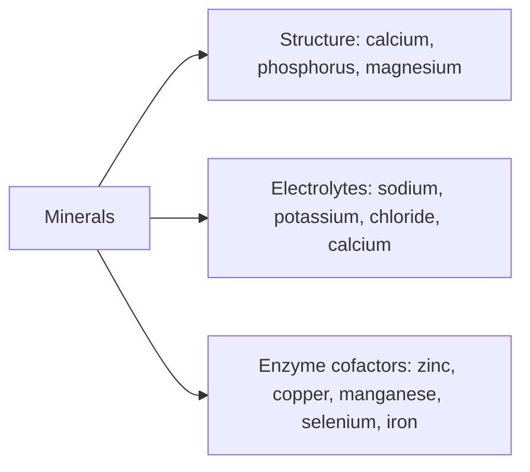

# Minerals overview

## Summary

Minerals are chemical elements the body needs for many biochemical processes: fluid balance, nerve conduction, muscle contraction and the structure of bones and teeth. Without adequate levels, vital functions are disturbed and health problems follow. Some minerals act as electrolytes (sodium, potassium, calcium, chloride), carrying electrical charge; others are cofactors of enzymes. Macrominerals are needed in amounts over 100 mg per day, trace elements in smaller amounts.

*This note is educational. It is not medical advice and does not replace a doctor, dietitian or pharmacist, especially during pregnancy, illness or when taking medicines.*

## Prerequisites

[Enzymes and coenzymes](../../../../natural-sciences/chemistry/biochemistry/enzymes-and-coenzymes.md) explains cofactors.

## Core concepts

### Definition

A *dietary mineral* is a chemical element, other than carbon, hydrogen, nitrogen and oxygen, required for normal body function. *Macrominerals* (calcium, phosphorus, magnesium, sodium, potassium, chloride, sulfur) are needed in amounts over 100 mg per day; *trace elements* (iron, zinc, copper, manganese, selenium, iodine, chromium, molybdenum, fluoride) in smaller amounts. *Electrolytes* are minerals that dissolve into charged ions in body fluids.

### Analogy

Minerals are like the bricks, wiring and screws of a house. Calcium and phosphorus are the bricks of the skeleton; sodium and potassium are the wiring that carries electrical signals; trace elements are the small screws that hold enzymes together. A house with no screws falls apart even if it has plenty of bricks. The analogy breaks because, unlike screws, many minerals are toxic in excess.

### Mechanism

- **Structure.** Calcium and phosphate form hydroxyapatite in bones and teeth; magnesium is also part of bone.
- **Electrolytes.** Sodium, potassium, chloride and calcium in solution maintain membrane potentials, nerve impulses, muscle contraction and fluid balance. Minerals are mostly present as soluble salts that take part in acid-base balance and blood pressure regulation.
- **Enzyme cofactors.** Zinc, copper, manganese, selenium, iron and magnesium are part of the active sites of enzymes.
- **Transport.** Iron in hemoglobin carries oxygen.

The flowchart shows the three main roles.

### Food sources

| Mineral | Good sources |
| --- | --- |
| Calcium | Milk, yogurt, cheese, green leafy vegetables (broccoli), almonds |
| Iron | Red meat, liver, legumes, spinach |
| Magnesium | Nuts, seeds, whole grains, green vegetables |
| Zinc | Meat, seafood, nuts, seeds, whole grains |
| Potassium | Bananas, potatoes, tomatoes, avocado |

### Reference intakes

US adult values (NIH Office of Dietary Supplements, checked 2026-10).

| Mineral | RDA or AI (men / women) | UL |
| --- | --- | --- |
| Calcium | 1,000 mg (1,200 mg women over 50) | 2,500 mg |
| Magnesium | 400 to 420 / 310 to 320 mg | 350 mg from supplements |
| Potassium | 3,400 / 2,600 mg (AI) | Not set |
| Iron | 8 / 18 mg | 45 mg |
| Zinc | 11 / 8 mg | 40 mg |
| Copper | 900 µg | 10,000 µg |
| Manganese | 2.3 / 1.8 mg (AI) | 11 mg |
| Selenium | 55 µg | 400 µg |
| Chromium | 35 / 25 µg (AI) | Not set |

## Worked example

A woman aged 30 who eats little meat and has heavy periods needs 18 mg of iron daily, more than twice a man's requirement. Plant iron is less well absorbed than meat iron. Her diet provides 10 mg mostly from plants, and she develops fatigue. Blood tests show low ferritin. Combining legumes with vitamin C sources, eating some red meat or fish, and taking a supplement prescribed by her doctor corrects the deficiency.

## Trade offs and when to use it

- A varied diet covers most mineral needs. Common shortfalls are iron (women, children), calcium (low dairy intake), magnesium and potassium (low intake of vegetables and whole grains), and iodine and selenium in some regions.
- Excess is harmful for several minerals: iron, zinc, selenium and copper have narrow safe ranges.

## Common mistakes

- **Supplementing several minerals at high doses.** Minerals compete for absorption; high zinc causes copper deficiency.
- **Ignoring the UL.** Toxicity is more common with minerals than with water-soluble vitamins.

## Practice

1. What distinguishes macrominerals from trace elements?
2. Name three electrolytes.
3. Why can excess zinc cause copper deficiency?

### Answers

1. Macrominerals are needed in amounts over 100 mg per day; trace elements in smaller amounts.
2. Sodium, potassium and chloride (also calcium).
3. Zinc induces metallothionein in gut cells, which binds copper and blocks its absorption.

## Further reading

- European Food Safety Authority (2017). *Dietary Reference Values for nutrients: summary report*. EFSA Supporting Publications, 14(12), e15121. [DOI](https://doi.org/10.2903/sp.efsa.2017.e15121). EFSA dietary reference values.
- NIH Office of Dietary Supplements. Iron: Fact Sheet for Health Professionals. [Link](https://ods.od.nih.gov/factsheets/Iron-HealthProfessional/). One of the NIH fact sheets used for the reference table; each mineral note cites its own.
