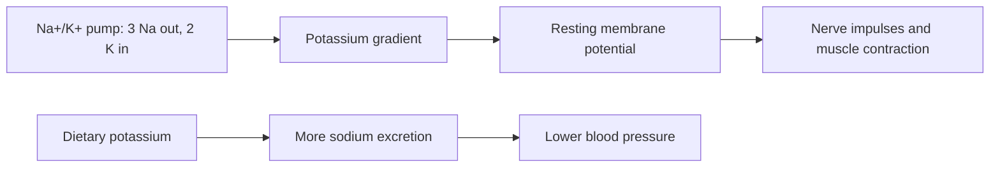

# Potassium

## Summary

Potassium is the main positive ion inside cells. Together with sodium, it maintains the electrical potential across cell membranes that makes nerve impulses and muscle contractions, including heartbeats, possible. A high potassium intake lowers blood pressure, especially when sodium intake is high, and is associated with lower stroke risk. Most people eat less than recommended; vegetables, fruit, legumes and potatoes are the main sources.

*This note is educational. It is not medical advice and does not replace a doctor, dietitian or pharmacist, especially during pregnancy, illness or when taking medicines.*

## Prerequisites

- [Minerals overview](minerals-overview.md)

## Core concepts

### Definition

*Potassium* (K) is a macromineral and the main intracellular cation (about 140 mmol/L inside cells versus 3.5 to 5.0 mmol/L in blood). The *sodium-potassium pump* (Na+/K+-ATPase) moves 3 sodium ions out and 2 potassium ions in for each ATP.

### Analogy

Potassium and sodium are like water held behind and in front of a dam. The pump keeps potassium high inside and sodium high outside, and the difference is a store of energy. Nerves and muscles open gates in the dam briefly to produce signals. The analogy breaks because the "water" here is electrically charged, so the dam stores electrical as well as chemical energy.

### Mechanism

- **Membrane potential.** The potassium gradient sets the resting membrane potential (about -70 mV in neurons). Changes in blood potassium alter excitability: both low and high levels cause arrhythmias.
- **Nerve and muscle function.** Repolarization after an action potential depends on potassium leaving the cell.
- **Blood pressure.** Potassium increases sodium excretion by the kidneys and relaxes blood vessels, counteracting sodium.
- **Acid-base balance and bone.** Potassium-rich plant foods supply alkaline salts (citrate, bicarbonate) that may reduce calcium loss in urine.
- **Kidney stones.** Potassium citrate lowers urinary calcium and is used to prevent stones.

The flowchart shows the sodium-potassium pump and its effects.

### Intake and food sources

| Item | Value |
| --- | --- |
| Adequate intake | 3,400 mg men, 2,600 mg women (US); EFSA 3,500 mg |
| UL | Not set for food; supplements are limited because of hyperkalemia risk |
| Food sources | Bananas (about 360 mg each), oranges, potatoes (about 400 to 600 mg per 100 g baked), spinach, tomatoes, avocado, beans, nuts |

People with kidney disease or taking ACE inhibitors, angiotensin receptor blockers or potassium-sparing diuretics must avoid potassium supplements and salt substitutes unless a doctor advises them.

### Proposed effects and evidence

Each entry states the proposed effect and how strong the human evidence is, using the grades defined in the [Evidence grades](../evidence-grades.md) note.

- **Blood pressure regulation.** Higher potassium lowered systolic pressure by about 3.5 mmHg overall and more in people with hypertension (meta-analysis). Evidence: strong.
- **Nervous system function.** Essential for nerve conduction; low potassium causes weakness, tremor and poor coordination. Evidence: established physiology.
- **Muscle function including the heart.** Essential for contraction; abnormal levels cause cramps, weakness and arrhythmias. Evidence: established physiology.
- **Acid-base balance.** Potassium salts of organic acids in plants are alkalinizing. Evidence: established physiology.
- **Hydration and electrolyte balance.** Main intracellular electrolyte; lost in sweat in small amounts. Evidence: established physiology.
- **Lower stroke risk.** Higher intake associated with 24 percent lower stroke risk; salt substitutes with potassium reduced stroke and death in a large trial. Evidence: moderate.
- **Bone health.** Associated with higher bone density; trials limited. Evidence: limited.
- **Regulation of kidney function.** Kidneys control potassium and sodium excretion; potassium increases sodium excretion. Evidence: established physiology.
- **Support of metabolism and protein synthesis.** Required for carbohydrate metabolism and protein synthesis. Evidence: established physiology.
- **Lower risk of kidney stones.** Potassium citrate prevents calcium stones. Evidence: moderate.

## Worked example

In the Salt Substitute and Stroke Study (Neal and colleagues, 2021), about 21,000 older adults in rural China with prior stroke or high blood pressure used a salt substitute (75 percent sodium chloride, 25 percent potassium chloride). Over about 5 years, stroke fell by 14 percent and death by 12 percent compared with regular salt. The effect came from both less sodium and more potassium.

## Trade offs and when to use it

Increasing potassium through vegetables, fruit and legumes is safe for healthy people and lowers blood pressure. Supplements and salt substitutes are dangerous with impaired kidney function.

## Common mistakes

- **Taking potassium supplements without medical advice.** High blood potassium can cause fatal arrhythmias.
- **Relying on bananas only.** Potatoes, beans and leafy vegetables contain as much or more.

## Practice

1. What is the main intracellular cation?
2. How does potassium lower blood pressure?
3. Who should avoid potassium supplements?

### Answers

1. Potassium.
2. It increases sodium excretion and relaxes blood vessels.
3. People with kidney disease or taking drugs that raise potassium.

## Further reading

- NIH Office of Dietary Supplements. Potassium: Fact Sheet for Health Professionals. [Link](https://ods.od.nih.gov/factsheets/Potassium-HealthProfessional/). Reference intakes and safety.
- Aburto, N. J., Hanson, S., Gutierrez, H. et al. (2013). Effect of increased potassium intake on cardiovascular risk factors and disease: systematic review and meta-analyses. BMJ, 346, f1378. [DOI](https://doi.org/10.1136/bmj.f1378). Meta-analysis of potassium and cardiovascular risk.
- Neal, B., Wu, Y., Feng, X. et al. (2021). Effect of salt substitution on cardiovascular events and death. New England Journal of Medicine, 385(12), 1067-1077. [DOI](https://doi.org/10.1056/NEJMoa2105675). Salt Substitute and Stroke Study.
