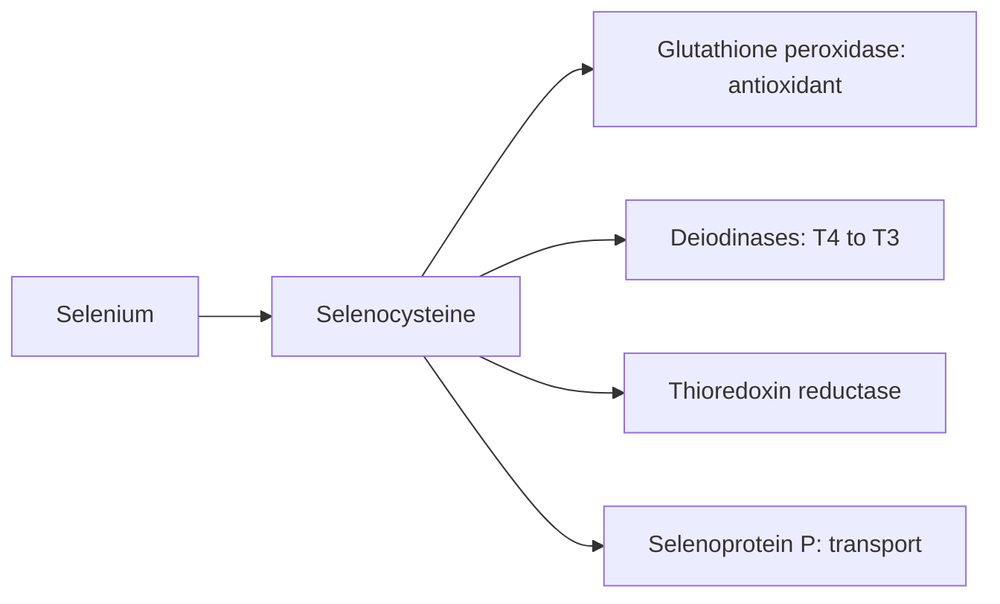

# Selenium

## Summary

Selenium is a trace element built into about 25 selenoproteins, including glutathione peroxidases (antioxidants) and deiodinases that activate thyroid hormone. It supports immunity, thyroid function and reproduction. Soil content varies widely, so intake differs between regions. Deficiency is rare but occurs in low-selenium areas. The safe range is narrow: excess causes selenosis (hair and nail loss), and trials of selenium supplements did not prevent cancer and suggested a higher diabetes risk.

*This note is educational. It is not medical advice and does not replace a doctor, dietitian or pharmacist, especially during pregnancy, illness or when taking medicines.*

## Prerequisites

- [Minerals overview](minerals-overview.md)

## Core concepts

### Definition

*Selenium* (Se) is a trace element incorporated into proteins as the amino acid *selenocysteine*. Key selenoproteins: *glutathione peroxidases*, *thioredoxin reductases*, *iodothyronine deiodinases* and *selenoprotein P* (transport).

### Analogy

Selenium is like a special battery in the antioxidant and thyroid machinery: without it, glutathione peroxidase cannot neutralize peroxides, and the thyroid cannot convert T4 into active T3. The analogy breaks because too many batteries become toxic, and the margin is small.

### Mechanism

- **Antioxidant.** Glutathione peroxidase uses glutathione to reduce hydrogen peroxide and lipid peroxides ([Glutathione](../supplements/glutathione.md)).
- **Thyroid.** Deiodinases convert thyroxine (T4) to triiodothyronine (T3); the thyroid has the highest selenium content per gram of any organ.
- **Immunity and reproduction.** Selenoproteins are needed for immune cells and sperm formation.
- **Heavy metals.** Selenium binds mercury, which may reduce mercury toxicity.

The flowchart shows selenoproteins and their roles.

### Intake and food sources

| Item | Value |
| --- | --- |
| RDA | 55 µg |
| UL | 400 µg |
| Food sources | Brazil nuts (about 50 to 90 µg per nut, highly variable), seafood (oysters, tuna, sardines), meat (beef, chicken), eggs, whole grains (brown rice, wheat), sunflower and sesame seeds |

Plant content depends on soil selenium: European soils are generally lower than North American ones.

### Proposed effects and evidence

Each entry states the proposed effect and how strong the human evidence is, using the grades defined in the [Evidence grades](../evidence-grades.md) note.

- **Protection from oxidative stress.** Part of glutathione peroxidase. Evidence: established physiology.
- **Thyroid function.** Needed for thyroid hormone activation; supplements lowered thyroid antibodies in some studies of autoimmune thyroiditis, with unclear clinical benefit. Evidence: limited.
- **Immune support.** Deficiency impairs immunity; benefit of extra selenium in people with adequate status not shown. Evidence: limited.
- **Heart health.** Deficiency causes Keshan disease (cardiomyopathy) in low-selenium regions; no benefit of supplements in adequate populations. Evidence: limited.
- **Cancer protection.** SELECT found no prevention of prostate cancer. Evidence: not supported.
- **Reproductive health and sperm quality.** Some trials in infertile men show improved sperm motility. Evidence: limited.
- **Neurological function.** Little human evidence. Evidence: very limited.
- **Detoxification of heavy metals such as mercury.** Selenium binds mercury; clinical relevance unclear. Evidence: limited.
- **Skin health.** No meaningful evidence. Evidence: very limited.
- **Blood glucose regulation.** Some trials suggested higher type 2 diabetes risk with supplements. Evidence: not supported.

## Worked example

One or two Brazil nuts a day provide about 100 to 150 µg selenium, more than the RDA. A person who eats a handful (about 10 nuts) daily, plus a selenium supplement of 200 µg, may exceed the UL of 400 µg, risking brittle nails, hair loss and a garlic breath odor (selenosis).

## Trade offs and when to use it

Selenium status depends on region. Supplements are useful only where intake is low, and the safe margin between adequacy and toxicity is narrow.

## Common mistakes

- **Eating many Brazil nuts daily.** One or two are enough.
- **Taking selenium for cancer prevention.** Trials found no benefit and possible harm.

## Practice

1. Which amino acid contains selenium?
2. Name two selenoproteins.
3. What did the SELECT trial show about selenium?

### Answers

1. Selenocysteine.
2. Glutathione peroxidase and iodothyronine deiodinase.
3. No prevention of prostate cancer.

## Further reading

- NIH Office of Dietary Supplements. Selenium: Fact Sheet for Health Professionals. [Link](https://ods.od.nih.gov/factsheets/Selenium-HealthProfessional/). Reference intakes and evidence.
- Rayman, M. P. (2012). Selenium and human health. The Lancet, 379(9822), 1256-1268. [DOI](https://doi.org/10.1016/S0140-6736(11)61452-9). Review of selenium and human health.
- Klein, E. A., Thompson, I. M., Tangen, C. M. et al. (2011). Vitamin E and the risk of prostate cancer: the Selenium and Vitamin E Cancer Prevention Trial (SELECT). JAMA, 306(14), 1549-1556. [DOI](https://doi.org/10.1001/jama.2011.1437). SELECT trial of selenium and vitamin E.
