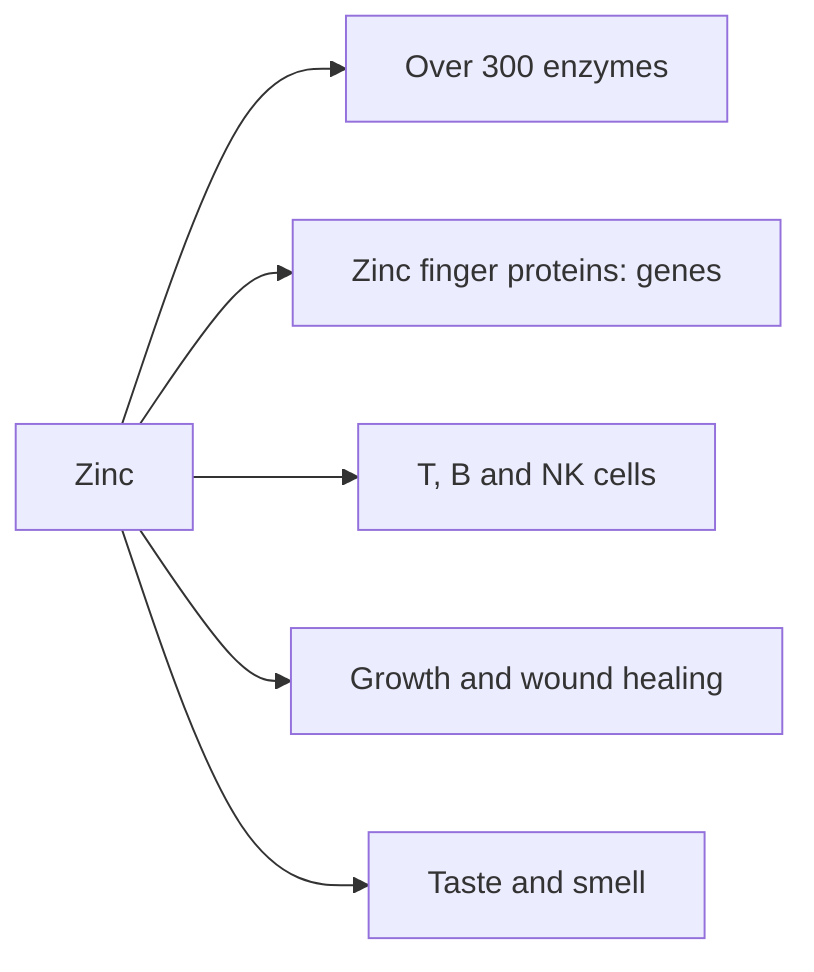

# Zinc

## Summary

Zinc is a trace element needed by more than 300 enzymes and by thousands of proteins that regulate genes. It supports immunity, growth and development, protein and DNA synthesis, wound healing, taste and smell. Deficiency causes poor growth, impaired immunity, hair loss, skin lesions and loss of taste. Zinc lozenges may shorten colds when started early. High doses cause copper deficiency.

*This note is educational. It is not medical advice and does not replace a doctor, dietitian or pharmacist, especially during pregnancy, illness or when taking medicines.*

## Prerequisites

- [Minerals overview](minerals-overview.md)

## Core concepts

### Definition

*Zinc* (Zn) is a trace element; the body contains about 2 to 3 g, mostly in muscle and bone. *Zinc finger proteins* use zinc to fold into shapes that bind DNA and regulate genes.

### Analogy

Zinc is like the clasp that holds many proteins in shape: without it, enzymes lose their active form and gene-regulating proteins cannot grip DNA. The analogy breaks because zinc also acts as a signal inside immune cells, not only as a structural clasp.

### Mechanism

- **Enzymes.** Catalytic or structural part of enzymes such as carbonic anhydrase, alcohol dehydrogenase, DNA and RNA polymerases and copper-zinc superoxide dismutase.
- **Gene regulation.** Zinc finger transcription factors.
- **Immunity.** Needed for development and function of T cells, B cells, NK cells and monocytes; deficiency causes thymus atrophy ([Nutrition and immunity](../foundations/nutrition-and-immunity.md)).
- **Growth and wound healing.** Cell division, protein synthesis and collagen formation.
- **Taste and smell.** Gustin, a zinc protein, affects taste.
- **Absorption.** Phytates in grains and legumes reduce zinc absorption; vegetarians may need up to 50 percent more.

The flowchart shows the main roles of zinc.

### Intake and food sources

| Item | Value |
| --- | --- |
| RDA | 11 mg men, 8 mg women |
| UL | 40 mg |
| Food sources | Oysters (very rich, about 30 to 75 mg per 100 g), beef, pork, chicken, crab, pumpkin and sesame seeds, cashews, wheat bran, brown rice, beans, lentils, fortified cereals |
| Supplement forms | Tablets, capsules, powders, lozenges; ointments and liquids for skin |

Long-term intake above 40 mg can cause copper deficiency, anemia and neurological problems.

### Proposed effects and evidence

Each entry states the proposed effect and how strong the human evidence is, using the grades defined in the [Evidence grades](../evidence-grades.md) note.

- **Immune support and shorter colds.** Zinc lozenges started within 24 hours shortened colds in a Cochrane review; dose and formulation matter. Evidence: moderate.
- **Skin health, acne and eczema.** Oral zinc shows modest benefit for acne in some trials; zinc oxide is used topically. Evidence: limited.
- **Growth and development.** Zinc supplements improve growth in deficient children. Evidence: strong.
- **Protein and DNA synthesis.** Essential for these processes. Evidence: established physiology.
- **Cognitive function.** Deficiency impairs cognition; supplements have unclear effects otherwise. Evidence: limited.
- **Antioxidant protection.** Part of superoxide dismutase; part of the AREDS formula for AMD. Evidence: moderate.
- **Prostate health.** The prostate is rich in zinc; supplements do not prevent prostate disease, and high doses may increase risk. Evidence: not supported.
- **Appetite and taste.** Deficiency causes loss of appetite and taste. Evidence: established physiology.
- **Cardiovascular health.** No consistent evidence. Evidence: very limited.
- **Wound healing.** Zinc helps healing in deficient patients; no benefit otherwise. Evidence: moderate.

## Worked example

At the first sign of a cold, a person takes zinc acetate lozenges providing about 75 to 90 mg zinc per day for 5 days, dissolving them slowly in the mouth. In the Cochrane review, this shortened colds by about a day on average. Side effects include a bad taste and nausea. Long-term use at this dose would cause copper deficiency.

## Trade offs and when to use it

Zinc deficiency is common in low-income countries; in well-fed populations, short-term high doses for colds are reasonable, but long-term high doses are harmful. Zinc nasal sprays caused permanent loss of smell and should not be used.

## Common mistakes

- **Taking high-dose zinc for months.** It causes copper deficiency.
- **Using zinc nasal sprays.** They have caused permanent loss of smell.

## Practice

1. Name three functions of zinc.
2. What is the UL for zinc?
3. When must zinc lozenges be started to help a cold?

### Answers

1. Enzyme cofactor, gene regulation, immunity (also growth, taste).
2. 40 mg per day.
3. Within 24 hours of symptoms.

## Further reading

- NIH Office of Dietary Supplements. Zinc: Fact Sheet for Health Professionals. [Link](https://ods.od.nih.gov/factsheets/Zinc-HealthProfessional/). Reference intakes, deficiency and evidence.
- Singh, M., Das, R. R. (2013). Zinc for the common cold. Cochrane Database of Systematic Reviews, CD001364. [DOI](https://doi.org/10.1002/14651858.CD001364.pub4). Cochrane review of zinc for the common cold.
