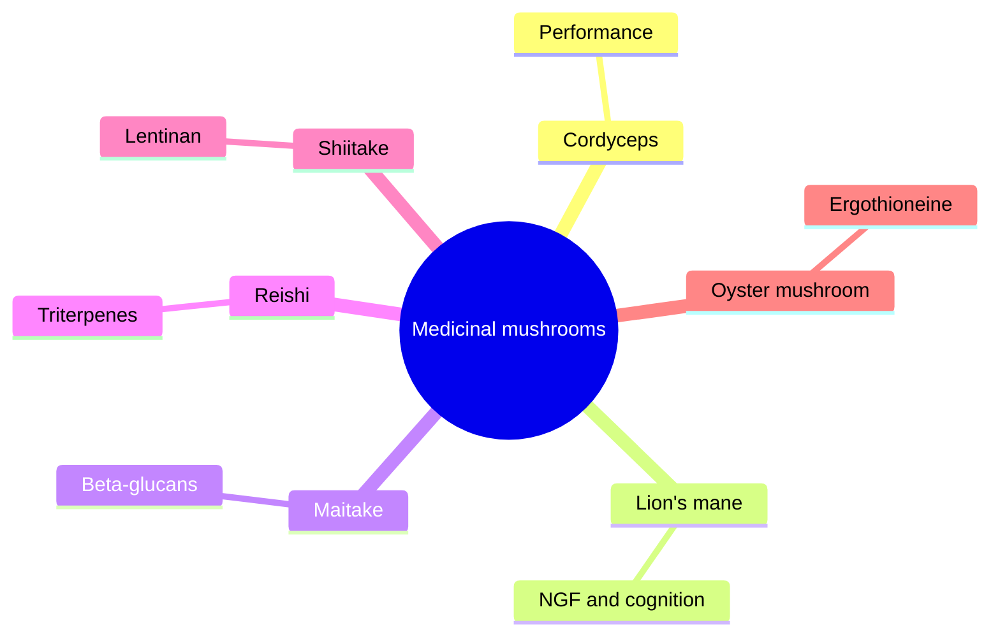

# Medicinal mushrooms

Several fungi used in traditional Chinese and Japanese medicine are sold as supplements: cordyceps, lion's mane, maitake, reishi and shiitake. They contain beta-glucans and other polysaccharides that affect the immune system, triterpenes and specific compounds. Edible mushrooms such as the oyster mushroom are also rich in ergothioneine. Laboratory and animal results are extensive; human evidence is limited, except for some use of mushroom-derived polysaccharides as cancer treatment adjuncts in Japan and China.

## Map

## Reading order

1. [Medicinal mushrooms overview](mushrooms-overview.md)
2. [Cordyceps](cordyceps.md)
3. [Lion's mane](lions-mane.md)
4. [Maitake](maitake.md)
5. [Reishi](reishi.md)
6. [Shiitake](shiitake.md)
7. [Oyster mushroom](oyster-mushroom.md)
