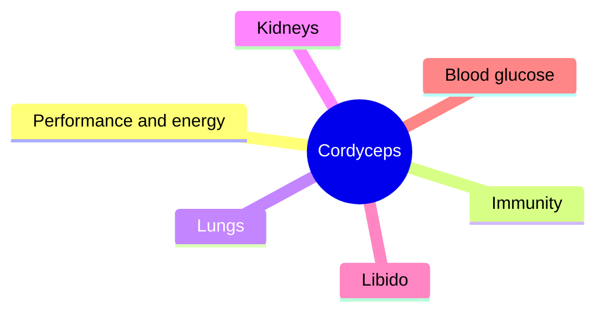

# Cordyceps

## Summary

Cordyceps is a genus of parasitic fungi used in traditional Chinese medicine. The best-known species are Cordyceps sinensis (now Ophiocordyceps sinensis, which grows on caterpillars and is extremely expensive) and Cordyceps militaris (cultivated). It is promoted as an adaptogen for energy, endurance, lungs, kidneys and libido. Small trials show inconsistent effects on exercise performance; most other claims rest on traditional use and laboratory studies.

*This note is educational. It is not medical advice and does not replace a doctor, dietitian or pharmacist, especially during pregnancy, illness or when taking medicines.*

## Prerequisites

- [Medicinal mushrooms overview](mushrooms-overview.md)

## Core concepts

### Definition

*Cordyceps* is a genus of ascomycete fungi. Commercial products mostly use cultivated C. militaris or fermented mycelium (Cs-4). *Cordycepin* (3'-deoxyadenosine) is a characteristic compound of C. militaris. An *adaptogen* is a substance claimed to increase resistance to stress, a concept with no clear pharmacological definition.

### Analogy

Cordyceps is described as a turbocharger for the body's oxygen use. In practice, studies show at most a small boost, and only in some people. The analogy breaks because no consistent mechanism for a turbo effect has been found.

### Mechanism

Cordycepin resembles adenosine and affects cell signaling. Polysaccharides modulate immune cells. Proposed performance mechanisms include increased ATP production and better oxygen use, but studies are inconsistent.

The mindmap shows claimed uses of cordyceps.

### Proposed effects and evidence

Each entry states the proposed effect and how strong the human evidence is, using the grades defined in the [Evidence grades](../evidence-grades.md) note.

- **Better physical performance and oxygen use.** Small trials; C. militaris improved some measures after 3 weeks in one study, others found no effect. Evidence: limited.
- **Immune support.** Laboratory and small human studies. Evidence: very limited.
- **Anti-inflammatory action.** Laboratory studies. Evidence: very limited.
- **Lung health in asthma and bronchitis.** Traditional use; small low-quality trials. Evidence: very limited.
- **Kidney health in chronic kidney disease.** Chinese trials of low quality. Evidence: limited.
- **Libido and sexual function.** Traditional use; little evidence. Evidence: very limited.
- **Anticancer effects.** Laboratory studies. Evidence: very limited.
- **Cardiovascular health.** Animal studies. Evidence: very limited.
- **Blood glucose regulation.** Animal studies. Evidence: very limited.
- **Liver protection.** Animal studies. Evidence: very limited.
- **Better mood and less fatigue.** Little evidence. Evidence: very limited.

## Worked example

In a study (Hirsch and colleagues, 2017), 28 young adults took a C. militaris mushroom blend (4 g daily). After 3 weeks, VO2 max and time to exhaustion improved slightly more than placebo, while there was no effect after 1 week. The study was small, used a blend, and was industry related.

## Trade offs and when to use it

Cordyceps appears safe in short-term use; wild Ophiocordyceps is very expensive and often adulterated. It may interact with immunosuppressants and anticoagulants.

## Common mistakes

- **Expecting large performance gains.** Effects are small or absent.
- **Buying expensive "wild" cordyceps.** Cultivated C. militaris is the usual product.

## Practice

1. What is cordycepin?
2. Why is wild Cordyceps sinensis expensive?
3. What is the evidence for performance?

### Answers

1. An adenosine-like compound from C. militaris.
2. It grows only on caterpillars in high mountain regions.
3. Small, inconsistent trials.

## Further reading

- Hirsch, K. R., Smith-Ryan, A. E., Roelofs, E. J. et al. (2017). Cordyceps militaris improves tolerance to high-intensity exercise after acute and chronic supplementation. Journal of Dietary Supplements, 14(1), 42-53. [DOI](https://doi.org/10.1080/19390211.2016.1203386). Trial of C. militaris and exercise tolerance.
- Wasser, S. P. (2002). Medicinal mushrooms as a source of antitumor and immunomodulating polysaccharides. Applied Microbiology and Biotechnology, 60(3), 258-274. [DOI](https://doi.org/10.1007/s00253-002-1076-7). Review of medicinal mushrooms.
