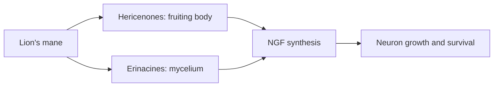

# Lion's mane

## Summary

Lion's mane (Hericium erinaceus) is an edible mushroom native to Asia, North America and Europe, including Poland, where it is rare and strictly protected and must not be picked. It contains hericenones (in the fruiting body) and erinacines (in the mycelium), which stimulate the synthesis of nerve growth factor (NGF) in laboratory studies. NGF supports the survival and growth of neurons. Small human trials suggest modest cognitive benefits in mild cognitive impairment; claims for Alzheimer and Parkinson disease, anxiety and depression rest on preliminary evidence.

*This note is educational. It is not medical advice and does not replace a doctor, dietitian or pharmacist, especially during pregnancy, illness or when taking medicines.*

## Prerequisites

- [Medicinal mushrooms overview](mushrooms-overview.md)

## Core concepts

### Definition

*Lion's mane* (Hericium erinaceus, also called Yamabushitake) is a tooth fungus. *Nerve growth factor* (NGF) is a neurotrophin that regulates growth, maintenance and survival of certain neurons. NGF was discovered by Rita Levi-Montalcini in the 1950s, and the discovery of growth factors was awarded the Nobel Prize in 1986 (with Stanley Cohen).

### Analogy

Lion's mane compounds are thought to act like a gardener's fertilizer for nerve cells: NGF helps neurons grow branches and survive. The analogy breaks because it is unclear how much of these compounds reach the brain in humans.

### Mechanism

Hericenones and erinacines cross into cells and increase NGF and brain-derived neurotrophic factor (BDNF) expression in laboratory and animal studies. NGF has neuroprotective effects (protects neurons from degeneration) and neurotrophic effects (regulates their differentiation and growth). Beta-glucans contribute immune effects.

**Product quality.** It is important that extracts be standardized for active compounds. For lion's mane, the content of hericenones and erinacines is usually not controlled; extracts are standardized for polysaccharides and beta-glucans instead.

The flowchart shows the proposed mechanism.

### Proposed effects and evidence

Each entry states the proposed effect and how strong the human evidence is, using the grades defined in the [Evidence grades](../evidence-grades.md) note.

- **Prevention of neurodegenerative diseases.** Animal studies. Evidence: very limited.
- **Support in Alzheimer and Parkinson disease.** Animal and small pilot human studies. Evidence: very limited.
- **Anti-anxiety and antidepressant effects.** Small human trials. Evidence: limited.
- **Better concentration, memory and learning.** A 16-week trial in mild cognitive impairment showed improved scores that faded after stopping. Evidence: limited.
- **Immune support and anti-inflammatory action.** Laboratory and animal studies. Evidence: very limited.
- **Cardiovascular support: blood pressure and cholesterol via beta-glucans.** Animal studies. Evidence: very limited.
- **Liver protection and digestion.** Animal studies; traditional use for stomach complaints. Evidence: very limited.
- **Nerve regeneration after injury.** Animal studies of peripheral nerve injury showed faster recovery. Evidence: very limited.
- **Better sleep quality.** One small study in women with menopausal symptoms. Evidence: very limited.

## Worked example

In a Japanese trial (Mori and colleagues, 2009), 30 older adults with mild cognitive impairment took 3 g dried lion's mane fruiting body daily or placebo for 16 weeks. Cognitive scores improved in the mushroom group, but declined again 4 weeks after stopping. The trial was small.

## Trade offs and when to use it

Lion's mane is a safe culinary mushroom; supplements are generally well tolerated, but rare allergic reactions occur. Wild specimens in Poland are protected.

## Common mistakes

- **Picking wild lion's mane in Poland.** It is strictly protected.
- **Assuming products contain hericenones and erinacines.** Most are standardized only for polysaccharides.

## Practice

1. Which compounds in lion's mane stimulate NGF?
2. What does NGF do?
3. What did the 2009 trial find?

### Answers

1. Hericenones and erinacines.
2. It supports growth, maintenance and survival of neurons.
3. Improved cognitive scores in mild cognitive impairment that faded after stopping.

## Further reading

- Mori, K., Inatomi, S., Ouchi, K. et al. (2009). Improving effects of the mushroom Yamabushitake (Hericium erinaceus) on mild cognitive impairment: a double-blind placebo-controlled clinical trial. Phytotherapy Research, 23(3), 367-372. [DOI](https://doi.org/10.1002/ptr.2634). Trial of lion's mane in mild cognitive impairment.
- Levi-Montalcini, R. (1987). The nerve growth factor 35 years later. Science, 237(4819), 1154-1162. [DOI](https://doi.org/10.1126/science.3306916). History of nerve growth factor by its discoverer.
