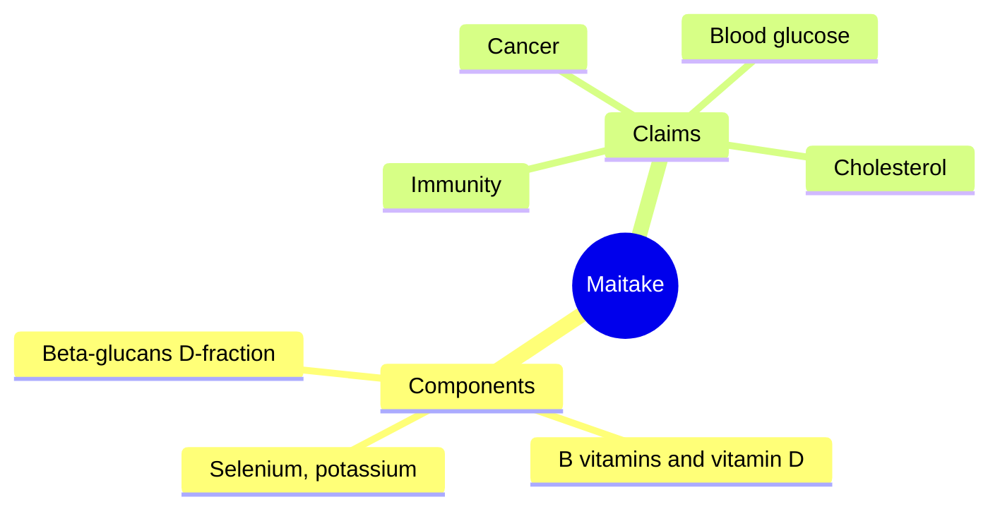

# Maitake

## Summary

Maitake (Grifola frondosa), the "dancing mushroom" or "hen of the woods", is an edible mushroom used in Japanese and Chinese traditional medicine and as a supplement. It contains beta-glucans (the D-fraction and MD-fraction), B vitamins, vitamin D (when exposed to UV light) and minerals. It is studied for immune modulation, cancer and blood glucose control, mostly in laboratory and animal studies with a few small human trials.

*This note is educational. It is not medical advice and does not replace a doctor, dietitian or pharmacist, especially during pregnancy, illness or when taking medicines.*

## Prerequisites

- [Medicinal mushrooms overview](mushrooms-overview.md)

## Core concepts

### Definition

*Maitake* is a polypore mushroom that grows at the base of trees. The *D-fraction* is a protein-bound beta-glucan extract developed in Japan.

### Analogy

Maitake is like a fungal training partner for the immune system: its beta-glucans give immune cells something to react to. The analogy breaks because a "training effect" in humans has not been shown to prevent disease.

### Mechanism

Beta-glucans (D-fraction) activate macrophages, T cells and NK cells in laboratory studies and in some human studies. Maitake extracts lowered blood glucose in diabetic animals, possibly through effects on insulin sensitivity. Maitake contains selenium, potassium, calcium, magnesium, B vitamins and vitamin D.

The mindmap shows maitake's components and claims.

### Proposed effects and evidence

Each entry states the proposed effect and how strong the human evidence is, using the grades defined in the [Evidence grades](../evidence-grades.md) note.

- **Immune support.** Increased immune cell activity in a small trial in breast cancer patients. Evidence: limited.
- **Anticancer effects.** Laboratory and animal studies; small uncontrolled human studies. Evidence: very limited.
- **Blood glucose regulation and insulin sensitivity.** Animal studies. Evidence: very limited.
- **Anti-inflammatory action.** Laboratory studies. Evidence: very limited.
- **Heart health: cholesterol and blood pressure.** Animal studies. Evidence: very limited.
- **Antioxidant action.** Laboratory studies. Evidence: very limited.
- **Weight control.** Animal studies. Evidence: very limited.
- **Prebiotic effect on gut bacteria.** Laboratory studies. Evidence: very limited.
- **Liver protection.** Animal studies. Evidence: very limited.
- **Better physical condition and recovery.** No meaningful evidence. Evidence: very limited.

## Worked example

In a phase I/II trial at Memorial Sloan Kettering, postmenopausal women after breast cancer treatment took maitake extract at various doses. Some immune parameters changed in both directions depending on dose, illustrating that "immune boosting" is not a simple up or down effect.

## Trade offs and when to use it

Maitake is a good culinary mushroom. Extracts may lower blood glucose and interact with diabetes drugs and warfarin.

## Common mistakes

- **Using maitake to treat cancer.** Evidence is insufficient.
- **Combining with diabetes drugs without advice.** It may lower blood glucose further.

## Practice

1. What is the D-fraction?
2. Name two minerals in maitake.
3. What is the main evidence base for maitake?

### Answers

1. A protein-bound beta-glucan extract from maitake.
2. Selenium and potassium (also calcium, magnesium).
3. Laboratory and animal studies with few small human trials.

## Further reading

- Wasser, S. P. (2002). Medicinal mushrooms as a source of antitumor and immunomodulating polysaccharides. Applied Microbiology and Biotechnology, 60(3), 258-274. [DOI](https://doi.org/10.1007/s00253-002-1076-7). Review of medicinal mushroom polysaccharides.
