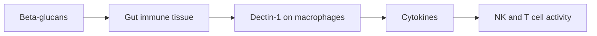

# Medicinal mushrooms overview

## Summary

Medicinal mushrooms are fungi used for their health-related compounds rather than only as food. Their main active components are beta-glucans (polysaccharides that interact with immune receptors), triterpenes (in reishi), and specific compounds such as cordycepin, hericenones and erinacines. Supplements are usually extracts standardized to polysaccharide content. Human trials are few and small; quality and standardization of products vary.

*This note is educational. It is not medical advice and does not replace a doctor, dietitian or pharmacist, especially during pregnancy, illness or when taking medicines.*

## Prerequisites

No prior notes are needed.

## Core concepts

### Definition

*Medicinal mushrooms* are macroscopic fungi used in traditional medicine and as supplements. *Beta-glucans* are glucose polymers with beta(1,3) and beta(1,6) bonds found in fungal cell walls. *Fruiting body* is the visible mushroom; *mycelium* is the root-like network, often grown on grain, which dilutes the product with starch.

### Analogy

Beta-glucans are like the uniform of a fungus that the immune system recognizes. Seeing the uniform puts immune cells on alert. Eating mushroom extracts is like showing the uniform to the guards in the gut, who may then be more vigilant. The analogy breaks because it is unclear how much this "alert" helps healthy people.

### Mechanism

Beta-glucans bind receptors such as dectin-1 and complement receptor 3 on macrophages, dendritic cells and NK cells, mainly in the gut-associated lymphoid tissue. This can increase cytokine production and immune cell activity. Triterpenes (ganoderic acids) have anti-inflammatory effects in the laboratory. Hot water extraction concentrates polysaccharides; alcohol extraction concentrates triterpenes.

The flowchart shows how mushroom beta-glucans interact with immunity.

### Proposed effects and evidence

Each entry states the proposed effect and how strong the human evidence is, using the grades defined in the [Evidence grades](../evidence-grades.md) note.

- **Immune modulation by beta-glucans.** Shown in laboratory and small human studies. Evidence: limited.
- **Cancer treatment adjunct (lentinan, PSK).** Used in Japan with chemotherapy; some meta-analyses show improved survival in gastric cancer. Evidence: limited.

## Worked example

Two lion's mane supplements cost the same. One is fruiting body extract standardized to 30 percent beta-glucans; the other is mycelium grown on oats with 10 percent beta-glucans and 40 percent starch. The label "mushroom powder" hides this difference, which matters if any effect depends on dose.

## Trade offs and when to use it

Medicinal mushrooms are generally safe as food; extracts can interact with immunosuppressants and anticoagulants, and some (reishi) have rare reports of liver toxicity.

## Common mistakes

- **Assuming all mushroom products are equal.** Check fruiting body versus mycelium and standardization.
- **Using mushrooms instead of cancer treatment.** Evidence supports only adjunct use in specific settings.

## Practice

1. What are beta-glucans?
2. What is the difference between fruiting body and mycelium products?
3. Which receptor binds beta-glucans?

### Answers

1. Glucose polymers in fungal cell walls that interact with immune receptors.
2. Mycelium is often grown on grain, adding starch and diluting active compounds.
3. Dectin-1.

## Further reading

- Wasser, S. P. (2002). Medicinal mushrooms as a source of antitumor and immunomodulating polysaccharides. Applied Microbiology and Biotechnology, 60(3), 258-274. [DOI](https://doi.org/10.1007/s00253-002-1076-7). Review of medicinal mushroom polysaccharides.
