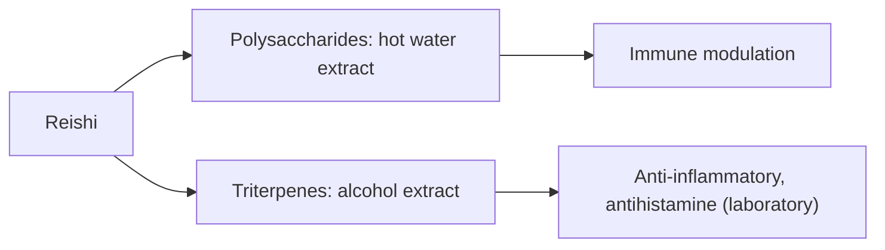

# Reishi

## Summary

Reishi (Ganoderma lucidum), the "mushroom of immortality" in traditional Chinese medicine, is a woody, bitter mushroom used as dried slices, powders, extracts, capsules and tea. It contains polysaccharides (beta-glucans), triterpenes (ganoderic acids), peptides and sterols. It is promoted for immunity, cancer, stress and sleep. A Cochrane review found that reishi used alongside cancer treatment may improve immune markers and quality of life, but evidence is low quality and there is no evidence of longer survival. Rare cases of liver toxicity have been reported.

*This note is educational. It is not medical advice and does not replace a doctor, dietitian or pharmacist, especially during pregnancy, illness or when taking medicines.*

## Prerequisites

- [Medicinal mushrooms overview](mushrooms-overview.md)

## Core concepts

### Definition

*Reishi* (lingzhi) is a polypore fungus. *Ganoderic acids* are its bitter triterpenes, concentrated by alcohol extraction; polysaccharides are concentrated by hot water extraction.

### Analogy

Reishi is like a slow herbal tonic in tradition: taken daily for long periods to "balance" the body. Modern research looks for specific effects and finds mostly modest immune changes. The analogy breaks because "balance" is not a measurable outcome.

### Mechanism

Polysaccharides stimulate immune cells (T cells, macrophages, NK cells). Triterpenes inhibit enzymes such as 5-alpha-reductase and have anti-inflammatory and anti-histamine effects in the laboratory.

The flowchart shows reishi's two groups of compounds.

### Proposed effects and evidence

Each entry states the proposed effect and how strong the human evidence is, using the grades defined in the [Evidence grades](../evidence-grades.md) note.

- **Immune support.** Increased some immune markers in cancer patients in low-quality trials. Evidence: limited.
- **Anticancer effects.** Cochrane: possible benefit as adjunct for response and quality of life; no survival evidence. Evidence: limited.
- **Anti-inflammatory action.** Laboratory studies. Evidence: very limited.
- **Antioxidant action.** Laboratory studies. Evidence: very limited.
- **Heart health: cholesterol and blood pressure.** Small trials, inconsistent. Evidence: limited.
- **Better sleep and less stress, anxiety and depression.** Small trials, e.g. in fatigue; low quality. Evidence: very limited.
- **Liver protection.** Animal studies; paradoxically, rare cases of liver toxicity from powders. Evidence: very limited.
- **Physical fitness and endurance.** No meaningful evidence. Evidence: very limited.
- **Gut health and prebiotic effect.** Laboratory studies. Evidence: very limited.
- **Allergy relief.** Laboratory studies of triterpenes. Evidence: very limited.

## Worked example

A person with cancer considers reishi. The Cochrane review (Jin and colleagues, 2016) found that patients receiving reishi alongside chemotherapy or radiotherapy were more likely to respond to treatment and had better immune markers, but trials were small, from China, and of low quality. Reishi should only be used with the oncologist's knowledge.

## Trade offs and when to use it

Reishi may increase bleeding risk with anticoagulants and interact with immunosuppressants and blood pressure medicines.

## Common mistakes

- **Using reishi instead of treatment.** There is no survival evidence.
- **Ignoring liver warning signs.** Stop if jaundice or dark urine appears.

## Practice

1. What are ganoderic acids?
2. Which extraction concentrates polysaccharides?
3. What did the Cochrane review find?

### Answers

1. Bitter triterpenes of reishi.
2. Hot water extraction.
3. Possible adjunct benefits on response and quality of life, low-quality evidence, no survival data.

## Further reading

- Jin, X., Ruiz Beguerie, J., Sze, D. M. et al. (2016). Ganoderma lucidum (Reishi mushroom) for cancer treatment. Cochrane Database of Systematic Reviews, CD007731. [DOI](https://doi.org/10.1002/14651858.CD007731.pub3). Cochrane review of reishi for cancer.
