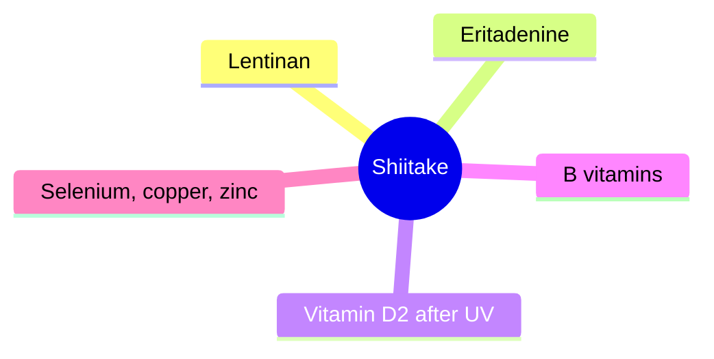

# Shiitake

## Summary

Shiitake (Lentinula edodes) is one of the most widely eaten mushrooms worldwide and is also used as a supplement. It contains the beta-glucan lentinan, protein, B vitamins, vitamin D (after UV exposure), selenium, copper and zinc, and eritadenine, which lowers cholesterol in animals. Purified lentinan is approved in Japan as an injectable adjunct to chemotherapy for gastric cancer. Eating raw or undercooked shiitake can cause a characteristic whip-like rash (shiitake dermatitis).

*This note is educational. It is not medical advice and does not replace a doctor, dietitian or pharmacist, especially during pregnancy, illness or when taking medicines.*

## Prerequisites

- [Medicinal mushrooms overview](mushrooms-overview.md)

## Core concepts

### Definition

*Shiitake* is a saprophytic mushroom traditionally cultivated on logs. *Lentinan* is a beta(1,3)-glucan with beta(1,6) branches isolated from shiitake.

### Analogy

Lentinan is like a drill instructor for the immune system: in hospital use, it is given alongside chemotherapy to keep immune cells active. Eating shiitake provides a small, gentle version of this signal. The analogy breaks because oral lentinan in food is not equivalent to injected purified lentinan.

### Mechanism

Lentinan activates macrophages, T cells and NK cells. Eritadenine reduces cholesterol in animal studies by affecting phospholipid metabolism. UV-exposed shiitake produce vitamin D2.

The mindmap shows shiitake's components.

### Proposed effects and evidence

Each entry states the proposed effect and how strong the human evidence is, using the grades defined in the [Evidence grades](../evidence-grades.md) note.

- **Immune support.** A 4-week trial of daily shiitake improved some immune markers in healthy adults. Evidence: limited.
- **Anticancer effects of lentinan.** Injectable lentinan with chemotherapy improved survival in gastric cancer meta-analyses in Japan. Evidence: limited.
- **Anti-inflammatory action.** Small human trials. Evidence: limited.
- **Heart health: lower LDL and blood pressure.** Animal studies with eritadenine. Evidence: very limited.
- **Antioxidant action.** Laboratory studies. Evidence: very limited.
- **Liver support.** Animal studies. Evidence: very limited.
- **Prebiotic effect.** Laboratory studies. Evidence: very limited.
- **Antiviral and antibacterial effects.** Laboratory studies. Evidence: very limited.
- **Weight control.** Animal studies. Evidence: very limited.
- **Skin health.** No meaningful evidence; raw shiitake can cause dermatitis. Evidence: very limited.

## Worked example

A person eats a stir-fry with lightly cooked shiitake and develops itchy, linear streaks on the skin two days later, looking like whip marks. This is shiitake dermatitis, a reaction to lentinan from raw or undercooked mushrooms; it resolves in 1 to 2 weeks. Thorough cooking prevents it.

## Trade offs and when to use it

Shiitake are nutritious and safe when well cooked.

## Common mistakes

- **Eating raw or undercooked shiitake.** Cook thoroughly to avoid dermatitis.
- **Equating dietary shiitake with lentinan treatment.** Clinical lentinan is purified and injected.

## Practice

1. What is lentinan?
2. Where is lentinan approved as a drug?
3. What causes shiitake dermatitis?

### Answers

1. A beta-glucan from shiitake.
2. In Japan, as an adjunct for gastric cancer.
3. Eating raw or undercooked shiitake.

## Further reading

- Wasser, S. P. (2002). Medicinal mushrooms as a source of antitumor and immunomodulating polysaccharides. Applied Microbiology and Biotechnology, 60(3), 258-274. [DOI](https://doi.org/10.1007/s00253-002-1076-7). Review of mushroom polysaccharides including lentinan.
