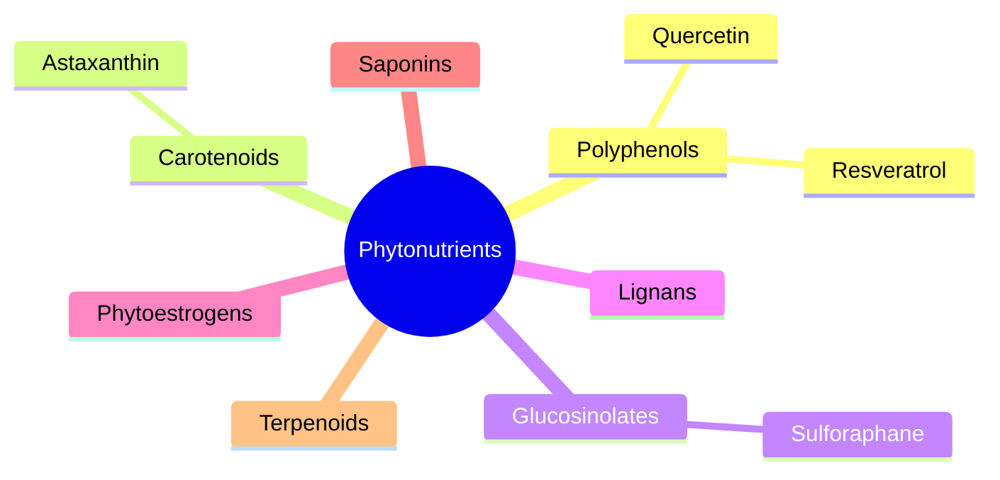

# Phytonutrients

Phytonutrients (phytochemicals) are compounds made by plants that are not essential nutrients but may affect health. These notes give an overview, describe the seven main classes (polyphenols, carotenoids, glucosinolates, lignans, phytoestrogens, saponins and terpenoids), and cover four compounds sold as supplements: resveratrol, quercetin, astaxanthin and sulforaphane.

## Map

## Reading order

1. [Phytonutrients overview](overview.md)
2. [Polyphenols](polyphenols.md)
3. [Carotenoids](carotenoids.md)
4. [Glucosinolates](glucosinolates.md)
5. [Lignans](lignans.md)
6. [Phytoestrogens](phytoestrogens.md)
7. [Saponins](saponins.md)
8. [Terpenoids](terpenoids.md)
9. [Resveratrol](resveratrol.md)
10. [Quercetin](quercetin.md)
11. [Astaxanthin](astaxanthin.md)
12. [Sulforaphane](sulforaphane.md)
