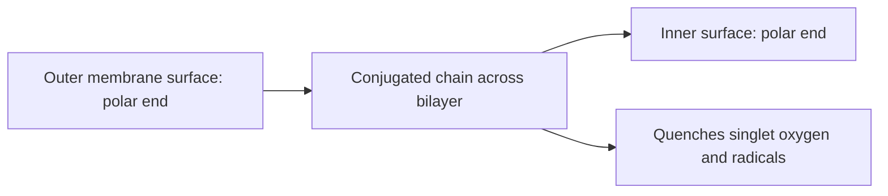

# Astaxanthin

## Summary

Astaxanthin is a red xanthophyll carotenoid produced by microalgae such as Haematococcus pluvialis and accumulated by salmon, trout, shrimp, krill and crabs, which it colors pink. It is a strong antioxidant that spans cell membranes. Marketing claims that it is 6,000 times stronger than vitamin C come from specific laboratory assays and do not translate to effects in the body. Small human trials suggest modest benefits for skin, eye fatigue and some blood markers.

*This note is educational. It is not medical advice and does not replace a doctor, dietitian or pharmacist, especially during pregnancy, illness or when taking medicines.*

## Prerequisites

- [Carotenoids](carotenoids.md)

## Core concepts

### Definition

*Astaxanthin* (3,3'-dihydroxy-beta,beta-carotene-4,4'-dione) is a xanthophyll carotenoid. It is not converted to vitamin A. Supplements come from algae (natural) or are synthesized; synthetic astaxanthin is mainly used in fish feed.

### Analogy

Astaxanthin is like a lightning rod that crosses the whole wall of a building: its two polar ends anchor on both sides of the cell membrane, and its long middle absorbs dangerous energy. The analogy breaks because a good lightning rod in the test tube does not mean fewer "fires" in the human body.

### Mechanism

Its polar end groups and long conjugated chain let it span the lipid bilayer and quench singlet oxygen and radicals inside and on the surface of membranes. In laboratory studies, it reduces inflammatory signaling (NF-kB) and lipid peroxidation.

**The "6,000 times" claim.** Figures such as 6,000 times stronger than vitamin C, 550 times stronger than vitamin E and 40 times stronger than beta-carotene come from singlet oxygen quenching assays in the test tube. They do not measure effects in the body.

**Supplements.** Usually 4 to 12 mg daily in capsules or liquids. Wild salmon contains about 3 to 4 mg per 100 g.

The diagram shows astaxanthin in the membrane.

### Proposed effects and evidence

Each entry states the proposed effect and how strong the human evidence is, using the grades defined in the [Evidence grades](../evidence-grades.md) note.

- **Very strong antioxidant action.** Shown in assays; the "6,000 times vitamin C" figure does not reflect effects in the body. Evidence: limited.
- **Anti-inflammatory action.** Small trials show reduced inflammatory markers. Evidence: limited.
- **Cardiovascular health: lower LDL, triglycerides and higher HDL.** Small trials with mixed results. Evidence: limited.
- **Skin protection, moisture and elasticity.** Small trials show modest improvements in skin moisture and wrinkles. Evidence: limited.
- **Cognitive function.** Small trials in older adults. Evidence: very limited.
- **Eye health and less eye fatigue.** Small trials suggest reduced eye strain. Evidence: limited.
- **Better physical performance and recovery.** Mixed results. Evidence: limited.
- **Immune support and NK cell activity.** One small trial. Evidence: very limited.
- **Protection from neurodegenerative diseases.** Animal studies. Evidence: very limited.
- **Protection of DNA from oxidative damage.** Reduced a DNA damage marker in one small trial. Evidence: very limited.

## Worked example

In a small 8-week trial, healthy women taking 2 mg astaxanthin daily showed a reduction in a plasma DNA damage marker and increased immune response compared with placebo. Such results come from small studies of biomarkers, not health outcomes.

## Trade offs and when to use it

Astaxanthin appears safe up to about 12 mg daily; it can color stool reddish. Benefits remain unproven.

## Common mistakes

- **Believing the 6,000 times vitamin C claim.** It describes a test tube assay only.
- **Expecting it to replace sunscreen.** Effects on skin are small.

## Practice

1. Which organisms produce astaxanthin?
2. Why do salmon have pink flesh?
3. Is astaxanthin a provitamin A?

### Answers

1. Microalgae such as Haematococcus pluvialis.
2. They accumulate astaxanthin from their food.
3. No.

## Further reading

- Ambati, R. R., Phang, S. M., Ravi, S. et al. (2014). Astaxanthin: sources, extraction, stability, biological activities and its commercial applications: a review. Marine Drugs, 12(1), 128-152. [DOI](https://doi.org/10.3390/md12010128). Review of astaxanthin sources and biological activities.
