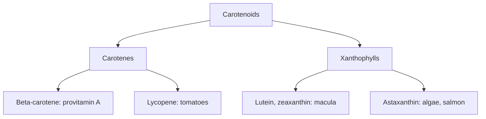

# Carotenoids

## Summary

Carotenoids are yellow, orange and red plant pigments, made of 40 carbon atoms. Some (beta-carotene, alpha-carotene, beta-cryptoxanthin) are converted to vitamin A; others (lutein, zeaxanthin, lycopene, astaxanthin) are not. They are antioxidants that quench singlet oxygen. Lutein and zeaxanthin protect the macula of the eye. Diets rich in carotenoid foods are linked to lower disease risk, but beta-carotene supplements increased lung cancer in smokers.

*This note is educational. It is not medical advice and does not replace a doctor, dietitian or pharmacist, especially during pregnancy, illness or when taking medicines.*

## Prerequisites

- [Phytonutrients overview](overview.md)

## Core concepts

### Definition

*Carotenoids* are tetraterpenoid pigments. *Carotenes* (beta-carotene, lycopene) contain only carbon and hydrogen; *xanthophylls* (lutein, zeaxanthin, astaxanthin) contain oxygen. They are fat-soluble and absorbed better with fat.

### Analogy

Carotenoids are like sunglasses for plants and for our eyes: they absorb high-energy blue light and quench reactive oxygen before it damages tissue. The analogy breaks because in high doses some carotenoids can switch to promoting oxidation, especially in smokers' lungs.

### Mechanism

- **Provitamin A.** Beta-carotene is cleaved into two retinal molecules ([Vitamin A](../vitamins/vitamin-a.md)).
- **Singlet oxygen quenching.** The long chain of conjugated double bonds absorbs energy from singlet oxygen.
- **Eye.** Lutein and zeaxanthin accumulate in the macula, filtering blue light; the AREDS2 trial used them in place of beta-carotene.
- **Lycopene** from tomatoes is better absorbed from cooked and oil-containing products (tomato sauce) than raw tomatoes.

**Main food sources.** Carrots, sweet potatoes, pumpkin, apricots (beta-carotene); tomatoes (lycopene); spinach, kale, egg yolks (lutein, zeaxanthin); salmon, shrimp (astaxanthin, [Astaxanthin](astaxanthin.md)).

The flowchart shows carotenoid types.

### Proposed effects and evidence

Each entry states the proposed effect and how strong the human evidence is, using the grades defined in the [Evidence grades](../evidence-grades.md) note.

- **Eye health and slower AMD progression.** Lutein and zeaxanthin in the AREDS2 formula slowed progression of advanced AMD. Evidence: moderate.
- **Lower prostate cancer risk from lycopene.** Observational associations with tomato products; trials limited. Evidence: limited.
- **Lung cancer prevention by beta-carotene.** Supplements increased lung cancer in smokers (ATBC, CARET). Evidence: not supported.
- **Heart disease prevention.** Observational associations with dietary carotenoids; supplement trials negative. Evidence: limited.

## Worked example

A person eats 100 g of carrots (about 8 mg beta-carotene) raw with no fat and absorbs a small fraction. Cooking the carrots and adding olive oil increases absorption several times. In contrast, a smoker taking 20 mg beta-carotene supplements daily in the ATBC trial had about 18 percent more lung cancer.

## Trade offs and when to use it

Carotenoids from food are safe; high intake only colors the skin yellow (carotenemia). Smokers and former asbestos workers should avoid beta-carotene supplements.

## Common mistakes

- **Eating carotenoid foods without fat.** Add oil or nuts to improve absorption.
- **Smokers taking beta-carotene supplements.** They increase lung cancer risk.

## Practice

1. Which carotenoids are provitamin A?
2. Which carotenoids protect the macula?
3. How can lycopene absorption be improved?

### Answers

1. Beta-carotene, alpha-carotene and beta-cryptoxanthin.
2. Lutein and zeaxanthin.
3. Eat cooked tomato products with oil.

## Further reading

- Rao, A. V., Rao, L. G. (2007). Carotenoids and human health. Pharmacological Research, 55(3), 207-216. [DOI](https://doi.org/10.1016/j.phrs.2007.01.012). Review of carotenoids and health.
- Alpha-Tocopherol, Beta Carotene Cancer Prevention Study Group (1994). The effect of vitamin E and beta carotene on the incidence of lung cancer and other cancers in male smokers. New England Journal of Medicine, 330(15), 1029-1035. [DOI](https://doi.org/10.1056/NEJM199404143301501). Beta-carotene trial in smokers.
- Age-Related Eye Disease Study Research Group (2001). A randomized, placebo-controlled, clinical trial of high-dose supplementation with vitamins C and E, beta carotene, and zinc for age-related macular degeneration and vision loss: AREDS report no. 8. Archives of Ophthalmology, 119(10), 1417-1436. [DOI](https://doi.org/10.1001/archopht.119.10.1417). AREDS trial.
