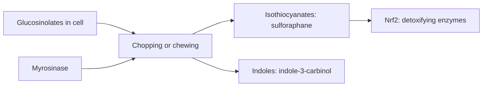

# Glucosinolates

## Summary

Glucosinolates are sulfur-containing compounds in cruciferous vegetables (broccoli, cauliflower, cabbage, Brussels sprouts, kale, rocket). When the plant is cut or chewed, the enzyme myrosinase converts them into isothiocyanates such as sulforaphane and indoles such as indole-3-carbinol. These compounds activate detoxifying enzymes in laboratory studies and are proposed to reduce cancer risk. Diets high in cruciferous vegetables are associated with modestly lower risk of some cancers.

*This note is educational. It is not medical advice and does not replace a doctor, dietitian or pharmacist, especially during pregnancy, illness or when taking medicines.*

## Prerequisites

- [Phytonutrients overview](overview.md)

## Core concepts

### Definition

*Glucosinolates* are beta-thioglucoside N-hydroxysulfates. *Myrosinase* is the plant enzyme that hydrolyzes them. *Isothiocyanates* (sulforaphane) and *indoles* (indole-3-carbinol) are the active breakdown products.

### Analogy

Glucosinolates are like a two-component glue stored in separate tubes inside the plant cell. Chewing or chopping mixes the tubes (glucosinolate meets myrosinase) and the active compound forms. The analogy breaks because gut bacteria can also mix the components, though less efficiently.

### Mechanism

When plant tissue is damaged, myrosinase converts glucoraphanin to sulforaphane, glucobrassicin to indole-3-carbinol, and so on. Cooking destroys myrosinase; gut bacteria still convert some glucosinolates, but less. Isothiocyanates activate Nrf2, inducing phase II detoxifying enzymes (glutathione S-transferases, quinone reductase) ([Sulforaphane](sulforaphane.md)).

**Practical tip.** Chopping broccoli and waiting about 40 minutes before cooking, or adding a little mustard seed powder (which contains myrosinase) to cooked broccoli, increases sulforaphane formation.

The flowchart shows activation of glucosinolates.

### Proposed effects and evidence

Each entry states the proposed effect and how strong the human evidence is, using the grades defined in the [Evidence grades](../evidence-grades.md) note.

- **Anticancer effects.** Laboratory and animal evidence; cohort studies show modestly lower risk of some cancers with cruciferous vegetables. Evidence: limited.
- **Support of detoxification.** Induces phase II enzymes in humans in small studies. Evidence: limited.
- **Lung cancer prevention by isothiocyanates.** Observational associations. Evidence: limited.

## Worked example

Broccoli sprouts contain 10 to 100 times more glucoraphanin than mature broccoli. In a trial in a polluted region of China, a broccoli sprout drink increased excretion of benzene and acrolein, air pollutants, through the glutathione pathway. Whether this reduces disease was not measured.

## Trade offs and when to use it

Cruciferous vegetables are healthy; very large raw intakes can affect thyroid function in people with iodine deficiency.

## Common mistakes

- **Overcooking broccoli.** Steam briefly or let chopped broccoli rest before cooking.
- **Expecting supplements to equal vegetables.** Many supplements lack active myrosinase.

## Practice

1. Which enzyme activates glucosinolates?
2. Name two breakdown products of glucosinolates.
3. How can sulforaphane formation be increased?

### Answers

1. Myrosinase.
2. Sulforaphane and indole-3-carbinol.
3. Chop broccoli and wait before cooking, or add mustard seed powder.

## Further reading

- Yagishita, Y., Fahey, J. W., Dinkova-Kostova, A. T. et al. (2019). Broccoli or sulforaphane: is it the source or dose that matters?. Molecules, 24(19), 3593. [DOI](https://doi.org/10.3390/molecules24193593). Review of broccoli, sulforaphane and dose.
