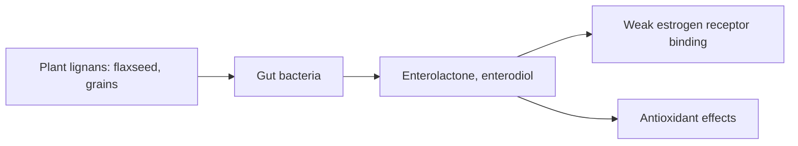

# Lignans

## Summary

Lignans are polyphenols found in seeds, whole grains, nuts and some vegetables, most abundantly in flaxseed. Gut bacteria convert plant lignans such as secoisolariciresinol into enterolignans (enterolactone and enterodiol), which have weak estrogen-like and antioxidant effects. Higher lignan intake is associated with lower cardiovascular risk and possibly lower breast cancer risk in postmenopausal women, but trials are few.

*This note is educational. It is not medical advice and does not replace a doctor, dietitian or pharmacist, especially during pregnancy, illness or when taking medicines.*

## Prerequisites

- [Phytonutrients overview](overview.md)

## Core concepts

### Definition

*Lignans* are diphenolic compounds formed from two phenylpropanoid units. *Enterolignans* (enterolactone, enterodiol) are the mammalian metabolites produced by gut bacteria. Lignans are also counted among the phytoestrogens.

### Analogy

Plant lignans are like a coded message that only the gut bacteria can decode. Without the right bacteria, the message (enterolactone) is not produced, and the effect is lost. The analogy breaks because the "decoded" message is weak compared with human estrogen.

### Mechanism

Plant lignans (secoisolariciresinol, matairesinol, pinoresinol, lariciresinol) are converted by colonic bacteria into enterodiol and enterolactone, which are absorbed. These bind estrogen receptors weakly, act as antioxidants and may affect hormone metabolism. Antibiotics reduce enterolactone production for weeks.

**Sources.** Flaxseed (by far the richest, about 300 mg per 100 g), sesame seeds, whole grains (rye, oats), nuts, legumes and some vegetables.

The flowchart shows lignan metabolism.

### Proposed effects and evidence

Each entry states the proposed effect and how strong the human evidence is, using the grades defined in the [Evidence grades](../evidence-grades.md) note.

- **Heart health.** Higher enterolactone associated with lower cardiovascular mortality in cohorts; flaxseed lowers blood pressure slightly in trials. Evidence: limited.
- **Hormonal health and breast cancer risk.** Associations in postmenopausal women; no trial proof. Evidence: limited.
- **Antioxidant effects.** Shown in the laboratory. Evidence: very limited.

## Worked example

Two tablespoons (about 20 g) of ground flaxseed provide about 60 mg lignans. Whole flaxseeds pass through the gut largely intact, so grinding them increases lignan release and also omega-3 (ALA) availability.

## Trade offs and when to use it

Ground flaxseed is a cheap, safe source; it adds fiber and alpha-linolenic acid.

## Common mistakes

- **Eating whole flaxseeds.** Grind them to release lignans.
- **Ignoring the role of gut bacteria.** Antibiotics reduce conversion to active forms.

## Practice

1. What is the richest food source of lignans?
2. What do gut bacteria make from plant lignans?
3. Why grind flaxseed?

### Answers

1. Flaxseed.
2. Enterolactone and enterodiol.
3. Whole seeds pass through undigested.

## Further reading

- Adlercreutz, H. (2007). Lignans and human health. Critical Reviews in Clinical Laboratory Sciences, 44(5-6), 483-525. [DOI](https://doi.org/10.1080/10408360701612942). Review of lignans and human health.
