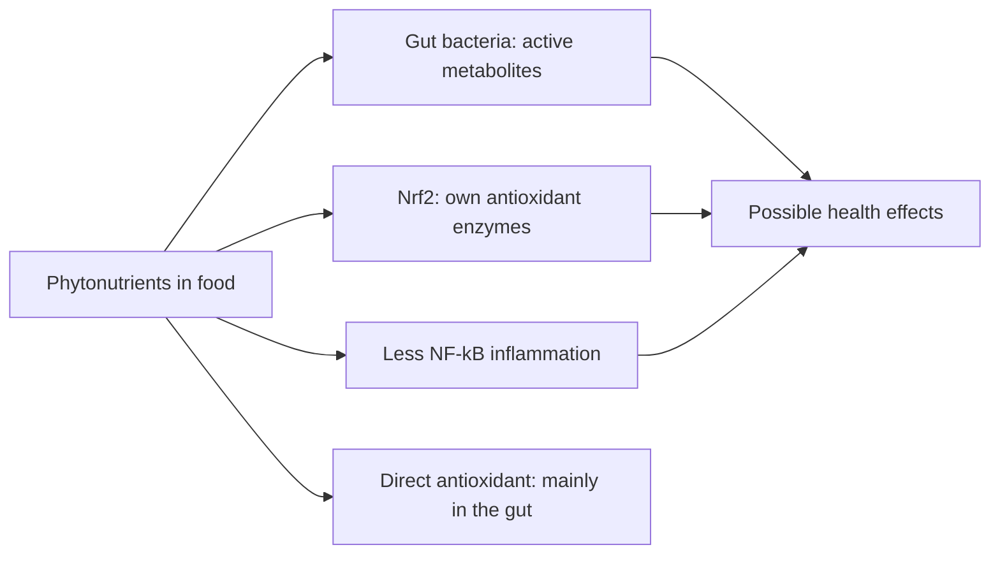

# Phytonutrients overview

## Summary

Phytonutrients are natural compounds in plants that may benefit human health. Many act as antioxidants, anti-inflammatory, antibacterial or antiviral agents in laboratory studies. Diets rich in vegetables, fruit, whole grains and seeds, which supply thousands of these compounds, are associated with lower risk of heart disease, cancer and early death. Evidence for single isolated compounds as supplements is much weaker, because many are poorly absorbed and the benefits of whole foods probably come from combinations.

*This note is educational. It is not medical advice and does not replace a doctor, dietitian or pharmacist, especially during pregnancy, illness or when taking medicines.*

## Prerequisites

- [Oxidative stress](../../../../natural-sciences/chemistry/biochemistry/oxidative-stress.md)

## Core concepts

### Definition

*Phytonutrients* (phytochemicals) are biologically active, non-essential compounds produced by plants, often for defense against insects, microbes and ultraviolet light, or as pigments. The main classes:

| Class | Description | Examples | Best sources |
| --- | --- | --- | --- |
| Polyphenols | Strongly antioxidant and anti-inflammatory compounds with several phenol rings | Quercetin, resveratrol, catechins | Berries, green tea, red wine, onions |
| Carotenoids | Plant pigments; some are precursors of vitamin A | Beta-carotene, lutein, zeaxanthin, lycopene | Carrots, sweet potatoes, spinach, peppers |
| Saponins | Anti-inflammatory and cholesterol-lowering compounds; may protect the liver | Soy saponins, ginsenosides | Soy, ginseng |
| Glucosinolates | Sulfur compounds with proposed anticancer and detoxifying effects | Sulforaphane, indole-3-carbinol | Broccoli, cauliflower, cabbage |
| Lignans | Estrogen-like and antioxidant compounds | Secoisolariciresinol, enterolactone | Flaxseed, whole grains, nuts |
| Phytoestrogens | Plant compounds that mimic estrogen | Isoflavones (genistein, daidzein), lignans | Soy, flaxseed, chickpeas |
| Terpenoids | Anti-inflammatory, antiviral and antioxidant compounds, often responsible for plant aroma | Limonene, linalool, menthol | Mint, lavender, citrus |

Note: the notes list secoiridoids as examples of lignans; secoiridoids (such as oleuropein in olives) are a separate group of polyphenols. The main dietary lignan is secoisolariciresinol, which gut bacteria convert to enterolactone.

### Analogy

Phytonutrients are like the plant's own security system: pigments act as sunscreen, bitter compounds deter insects, and antioxidants protect against the plant's own oxidative stress. Eating plants lets us borrow parts of this system. The analogy breaks because many of these compounds work in humans not as protectors themselves, but as mild stresses that switch on our own defense genes.

### Mechanism

**Why they matter.** Phytonutrients provide protective effects. Many have antioxidant properties in the test tube (as do vitamin C and flavonoids), which may protect against free radicals implicated in premature aging, cataract, heart disease and cancer. The best-studied groups are flavonoids and carotenoids.

**Proposed effects of polyphenols (mainly flavonoids)** found in onions, apples, grapes, green tea, buckwheat, red wine and herbs such as linden, hawthorn and elderberry:

- anti-asthmatic and anti-allergic effects;
- lower blood glucose in people with diabetes;
- protection of cholesterol from oxidation;
- antibacterial and antiviral effects;
- protection of DNA from ultraviolet damage;
- slowing of coronary heart disease;
- limiting the growth and spread of tumors.

**How they act in the body.** Many polyphenols are poorly absorbed and quickly metabolized; blood levels are far below those used in laboratory studies. Their effects may come from:

- activating the Nrf2 pathway, which switches on the body's own antioxidant and detoxifying enzymes (hormesis);
- modulating inflammatory signaling (NF-kB);
- effects in the gut, including on gut bacteria, which convert them into active metabolites.

**Commonly cited compounds.**

- Quercetin (a flavonoid in apples, grapes, onions and tea) is proposed to protect against cell changes leading to cancer and against heart disease ([Quercetin](quercetin.md)).
- Lycopene, a red carotenoid in tomatoes, is proposed to prevent heart disease and prostate cancer ([Carotenoids](carotenoids.md)).
- Beta-carotene, an orange carotenoid in apricots, pumpkin, carrots and peppers, is claimed to prevent lung cancer; supplements actually increased lung cancer in smokers.
- Saponins in onions, garlic and aloe are proposed to protect against infections, cancer and high cholesterol ([Saponins](saponins.md)).
- Isothiocyanates in cabbage, broccoli and Brussels sprouts may help prevent lung cancer ([Glucosinolates](glucosinolates.md)).
- Terpenes in oranges and grapefruit are proposed to prevent ulcers and dental caries ([Terpenoids](terpenoids.md)).

The diagram shows how phytonutrients are thought to act.

### Proposed effects and evidence

Each entry states the proposed effect and how strong the human evidence is, using the grades defined in the [Evidence grades](../evidence-grades.md) note.

- **Diets rich in plant foods lower cardiovascular disease and mortality.** About 8 to 10 percent lower risk per 200 g of fruit and vegetables daily in a meta-analysis of cohort studies. Evidence: moderate.
- **Isolated phytonutrient supplements prevent chronic disease.** Few trials; beta-carotene caused harm in smokers. Evidence: not supported.
- **Antioxidant effects in the body as in the test tube.** Blood levels are too low; effects likely work through signaling. Evidence: limited.

## Worked example

Eating 800 g of fruit and vegetables daily was associated with about 30 percent lower risk of early death compared with almost none in a 2017 meta-analysis (Aune and colleagues). A person aiming for this eats a variety of colors: red tomatoes (lycopene), orange carrots (beta-carotene), green broccoli (glucosinolates), purple berries (anthocyanins) and onions (quercetin).

## Trade offs and when to use it

Phytonutrients are best obtained from varied whole plant foods. Supplements concentrate single compounds and can interact with drugs.

## Common mistakes

- **Choosing a supplement over vegetables.** Whole foods provide combinations that supplements lack.
- **Treating test tube antioxidant capacity as health benefit.** Effects in the body are different.

## Practice

1. Name four classes of phytonutrients.
2. Why do polyphenols work at low blood levels?
3. Which carotenoid is found in tomatoes?

### Answers

1. Polyphenols, carotenoids, glucosinolates and terpenoids (also lignans, phytoestrogens, saponins).
2. They may act through signaling such as Nrf2 and through gut bacteria rather than as direct antioxidants.
3. Lycopene.

## Further reading

- Liu, R. H. (2003). Health benefits of fruit and vegetables are from additive and synergistic combinations of phytochemicals. American Journal of Clinical Nutrition, 78(3 Suppl), 517S-520S. [DOI](https://doi.org/10.1093/ajcn/78.3.517S). Review of additive and synergistic effects of phytochemicals.
- Manach, C., Scalbert, A., Morand, C. et al. (2004). Polyphenols: food sources and bioavailability. American Journal of Clinical Nutrition, 79(5), 727-747. [DOI](https://doi.org/10.1093/ajcn/79.5.727). Review of polyphenol sources and bioavailability.
- Aune, D., Giovannucci, E., Boffetta, P. et al. (2017). Fruit and vegetable intake and the risk of cardiovascular disease, total cancer and all-cause mortality: a systematic review and dose-response meta-analysis of prospective studies. International Journal of Epidemiology, 46(3), 1029-1056. [DOI](https://doi.org/10.1093/ije/dyw319). Meta-analysis of fruit and vegetable intake and mortality.
