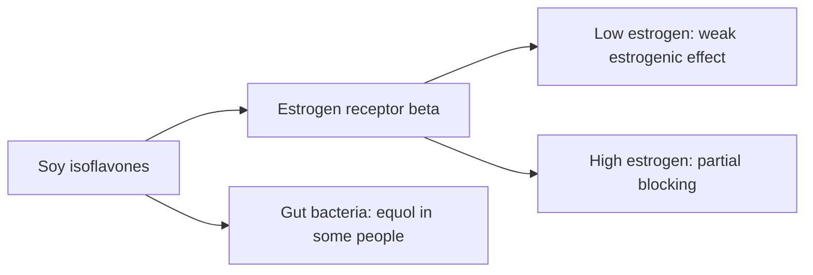

# Phytoestrogens

## Summary

Phytoestrogens are plant compounds structurally similar to estradiol that bind estrogen receptors weakly. The main types are isoflavones (genistein and daidzein in soy), lignans (flaxseed) and coumestans. They act as weak estrogens or anti-estrogens depending on tissue and hormone levels. Soy foods are associated with lower breast cancer risk in Asian populations and modestly reduce hot flashes; fears that soy foods harm men or women with breast cancer are not supported by current evidence.

*This note is educational. It is not medical advice and does not replace a doctor, dietitian or pharmacist, especially during pregnancy, illness or when taking medicines.*

## Prerequisites

- [Phytonutrients overview](overview.md)

## Core concepts

### Definition

*Phytoestrogens* are non-steroidal plant compounds that bind estrogen receptors, with a preference for estrogen receptor beta. *Isoflavones* (genistein, daidzein, glycitein) are found mainly in soy; *equol* is a more active metabolite of daidzein made by the gut bacteria of about 30 to 50 percent of people.

### Analogy

Phytoestrogens are like a key that fits the estrogen lock but turns it only a little. When real estrogen is low, the weak key adds some signal; when real estrogen is high, it occupies the lock and blocks the stronger key. The analogy breaks because effects also depend on which receptor subtype a tissue has.

### Mechanism

Isoflavones bind estrogen receptor beta more than alpha, giving tissue-selective effects. They also affect enzymes and signaling unrelated to estrogen. Fermented soy (miso, natto, tempeh) contains more of the absorbable aglycone forms.

**Sources.** Soy and soy foods (tofu, tempeh, soy milk, edamame), flaxseed, chickpeas and other legumes.

The flowchart shows the actions of isoflavones.

### Proposed effects and evidence

Each entry states the proposed effect and how strong the human evidence is, using the grades defined in the [Evidence grades](../evidence-grades.md) note.

- **Hormonal balance and fewer menopausal hot flashes.** Meta-analyses show modest reductions in hot flash frequency. Evidence: moderate.
- **Lower breast cancer risk.** Observational data in Asian populations with lifelong intake. Evidence: limited.
- **Bone health.** Small effects on bone density. Evidence: limited.
- **Harmful feminizing effects in men from soy foods.** Clinical studies show no effect on testosterone or estrogen at normal intakes. Evidence: not supported.

## Worked example

A 52-year-old woman with hot flashes adds two servings of soy foods (tofu and soy milk, about 50 mg isoflavones) daily. In meta-analyses, isoflavones reduced hot flash frequency by about 20 percent more than placebo, smaller than hormone therapy but meaningful for some women.

## Trade offs and when to use it

Soy foods are safe for most people. High-dose isoflavone supplements are less studied; people with hormone-sensitive conditions should discuss them with their doctor.

## Common mistakes

- **Avoiding soy foods out of fear for hormones.** Normal intake does not disturb hormones in men.
- **Assuming supplements equal soy foods.** Food matrix and dose differ.

## Practice

1. Which receptor do isoflavones prefer?
2. Name two soy isoflavones.
3. What is equol?

### Answers

1. Estrogen receptor beta.
2. Genistein and daidzein.
3. A more active metabolite of daidzein made by some people's gut bacteria.

## Further reading

- Messina, M. (2016). Soy and health update: evaluation of the clinical and epidemiologic literature. Nutrients, 8(12), 754. [DOI](https://doi.org/10.3390/nu8120754). Review of soy and health.
