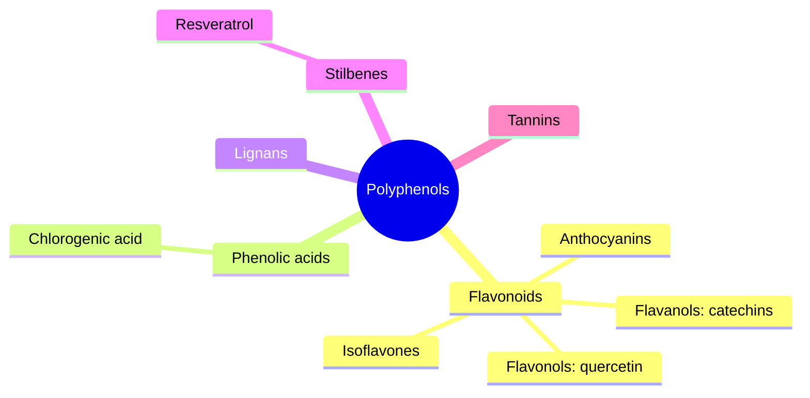

# Polyphenols

## Summary

Polyphenols are a large group of plant compounds with several phenol rings. They include flavonoids (anthocyanins, flavones, flavonols, isoflavones, catechins), phenolic acids (chlorogenic and ferulic acid), lignans, stilbenes (resveratrol) and tannins. They are antioxidant and anti-inflammatory in laboratory studies and may support heart health, metabolism and weight control. Diets rich in polyphenol foods such as cocoa, tea, berries and olive oil are associated with lower cardiovascular risk.

*This note is educational. It is not medical advice and does not replace a doctor, dietitian or pharmacist, especially during pregnancy, illness or when taking medicines.*

## Prerequisites

- [Phytonutrients overview](overview.md)

## Core concepts

### Definition

*Polyphenols* are compounds with multiple phenolic groups (aromatic rings with hydroxyl groups, -OH). This structure lets them neutralize free radicals and interact with proteins, enzymes and signaling pathways.

| Group | Characteristics | Examples |
| --- | --- | --- |
| Flavonoids | Largest group: anthocyanins, flavones, flavonols, isoflavones, flavanols (catechins) | Quercetin, rutin, epicatechin |
| Phenolic acids | Structures based on phenolic acids, common in plant foods | Chlorogenic acid, ferulic acid |
| Lignans | In seeds, grains and some vegetables; estrogen-like effects | Secoisolariciresinol, enterolactone |
| Stilbenes | Small group with a stilbene unit | Resveratrol |
| Tannins | Form complexes with proteins; astringent | Tannic acid |

### Analogy

Polyphenols are like a plant's rust protection: their ring structures absorb the "rust" (oxidation) before it reaches important parts. In the human body, they act more like smoke alarms that wake our own repair crews than like direct rust protection. The analogy breaks because many polyphenols also feed gut bacteria and change their composition.

### Mechanism

Polyphenol rings donate hydrogen atoms to free radicals and chelate metals. In the body, more important effects include modulating enzymes and signaling pathways (Nrf2, NF-kB), improving endothelial function (cocoa flavanols raise nitric oxide) and interacting with gut microbes. Absorption varies widely: isoflavones are absorbed well, anthocyanins and proanthocyanidins poorly.

**Best sources.**

- Fruit: berries, grapes, apples.
- Vegetables: broccoli, onions, spinach.
- Drinks: green and black tea, coffee.
- Nuts and seeds: walnuts, flaxseed.
- Spices: turmeric, cinnamon.

The mindmap shows the main groups.

### Proposed effects and evidence

Each entry states the proposed effect and how strong the human evidence is, using the grades defined in the [Evidence grades](../evidence-grades.md) note.

- **Heart health.** Cocoa flavanols and tea improve blood pressure and endothelial function slightly; the COSMOS trial found a non-significant reduction in cardiovascular events with cocoa flavanols. Evidence: limited.
- **Lower cancer risk.** Observational associations; no trial proof. Evidence: limited.
- **Metabolism and weight control.** Green tea catechins have small effects on weight. Evidence: limited.
- **Antioxidant and anti-inflammatory effects.** Shown in the laboratory; in the body mainly through signaling. Evidence: limited.

## Worked example

A person drinks 3 cups of green tea (about 300 mg catechins), eats a bowl of berries (about 300 mg anthocyanins) and uses olive oil daily. Their polyphenol intake is about 1 to 1.5 g, similar to the high-intake group in cohort studies that show lower cardiovascular risk. Such observations cannot separate the effect of polyphenols from the rest of a healthy diet.

## Trade offs and when to use it

Food sources are safe; high-dose green tea extract supplements have caused liver injury.

## Common mistakes

- **Taking high-dose green tea extract.** Rare but serious liver injury has been reported.
- **Expecting red wine to be a health food.** Alcohol risks outweigh polyphenol benefits.

## Practice

1. Name five groups of polyphenols.
2. Which polyphenol is a stilbene?
3. Why are polyphenol effects in the body different from test tube effects?

### Answers

1. Flavonoids, phenolic acids, lignans, stilbenes and tannins.
2. Resveratrol.
3. Absorption is low and metabolites act through signaling.

## Further reading

- Manach, C., Scalbert, A., Morand, C. et al. (2004). Polyphenols: food sources and bioavailability. American Journal of Clinical Nutrition, 79(5), 727-747. [DOI](https://doi.org/10.1093/ajcn/79.5.727). Review of polyphenol sources and bioavailability.
