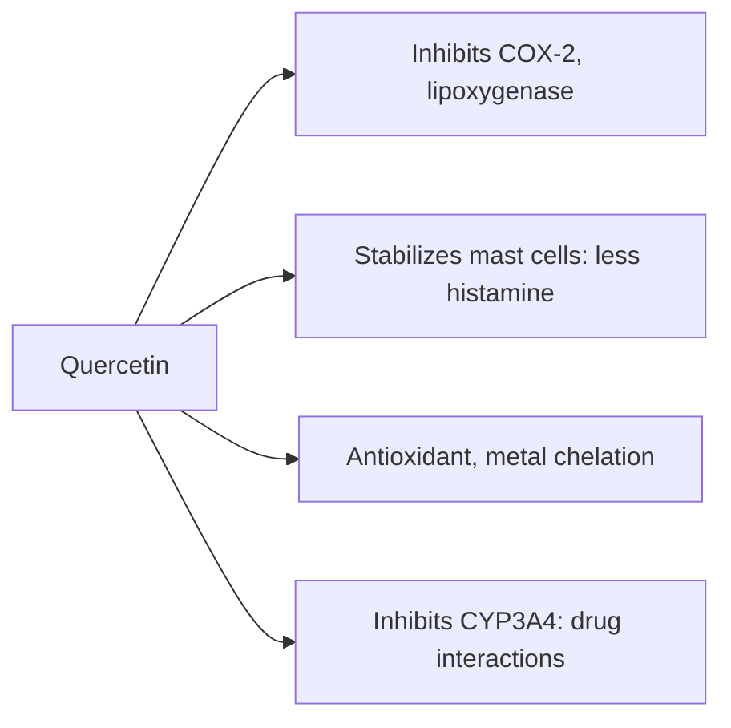

# Quercetin

## Summary

Quercetin is a flavonol, one of the most common flavonoids in the diet. It is found in onions, apples (with skin), grapes, berries, broccoli, kale, citrus, capers, tea and red wine. It is antioxidant, anti-inflammatory, antiviral and inhibits histamine release in laboratory studies. In humans, a meta-analysis found that doses of 500 mg or more daily lowered blood pressure slightly; other claims are mostly from laboratory or animal research.

*This note is educational. It is not medical advice and does not replace a doctor, dietitian or pharmacist, especially during pregnancy, illness or when taking medicines.*

## Prerequisites

- [Polyphenols](polyphenols.md)

## Core concepts

### Definition

*Quercetin* (3,3',4',5,7-pentahydroxyflavone) is a flavonol. In food it occurs mainly as glycosides (bound to sugars), such as rutin and the quercetin glucosides of onions, which are absorbed better than the free form.

### Analogy

Quercetin is like a versatile security guard in laboratory tests: it can calm inflammation, block histamine release and neutralize radicals. In the body, however, only a few of these guards make it through the gates, so the effects are much smaller. The analogy breaks because its metabolites may still have useful effects.

### Mechanism

Quercetin inhibits enzymes such as COX-2 and lipoxygenase, reduces pro-inflammatory cytokines, stabilizes mast cells (reducing histamine release) and chelates metals. It also inhibits CYP3A4 and other drug-metabolizing enzymes. Absorption is about 2 to 20 percent and depends on the food form; onion glucosides are absorbed best.

Quercetin (300 to 500 mg daily) and sulforaphane have been reported to increase the activity or synthesis of paraoxonase-1, an enzyme that breaks down some organophosphate pesticides; this comes from laboratory and animal studies ([Detoxification](../../physiology/detoxification.md)).

The flowchart shows the proposed actions of quercetin.

### Proposed effects and evidence

Each entry states the proposed effect and how strong the human evidence is, using the grades defined in the [Evidence grades](../evidence-grades.md) note.

- **Antioxidant action.** Shown in the laboratory. Evidence: limited.
- **Anti-inflammatory action.** Laboratory evidence; small human effects. Evidence: limited.
- **Immune support and fewer viral infections.** One trial found fewer respiratory infections after heavy exercise; others found no effect. Evidence: limited.
- **Antihistamine effect and allergy relief.** Laboratory and animal evidence; little human trial data. Evidence: very limited.
- **Cardiovascular health and lower blood pressure.** Meta-analysis: about 4 mmHg lower systolic pressure with at least 500 mg daily. Evidence: moderate.
- **Anticancer effects.** Laboratory studies only. Evidence: very limited.
- **Protection of the nervous system.** Animal studies. Evidence: very limited.
- **Diabetes support and glucose control.** Animal and small human studies. Evidence: limited.
- **Improved physical performance.** A meta-analysis found a very small improvement in endurance. Evidence: limited.
- **Protection from UV.** Laboratory studies. Evidence: very limited.

## Worked example

A large red onion (about 150 g) provides about 30 to 50 mg quercetin; a typical Western diet supplies 10 to 30 mg daily. Trials showing blood pressure effects used 500 to 1,000 mg daily from supplements, 10 to 50 times dietary intake. At such doses, interactions with drugs metabolized by CYP3A4 become possible.

## Trade offs and when to use it

Dietary quercetin is safe. Supplements up to 1 g daily appear safe short-term but may interact with medicines.

## Common mistakes

- **Taking quercetin with drugs metabolized by CYP3A4 without advice.** Ask a pharmacist about interactions.
- **Expecting antihistamine effects like medicines.** Human evidence is lacking.

## Practice

1. What class of flavonoid is quercetin?
2. Which food form of quercetin is absorbed best?
3. What did a meta-analysis find about blood pressure?

### Answers

1. A flavonol.
2. The glucosides in onions.
3. A small reduction with at least 500 mg daily.

## Further reading

- Serban, M. C., Sahebkar, A., Zanchetti, A. et al. (2016). Effects of quercetin on blood pressure: a systematic review and meta-analysis of randomized controlled trials. Journal of the American Heart Association, 5(7), e002713. [DOI](https://doi.org/10.1161/JAHA.115.002713). Meta-analysis of quercetin and blood pressure.
- Manach, C., Scalbert, A., Morand, C. et al. (2004). Polyphenols: food sources and bioavailability. American Journal of Clinical Nutrition, 79(5), 727-747. [DOI](https://doi.org/10.1093/ajcn/79.5.727). Polyphenol bioavailability.
