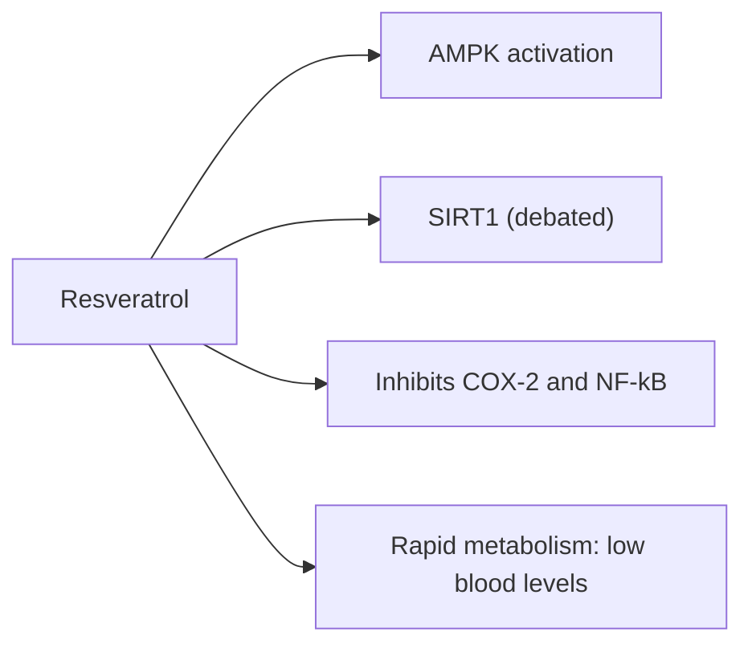

# Resveratrol

## Summary

Resveratrol is a stilbene polyphenol first isolated in 1940 from white hellebore (Veratrum grandiflorum) and since found in about 70 plant species. It is concentrated in the skins and seeds of dark grapes and is also present in red wine, peanuts, blackcurrants, strawberries, raspberries, blueberries, mulberries and Japanese knotweed. It has antioxidant and anti-inflammatory effects and extends lifespan in some animal models, but human trials show small or inconsistent effects, and blood levels after oral intake are very low.

*This note is educational. It is not medical advice and does not replace a doctor, dietitian or pharmacist, especially during pregnancy, illness or when taking medicines.*

## Prerequisites

- [Polyphenols](polyphenols.md)

## Core concepts

### Definition

*Resveratrol* (3,5,4'-trihydroxy-trans-stilbene) is a stilbene polyphenol produced by plants in response to injury and fungal infection.

### Analogy

Resveratrol was hoped to be a "longevity switch" that turns on the same cellular programs as calorie restriction. In yeast and some animals the switch works; in humans, it turns only a little, and most of the resveratrol swallowed is metabolized before it reaches the switch. The analogy breaks because the target (sirtuins) is still debated.

### Mechanism

Resveratrol activates AMPK and was reported to activate SIRT1 (sirtuin 1), enzymes linked to the benefits of calorie restriction; the direct activation of SIRT1 is disputed. It inhibits COX-2 and NF-kB, and acts as an antioxidant. Oral bioavailability of free resveratrol is below 1 percent because it is rapidly conjugated in the gut and liver.

**The French paradox.** Resveratrol was proposed to explain the "French paradox": relatively low heart disease rates in France despite high saturated fat intake and moderate red wine consumption. The amount of resveratrol in wine (about 0.2 to 2 mg per liter) is far below doses studied, and the paradox is now largely explained by data and lifestyle differences.

**Food sources.** Fresh or frozen strawberries, currants and grapes are easy dietary sources, though amounts are small.

The flowchart shows the proposed mechanisms.

### Proposed effects and evidence

Each entry states the proposed effect and how strong the human evidence is, using the grades defined in the [Evidence grades](../evidence-grades.md) note.

- **Antioxidant action.** Shown in the laboratory. Evidence: very limited.
- **Cardiovascular protection and the French paradox.** Small effects on blood pressure and endothelial function in some trials; the paradox is not explained by resveratrol. Evidence: limited.
- **Anti-inflammatory action.** Reduced inflammatory markers in some small trials. Evidence: limited.
- **Metabolic health, insulin sensitivity and weight loss.** Small improvements in glucose control in type 2 diabetes in some meta-analyses; no clear weight effect. Evidence: limited.
- **Anticancer effects.** Laboratory and animal studies only. Evidence: very limited.
- **Neuroprotection and Alzheimer disease.** A phase 2 trial showed changes in biomarkers without clear clinical benefit. Evidence: limited.
- **Anti-aging and longer lifespan.** Extends lifespan in some yeast, worm and fish studies; not in mice on normal diets or humans. Evidence: very limited.
- **Skin protection from UV.** Laboratory and topical studies. Evidence: very limited.
- **Antiviral effects against influenza, herpes and RSV.** Laboratory studies. Evidence: very limited.
- **Better blood vessel function.** Small improvements in flow-mediated dilation in some trials. Evidence: limited.

## Worked example

A glass of red wine (150 mL) contains about 0.1 to 0.3 mg resveratrol. Trials use 150 to 1,000 mg or more daily, the amount in hundreds to thousands of glasses. Drinking wine for resveratrol therefore makes no sense; the alcohol risks dominate.

## Trade offs and when to use it

Resveratrol supplements are generally well tolerated up to about 1 g daily; higher doses cause diarrhea. They may interact with anticoagulants.

## Common mistakes

- **Drinking red wine for resveratrol.** The amount is negligible and alcohol is harmful.
- **Extrapolating animal lifespan results to humans.** Human evidence is lacking.

## Practice

1. Where is resveratrol concentrated in grapes?
2. What is the French paradox?
3. Why are blood levels of resveratrol low?

### Answers

1. In the skins and seeds.
2. Low heart disease rates in France despite high saturated fat intake.
3. It is rapidly metabolized in the gut and liver.

## Further reading

- Berman, A. Y., Motechin, R. A., Wiesenfeld, M. Y. et al. (2017). The therapeutic potential of resveratrol: a review of clinical trials. npj Precision Oncology, 1, 35. [DOI](https://doi.org/10.1038/s41698-017-0038-6). Review of resveratrol clinical trials.
