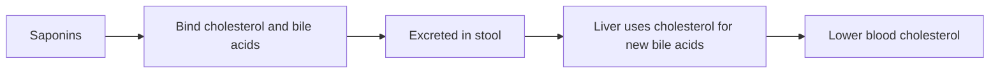

# Saponins

## Summary

Saponins are plant compounds made of a sugar chain attached to a steroid or triterpene, named for their soap-like foaming in water. They occur in legumes (soy, chickpeas), quinoa, oats, ginseng, onions, garlic and aloe. They bind cholesterol and bile acids in the gut and may lower blood cholesterol modestly; anti-inflammatory, liver-protective, anti-infective and anticancer effects are mostly shown in laboratory studies. Ginsenosides are the active saponins of ginseng.

*This note is educational. It is not medical advice and does not replace a doctor, dietitian or pharmacist, especially during pregnancy, illness or when taking medicines.*

## Prerequisites

- [Phytonutrients overview](overview.md)

## Core concepts

### Definition

*Saponins* are glycosides with a lipophilic aglycone (sapogenin: steroid or triterpenoid) and one or more hydrophilic sugar chains. This structure makes them surface-active, like detergents.

### Analogy

Saponins are like soap molecules made by plants: one end loves water, the other fat, so they foam and can wrap around fat-like molecules such as cholesterol. The analogy breaks because, unlike soap, they are poorly absorbed and act mostly inside the gut.

### Mechanism

In the gut, saponins form complexes with cholesterol and bile acids, increasing their excretion and lowering blood cholesterol modestly. In high concentrations, they can damage cell membranes (hemolysis), which is why some are toxic when injected but safe when eaten. Quinoa saponins are bitter and are removed by rinsing.

**Sources.** Soy, chickpeas and other legumes, ginseng (ginsenosides), quinoa, oats, onions, garlic, aloe.

The flowchart shows how saponins act in the gut.

### Proposed effects and evidence

Each entry states the proposed effect and how strong the human evidence is, using the grades defined in the [Evidence grades](../evidence-grades.md) note.

- **Lower cholesterol.** Animal studies and some human data; effects modest. Evidence: limited.
- **Anti-inflammatory and liver-protective effects.** Laboratory and animal studies. Evidence: very limited.
- **Protection against infections and cancer.** Laboratory studies. Evidence: very limited.

## Worked example

Quinoa is rinsed before cooking to remove bitter saponins on its surface. Legumes eaten as part of a normal diet supply saponins along with fiber and plant sterols, which together lower LDL cholesterol.

## Trade offs and when to use it

Food saponins are safe; isolated saponins at high doses can irritate the gut.

## Common mistakes

- **Treating ginseng saponins as proven treatment.** Clinical evidence is limited.
- **Skipping quinoa rinsing.** Saponins make it bitter.

## Practice

1. Why are saponins called soap-like?
2. How may saponins lower cholesterol?
3. What are the saponins of ginseng called?

### Answers

1. They foam in water because they have water-loving and fat-loving parts.
2. By binding cholesterol and bile acids in the gut.
3. Ginsenosides.

## Further reading

- Güçlü-Üstündağ, Ö., Mazza, G. (2007). Saponins: properties, applications and processing. Critical Reviews in Food Science and Nutrition, 47(3), 231-258. [DOI](https://doi.org/10.1080/10408390600698197). Review of saponin properties.
