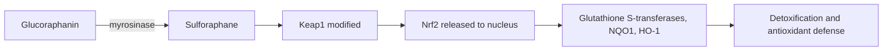

# Sulforaphane

## Summary

Sulforaphane is an isothiocyanate formed from glucoraphanin in cruciferous vegetables, especially broccoli and broccoli sprouts, when the enzyme myrosinase acts after chopping or chewing. It is one of the most potent natural activators of Nrf2, which switches on the body's own antioxidant and detoxifying enzymes. Human studies show increased detoxification of some air pollutants; anticancer and other effects are promising in the laboratory but unproven in people.

*This note is educational. It is not medical advice and does not replace a doctor, dietitian or pharmacist, especially during pregnancy, illness or when taking medicines.*

## Prerequisites

- [Glucosinolates](glucosinolates.md)

## Core concepts

### Definition

*Sulforaphane* (1-isothiocyanato-4-methylsulfinylbutane) is an isothiocyanate. Its precursor *glucoraphanin* is a glucosinolate ([Glucosinolates](glucosinolates.md)).

### Analogy

Sulforaphane is like a fire alarm that wakes the cell's own fire brigade. It does not fight the fire itself much; instead, by mildly stressing the cell, it switches on dozens of protective genes. The analogy breaks because constant alarms (very high doses) may not be beneficial.

### Mechanism

Sulforaphane reacts with cysteine residues on Keap1, releasing the transcription factor Nrf2, which moves to the nucleus and activates genes for phase II enzymes (glutathione S-transferases, NQO1, heme oxygenase-1) and glutathione synthesis. It also inhibits NF-kB and histone deacetylases in the laboratory.

**Sources.** Broccoli sprouts (richest), broccoli, cauliflower, cabbage, rocket, Brussels sprouts. Supplements are usually glucoraphanin with or without active myrosinase; without myrosinase, conversion depends on gut bacteria and is low. A dose of about 300 mg daily is cited for increasing paraoxonase-1 synthesis in the liver; this is from limited data.

The flowchart shows sulforaphane activating Nrf2.

### Proposed effects and evidence

Each entry states the proposed effect and how strong the human evidence is, using the grades defined in the [Evidence grades](../evidence-grades.md) note.

- **Antioxidant action through Nrf2.** Induces antioxidant enzymes in human tissues in small studies. Evidence: limited.
- **Support of detoxification by glutathione S-transferase.** Increased excretion of benzene and acrolein in a trial in a polluted region. Evidence: moderate.
- **Anticancer effects in colon, prostate and breast.** Laboratory and animal evidence; human trials limited. Evidence: very limited.
- **Cardiovascular health.** Small studies of markers. Evidence: very limited.
- **Anti-inflammatory action.** Small studies. Evidence: limited.
- **Immune support.** Small studies. Evidence: very limited.
- **Brain health.** Small trials in autism showed behavioral improvements; needs confirmation. Evidence: limited.
- **Skin protection from UV.** Topical broccoli sprout extract reduced UV redness in a small study. Evidence: very limited.
- **Better glucose metabolism.** A trial of broccoli sprout extract lowered fasting glucose in obese people with poorly controlled type 2 diabetes. Evidence: limited.
- **Liver health.** Small studies of liver enzymes. Evidence: very limited.

## Worked example

In a 12-week trial in Qidong, China, adults drinking a broccoli sprout beverage rich in glucoraphanin and sulforaphane excreted 61 percent more benzene metabolites and 23 percent more acrolein metabolites in urine than controls. This shows increased detoxification of airborne pollutants, though not reduced disease.

## Trade offs and when to use it

Broccoli sprouts and cruciferous vegetables are a safe source. Supplements vary in active content; high doses can cause digestive upset.

## Common mistakes

- **Buying supplements without myrosinase.** Conversion to sulforaphane may be low.
- **Overcooking broccoli.** Heat destroys myrosinase.

## Practice

1. Which enzyme forms sulforaphane?
2. Which transcription factor does sulforaphane activate?
3. What did the Qidong trial show?

### Answers

1. Myrosinase.
2. Nrf2.
3. Greater excretion of benzene and acrolein metabolites.

## Further reading

- Yagishita, Y., Fahey, J. W., Dinkova-Kostova, A. T. et al. (2019). Broccoli or sulforaphane: is it the source or dose that matters?. Molecules, 24(19), 3593. [DOI](https://doi.org/10.3390/molecules24193593). Review of broccoli and sulforaphane.
