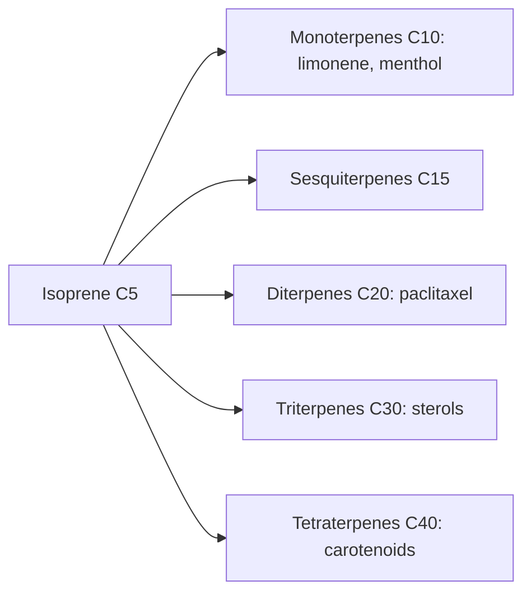

# Terpenoids

## Summary

Terpenoids (terpenes) are the largest group of plant compounds, built from five-carbon isoprene units. Many give plants their scent: limonene in citrus, linalool in lavender, menthol in mint. Others include carotenoids, saponins' aglycones and plant sterols. They have anti-inflammatory, antiviral and antioxidant effects in laboratory studies; some, such as menthol and artemisinin, have proven medical uses.

*This note is educational. It is not medical advice and does not replace a doctor, dietitian or pharmacist, especially during pregnancy, illness or when taking medicines.*

## Prerequisites

- [Phytonutrients overview](overview.md)

## Core concepts

### Definition

*Terpenoids* are compounds built from isoprene (C5) units: monoterpenes (C10, limonene, menthol), sesquiterpenes (C15), diterpenes (C20), triterpenes (C30, plant sterols, saponin aglycones) and tetraterpenes (C40, carotenoids).

### Analogy

Terpenoids are like a construction set made from identical five-carbon bricks: two bricks make the scent of an orange, four make a resin, eight make a carrot pigment. The analogy breaks because the bricks are modified with oxygen and rings, which changes their properties a lot.

### Mechanism

Many monoterpenes are volatile and form essential oils ([Essential oils overview](../../complementary-medicine/essential-oils/essential-oils-overview.md)). Menthol activates cold receptors (TRPM8), giving a cooling feeling. Limonene is studied for gastroesophageal reflux and as an anticancer agent in animals. Artemisinin (from sweet wormwood) is a key antimalarial drug, and paclitaxel (from yew) is a chemotherapy drug.

**Sources.** Mint, lavender, citrus peel (limonene), herbs and spices, conifers.

The notes state that terpenes from oranges and grapefruit may prevent ulcers and dental caries; this rests mainly on laboratory and animal studies.

The flowchart shows terpenoid classes by size.

### Proposed effects and evidence

Each entry states the proposed effect and how strong the human evidence is, using the grades defined in the [Evidence grades](../evidence-grades.md) note.

- **Anti-inflammatory, antiviral and antioxidant effects.** Mostly laboratory studies. Evidence: very limited.
- **Peppermint oil for irritable bowel syndrome.** Meta-analyses show benefit of enteric-coated peppermint oil. Evidence: moderate.
- **Prevention of ulcers and dental caries by citrus terpenes.** Laboratory and animal studies. Evidence: very limited.

## Worked example

Enteric-coated peppermint oil capsules (menthol-rich) are taken for irritable bowel syndrome. In meta-analyses, more patients reported global improvement than with placebo, because menthol relaxes gut smooth muscle by blocking calcium channels.

## Trade offs and when to use it

Terpenoids in food and spices are safe; concentrated essential oils can be toxic if swallowed.

## Common mistakes

- **Swallowing essential oils.** Many are toxic orally.
- **Assuming all terpenes are harmless because natural.** Some, like thujone, are neurotoxic.

## Practice

1. What is the building block of terpenoids?
2. Name a terpenoid in mint and one in citrus.
3. Which terpenoid class are carotenoids?

### Answers

1. Isoprene, a five-carbon unit.
2. Menthol and limonene.
3. Tetraterpenes.

## Further reading

- Khanna, R., MacDonald, J. K., Levesque, B. G. (2014). Peppermint oil for the treatment of irritable bowel syndrome: a systematic review and meta-analysis. Journal of Clinical Gastroenterology, 48(6), 505-512. [DOI](https://doi.org/10.1097/MCG.0b013e3182a88357). Meta-analysis of peppermint oil for irritable bowel syndrome.
- Liu, R. H. (2003). Health benefits of fruit and vegetables are from additive and synergistic combinations of phytochemicals. American Journal of Clinical Nutrition, 78(3 Suppl), 517S-520S. [DOI](https://doi.org/10.1093/ajcn/78.3.517S). Review of phytochemical combinations in fruit and vegetables.
